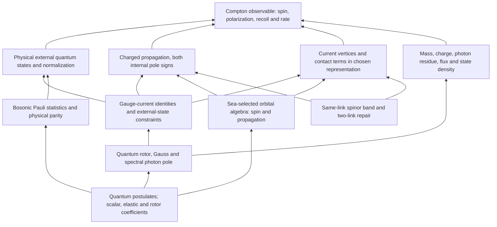

# P256 — work backward from interacting QED

Issue [#222](https://github.com/vantasnerdan/substrate-framework/issues/222).
**Active constructive campaign: bosonic statistics, rotation locking,
quantum orbital mass, compact photons, and the same primitive scattering current.**
The initial reference/interface calculations remain as comparators. Research
was resumed by direct owner instruction; the retired #203 campaign's
single-Euler/neutrino restrictions do not apply.
Historical source baseline: `14e0b08f6099698b6d117840e65f86cbe70d4efb`.
The owner-requested [19 October research capture](capture_20261019.md) maps
the current sources, evidence, historical source epochs and omitted bulk data.
This is an active research snapshot, not a terminal result or accepted release.
Producer manifests, not a checkout's HEAD alone, identify each calculation.

## New induced-photon continuation — conditional quantum branch

[`induced_photon_response.py`](induced_photon_response.py) supplies an independently
calculated photon kernel rather than importing the earlier Maxwell speed.
This **changes the law**: the bare magnetic curl term is removed, physical
electric inertia `UE_phys=1` is retained, and charged filled-band species are
specified explicitly. The microscopic link kinetic coefficient is
`UE_phys/a`, so `epsilon_b=1/(2 UE_phys)`. Original suppliers, source/receiver
bytes and the bounded CURRENT427 result are unchanged.

The active band and every inducing species use literal `ImprovedPhiLaw`
scalar Phi path coefficients, including both links of each length-two path.
The selected mean here is still the original heavy-trial
`G00=0.4187253908699568`, `Gjj=0.0632221974274214`; it is **not** a newly
admitted mass-resolved vacuum. The inherited primitive
`v=0.4990360130634525`, `m=0.2`, `r=0.12` remain declared inputs. No new
photon speed is fitted to this velocity.

For dimensionless lattice transfer `theta=a*q`, the exact path sum is
`S_l(theta_j)=sin(l*theta_j/2)/sin(theta_j/2)`, with `S_2=2*cos(theta_j/2)`.
The link-centered vertices obey
`qhat.J=h(k+theta/2)-h(k-theta/2)`, `qhat_j=2*sin(theta_j/2)`.
Both occupied-to-empty and empty-to-occupied doublet clusters are retained.
The physical BZ measure is `d^3theta/(2*pi)^3/a^3`; spatial, density and
mixed spectral measures carry factors `N/a`, `N/a^3`, `N/a^2`.
`A_link=a*A_phys`, charge and hbar are one.

Writing the exact interband denominators as `Delta`, the electric coefficient
comes from their dynamic spectral response and magnetic stiffness from a
separate finite-q calculation:

```text
epsilon = epsilon_b + (N/a) integral W_T / Delta^3
kappa   = lim(q->0) [physical static transverse K(q)] / |qhat/a|^2
c_ind   = sqrt(kappa/epsilon)
F_T(x)  = epsilon_b*x*I - K_T
          + (N/a) integral W_T*x/[Delta*(Delta^2-x)] - x*d_T*d_T^T/chi
x       = omega^2;   Z = [u^T (dF_T/dx) u]^-1
A0      = omega*(d_T.u)/chi;   photon leg = sqrt(Z/(2*omega))
```

Density and mixed-current Ward checks fix the scalar constraint and screened
Coulomb denominator, not the old bare Coulomb kernel:
`rho(q)rho(-q)/(2*(epsilon_b*|qhat/a|^2 + N*chi00_link/a^3))`.
`finite_mode(config,q)` solves the actual retarded two-polarization matrix,
returns separate eigenvectors/poles/residues/scalar legs and optional
three-component group velocities. Its pair threshold is explicitly a
numerical exact-band spectral minimum; a conservative `2M` lower bound is
also returned. It does not claim an exact full interacting-theory pole.

The canonical collective Hamiltonian
`H=(P+s.p)^2/(2*epsilon_b)+sum Delta*(x^2+p^2)/2+K*A^2/2`,
`s=sqrt(W_physical)/Delta`, gives positive quantum oscillators, not merely an
external-source susceptibility. Its use is **local tangent / large-N RPA**.
Compact prepared-field completion, finite-N nonlinear corrections, actual
Phi/SU4 vacuum selection and Root/source transfer are separate obligations.
In particular, the earlier global Maxwell confinement is not inherited.

### Executed supplier profiles

All final receipts below bind source
`01f70abc8fafe4944aa35ab0127ca4bbb4d2eb70f26b363ce14f7349dabb6596`,
actual configuration hashes, runtime and raw three-dimensional response grids.
Both CLIs naturally exited with their physical controls accepted:

```bash
/home/administrator/substrate-framework/.venv/bin/python \
  proposals/P256-qed-backward/induced_photon_response.py \
  --family 1,0.25 --orders 10,12 \
  --output proposals/P256-qed-backward/induced_photon_response_final_receipt.json

/home/administrator/substrate-framework/.venv/bin/python \
  proposals/P256-qed-backward/induced_photon_response.py \
  --a 0.015625 --species 1:0.2,63:2 --orders 10,12 \
  --output proposals/P256-qed-backward/induced_photon_response_mass_resolved_receipt.json
```

| Actual branch | epsilon | kappa | c_ind | c_ind / c_matter |
| --- | ---: | ---: | ---: | ---: |
| [64 light species, a=1](induced_photon_response_final_receipt_a1p0.json) | 7.21560430430 | 0.158375039584 | 0.148151827749 | 1.18070209 |
| [64 light species, a=0.25](induced_photon_response_final_receipt_a0p25.json) | 24.63407984996 | 0.464687613890 | 0.137344848900 | 1.09457543 |
| [One light + 63 massive auxiliaries, a=0.015625](induced_photon_response_mass_resolved_receipt.json) | 30.91186945145 | 0.567774227559 | 0.135526805673 | 1.08008646 |

The last profile has only one light electron/positron species: the probe is
a tagged excitation of its already filled valence band, not an extra empty
Dirac species. Auxiliary masses are `m=2`, physical gaps `1.29417988065`,
with the same kinetic cone and Peierls paths. At zero spatial transfer and
photon energy `0.4*M_light=0.0517671952260`, their individual retarded frequency
remainder is at most `0.000400160064`; the weighted electric remainder bound is
`0.00150485993`. Their static UV contribution and chosen mass/multiplicity
are not thereby explained away.

The mass-resolved order-10/order-12 changes are `4.95e-10` in epsilon and
`5.88e-9` in the smallest-q magnetic coefficient. The current Ward error is
`1.84e-14`, mixed density-current spectral error `7.06e-22`; omitting contact,
omitting poles or retaining half the poles gives link-static defects
`4.48825`, `4.48825`, `2.24412`, respectively. Native current/contact Bloch
errors are `2.42e-15` / `1.78e-15`. The 64-bin positive symplectic oscillator
has frequency `0.00677633993991`, versus the uncompressed spectral
`0.00677633991457`, relative difference `3.74e-9`.

Small-q cancellation was materially repaired with the **proved continuous-BZ**
identity `integral C(0)=integral B(0)`: integrate
`B(0)-B(q)+C(q)-C(0)` pointwise. Raw unsubtracted contact-minus-poles,
raw/identity gradient Ward forms and their difference remain in each receipt.
This is not a finite-volume holonomy subtraction. The final mass-resolved
raw constant-A alias is `2.714e-10` in link units; its physical
finite-node canonical-contact difference is approximately `1.11e-6`,
or `0.078%` of the smallest-q stiffness. Thus the finite-node oscillator is
a controlled discretization of the continuous identity law, **not** an
exact same-contact finite-box Hamiltonian.

Adverse calculations were not discarded: the actual N3, a=0.0625 coexact
cosine-field sea curvature is `-734.8051`; the exact same-path N5 calculation
repairs that selected direction to `+826.2666`. These are conditional
unprojected-sea calculations, not a stationary bulk or full-SU4 physical
state admission. With 64 filled charged flavors **and** a filled neutral
heavy sea, total fundamental number is `130*V` (plus reference 0 or 4);
on either odd-volume torus the global SU4 center projection is zero.
A keep-64 microscopic transfer therefore needs an even-volume trial with
the two heavy onsite fundamentals paired across cells using actual
wedge-two Wilson links, and its color-electric/plaquette costs paid.
The full-Fock empty-heavy variational upper is not an upper in that
fixed filled-heavy number sector.

The tiny-inertia root solver was also repaired by solving in local
frequency-squared units, not flooring omega; `UE_phys=1e-16` now gives
positive finite poles rather than numerical zero.

Runtime exercised: Python 3.12.3, NumPy 2.5.3, SciPy 1.18.1 in the project
venv. Actual Pyright 1.1.414 JSON-RPC symbols/definition and empty affected-file
diagnostics were exercised at the project root; ast-grep 0.45.3 positively
parsed the primitive law, mass composition and final quadrature functions.
The receipts also price low-energy sine/Wilson and deterministic Cartesian
Phi-ball remainders; no old huge-volume quantum bound is copied to this law.
Even the selected deterministic matrix radius `eta=1.5625e-14` has a
`kappa(q=.05)` error bound `0.421346911`, approximately `74.2%` of the
computed stiffness. The corresponding epsilon bound is `0.015996333`.
These pessimistic bounds are **not** a small-error quantum freeze theorem:
normal-state concentration and a sharper gauge-preserving transfer remain
material obligations.

**First coupled unmet obligations:** the selected branch still fails the common
cone by `8.0086%`; the old heavy mean has not yet been admitted for the changed
mass-resolved quantum vacuum; global/prepared microscopic field and full
Root/source/receiver transfers require their own actual parameter-bound
proofs. Fixed-charge infinite-cutoff `Z->0` is not an interacting-QED
completion. This is a transfer-ready conditional supplier, not campaign
closure or a retagging of the original law.

### Exact coefficient runtime repair — no new physics

The coupled Compton consumer exhausted its actual 3600-second command without
a capsule. The response bottleneck was materially repaired, rather than
reducing profiles/orders, fitting a scalar photon law or raising the timeout.
Current response source is
`4906bf0bb8c3a80fd20d2b93388878e9975af54bffd7f114ee027d5c3c00e64f`.
The original `01f70` source and receipts above remain frozen, with its exact
executed bytes archived; they are not relabeled with the newer source hash.

For the **uniform selected-Phi scalar span only**, each literal Peierls
matrix is decomposed once as `t_a=Tr(SELECTED_a*T)/4` and reconstructed with
a checked residual. The onsite coefficients are likewise extracted from
the actual onsite matrix. Bloch/current/contact coefficients are then
evaluated exactly with their original phases and link sums:

```text
h_a(k) = onsite_a + 2 Re sum t_a exp(i*l*k)
J_ia   = 2 Re sum i*S_l*t_a exp(i*l*k)
C_ia   = -2 Re sum S_l^2*t_a exp(i*l*k)
g_ij   = 2[(1+n_minus.n_plus) j_i.j_j
           -(n_minus.j_i)(n_plus.j_j)-(n_plus.j_i)(n_minus.j_j)]
density = |n_plus-n_minus|^2
mixed_i = 2*(n_plus-n_minus).j_i
contact_i = -2*n_zero.C_i
```

Both spectral clusters and the signed density-current combination remain.
No full-arbitrary-Phi ball, native path/current/contact diagnostic, band
remainder or quantized 64-bin symplectic proof was replaced by this scalar
algebra. Every BZ shell also evaluates literal 4x4 matrices, independently
diagonalizes all three actual Hamiltonians, constructs filled/empty
projectors, and checks every spectral tensor entry, density, mixed current,
contact and current. The reported vertex bound is now the actual
Clifford operator norm, not the previous largest matrix-entry norm.

The off-axis `q=(.13,.09,.07)` probe used deterministic random positive
`g0/gs`, both actual masses `.2/2`, and spacings `1,.25,.015625,.0078125`.
It naturally exited with maximum projector discrepancy `1.55e-15`,
energy discrepancy `1.14e-13`, spectral-tensor discrepancy `2.16e-11`,
and current reconstruction error zero. This checks algebra and vertices,
not low-order quadrature convergence or admission of those random vacua.

Actual final order-10/order-12 CLI capsules are
[`matrix_checked_receipt_a1p0`](induced_photon_response_matrix_checked_receipt_a1p0.json),
[`matrix_checked_receipt_a0p25`](induced_photon_response_matrix_checked_receipt_a0p25.json)
and [`matrix_checked_mass_receipt`](induced_photon_response_matrix_checked_mass_receipt.json).
Both original commands were rerun with the corresponding
`induced_photon_response_matrix_checked_receipt.json` /
`induced_photon_response_matrix_checked_mass_receipt.json` output names.
They naturally exited with all controls; all three physical input hashes
match their frozen predecessors. Epsilon is identical, and the largest
kappa change is `1.05e-10`, below its reported quadrature error.

At actual `a=1`, `q=(.1,0,0)`, order 12, 304128 quadrature points,
`finite_mode(velocity=False)` took `1.918 s` and the full three-component
velocity calculation took `11.874 s`, versus the consumer's earlier
`11.616 s` / `74.195 s` observations. The finite-q pole is
`omega=.01480953835798`, `Z=.1385441815454`, with longitudinal group
velocity `.1479825483512`; two physical polarizations are retained.
This is a runtime repair of the same conditional quantum supplier.
It does not pay the common-cone, Phi-freeze or full-SU4 admission debts.


## Constructed theorem chain

The goal is to build a joined electron–photon explanation and strengthen it
through successive constructions. The positive results now include:

1. **Bosonic degrees supply fermionic charge algebra.**
   [Primitive edge qubits](bosonic_statistics.md) yield exchange and coherent
   fermionic dynamics. A [neutral boundary parity marker](pauli_compton.md)
   gives the complete physical odd/even Fock space and an actual
   Gauss-preserving charged string state, without microscopic CAR matrices.
2. **Dynamics energetically selects that low-energy sector.**
   The [coupled sector theorem](code_phase.md) gives
   `E_s >= E_+ +(Delta-2K) N_def`. The
   [robustness extension](sector_stability.md) permits actual local
   Gauss-preserving sector mixing, bounds leakage quadratically, and retains
   the legitimate low-energy matter/photon states.
3. **The sea selects the spinor algebra.**
   [Occupied-energy minimization](sea_selection.md) selects Clifford
   four-frames from a weaker matrix second-moment budget. The
   [soft elastic construction](soft_budget.md) removes the hard budget:
   unrestricted orbital matrices plus a quartic Gram potential select
   metric Clifford structure, cubic isotropy and effective mass/velocity.
4. **The same sea predicts photon response and normalization.**
   [Exact momentum reduction](vacuum_limit.md) reaches L96 and derives the
   thermodynamic electric coefficient `log(1/ma)/(6 pi^2)`.
   The [spectral photon theorem](photon_matching.md) supplies a unique
   positive-residue pole below the pair threshold, with rigorous energy bounds.
5. **The constructions return to nonforward scattering.**
   [Actual Pauli occupation-state currents](pauli_compton.md) reproduce the
   connected Compton kernel with real virtual electron–hole states.
   The [soft-selected same-sea join](elastic_join.md) feeds actual photon
   energies/residues into recoil, group flux, phase-space Jacobian and the
   inclusive quantum soft cloud. Its weighted refined hard rate is
   `1.67503297366e-5`, with the finite-model/reference difference retained.
6. **The selected field supplies rotation locking and spatial dynamics.**
   [Symmetry locking](spin_orbital_locking.md) derives the unique connected
   diagonal Spin(3) lift and combined odd/even charged 2-pi action; this is not
   a demonstrated pure microscopic rigid-space rotation interferometer.
   [Unrestricted local stability](local_orbital_stability.md) retains every
   sitewise field coordinate; [hydrodynamics](orbital_hydrodynamics.md) keeps
   all 15 physical orientation and 45 restoring modes, including Berry dynamics.
7. **Matter and photons are coupled quantum states, not attached spectra.**
   The [four-orbital compact consumer](quantum_spinor_plaquette.md) measures
   actual Gauss charged multiplets, creator residues and positive same-H photon
   response. Its [integer-photon theorem](compact_charge_gap.md) removes the
   magnetic loss from the charged-gap bound.
8. **A quantum orbital amplitude generates the charged mass.**
   [Pure-quartic radial dynamics](quantum_radial_spinor.md) prefers zero before
   coupling, but the actual occupied matter selects a nonzero quantum
   distribution. The resulting charged energy difference is `1.53185901704`
   in the executed finite model; an exact quantum gap theorem replaces a
   prescribed static amplitude. Microscopic coefficient and selected-shape
   hypotheses remain explicit.
9. **Quantum gauge geometry keeps mass beyond the heavy-hopping bound.**
   [Positive Wilson geometry](wilson_mass_geometry.md) excludes the static
   mass interval for arbitrary spin-scalar compact U(1) links and constructs a global parallel sea.
   The [quantum geometric comparison](quantum_gauge_mass.md) then gives the
   infinite-loop charged gap `.5732` where the older hopping bound is
   `-7.9964`. The executed finite strong-hopping charge gap is `1.43752684208`
   at electric cutoff6; these are distinct analytic and numerical domains.
   Joint radial–phase dynamics removes the heavy-hopping restriction at
   sufficiently weak electric coupling without prescribing a preferred radius.
10. **The quantum current retains the interacting virtual states.**
   The [full Gauss-domain Peierls response](quantum_compton_response.md)
   includes the compact photon in both resolvents and the same-H contact.
   Its nonforward kernel is nonzero and frame-covariant; omitted contact or
   frozen ground intermediates fail the longitudinal identity. This finite
   planar matter-source response is not yet a photon S-matrix.
11. **An unrestricted quantum field can generate a charge gap.**
   [All fifteen adjoint coordinates](quantum_adjoint_mass.md), with a bare
   harmonic minimum at zero, give an infinite-Hilbert-space positive charge
   gap for `0 < s < 8/45`. The primitive Casimir and optimized neutral trial
   yield bounds `.0102225575` and `.02082039325` in the executed cases.
   This supplier has a sixfold neutral and fourfold charged multiplet;
   it is not silently substituted for the selected Dirac doublet.
12. **A changed local orbital law removes the fifteen orientation modes.**
   [SU(4) gauge locking](orbital_gauge_locking.md) supplies fifteen positive
   bare Higgs curvatures, not a proved quantum phase. The
   [residual rotation construction](gauged_rotation_fractionalization.md)
   checks full Z4 Gauss and a conditional charged localization class.
   Complete pure-gauge restoration still acts as identity; a physical
   reference-seam rotation protocol remains a separate premise.
13. **A neutral heavy sea controls the shape while retaining light feedback.**
   The [two-sea construction](heavy_orbital_join.md) uses a bare quartic
   minimum at zero and feeds its selected light band into the same photon
   and scattering consumer. [Primitive local colour moments](colour_gauss_feedback.md)
   distinguish complementary mean densities from an actual Gauss state.
   The [continuous SU(4) quantum consumer](quantum_su4_gauss.md) then retains
   the full Lie constraint, actual Haar links and both charged sectors.
   Opposite heavy polarity improves the executed finite charged differences;
   the equal-coefficient relation is an explicit hypothesis, not a selected phase.
14. **All forty-five restoring coordinates retain a quantum charge theorem.**
   The [Gaussian shape extension](quantum_restoring_shapes.md) includes every
   normal coordinate and gives `Delta >= .54 - A/Lambda` without commuting
   its matter vertices.
   The historical default-width execution gives `A=593873.588844812`.
   Its coupled variational trials have full-H residuals near `.159`, so
   their tiny projected residuals are not ground-state evidence.
   [Complete-shell Schur response](quantum_shape_resolvent.md) replaces that
   trial subspace with the whole physical dimension; it retains a distinct
   Gaussian-EFT domain rather than claiming the full nonlinear phase.
   The repaired strong-narrow three-sector command completed in 2458.90 s:
   `sigma^2=.0017182570727851325`, finite charge transfer `1.178929773845`,
   and full ground residuals below `1.35e-12`. This is Gaussian K1 evidence,
   not a full nonlinear or orientation-mode solution.
15. **Exact Haar alignment and primitive charge poles share one compact EFT.**
   [Continuous-Haar multiplication](exact_haar_alignment.md), with coefficient
   `Lambda*Jpref/8`, enters the [coupled photon Hamiltonian](quantum_su4_photon.md).
   Its executed `Jpref=.2,R=2` neutral and both charged sectors retain the same
   current/contact operators. The [dressed charge carrier](gauss_photon_charge.md)
   acts on that same Hamiltonian and measures source-active poles with normalized
   residue `.9645065263`. Independent matched-parent Ritz comparisons support
   their finite-domain ground assignment; source-initialized `k=1` alone does not.
16. **Unrestricted fields have explicit covariant trials, not a solved phase.**
   The [full-field boundary theorem](full_field_charge_bound.md) supplies an
   explicit neutral Gauss trial and a charge-cost **upper** bound on families
   with positive boundary density, not a bulk or lower-mass theorem.
   The [covariant paired trial](gauss_born_bundle.md) gives a negative full-field
   energy upper and a nonzero invariant-amplitude lower in its own parameter
   domain. The [full occupied-band section](full_band_gauss_section.md) retains
   all 120 two-cell field coordinates, Haar links and two EM phases on a
   separated-gap, positive-overlap chart. Its Gauss/derivative/current identities
   are reviewed; neither it nor the paired trial selects the full-field ground.
   The [compact full-band packet](full_band_packet_bound.md) now supplies
   a quantitative full-coordinate variational bound at the photon's bare
   coefficients, with Cartesian field kinetic replacing selected-orbit
   inertia. Parent execution and scoped review accept its negative-energy
   and invariant-amplitude consequences, not a solved phase.

The [moving-frame sequence](moving_frame.md) and
[leading-soft quantum dressing](soft_quantum.md) extend the same consumer.
[Compact-photon winding diagnosis](compact_topology.md) repairs directly
observed sampling traps and recovers independent loop/stiffness agreement.
Each theorem has explicit hypotheses and a runnable physical consumer; the
next iteration replaces or broadens a hypothesis rather than stopping at it.

The [general graph photon theorem](photon_neutrality.md) extends the neutral
ground comparison on the untruncated compact domain and constructs a
positivity-preserving finite approximation. Its exact finite-Fourier
counterexample selects the correct regulator rather than ending the route.
The [compact corrections](compact_asymptotics.md) and
[periodic primitive-contact representation](photon_projector_trace.md)
strengthen the actual photon/current supplier without hiding its numerical
or physical differences.
The [analytic infrared consumer](photon_infrared.py) derives exact transfer-zero
electric/magnetic coefficients of the same sea. Actual finite-transfer photon
poles and residues approach them; the inclusive join uses this infrared speed
and charge, not a finite matching probe or assumed equality with matter speed.

## Start at the observable, not a microscopic root

The target is leading-order Compton scattering `e^- gamma -> e^- gamma`,
initial electron at rest, explicitly resolved or averaged spin/polarization.
Its tree amplitude is order `e^2`, its differential cross section order
`e^4=16 pi^2 alpha^2`. The selected numerical reference uses `m=e=1` as
calculation units; it does **not** derive the measured electron mass/charge or
assert precision agreement with experiment beyond this perturbative scope.

The reference laboratory prediction is

\[
\frac{\omega'}\omega=\frac1{1+(\omega/m)(1-\cos\theta)},\qquad
\frac{d\sigma}{d\Omega}=\frac{\alpha^2}{2m^2}
\left(\frac{\omega'}\omega\right)^2
\left(\frac\omega{\omega'}+\frac{\omega'}\omega-\sin^2\theta\right).
\]

Its low-energy limit is Thomson scattering,
`d sigma/d Omega = alpha^2(1+cos^2 theta)/(2m^2)`. A classical transverse wave,
a persistent lump or matching this one coefficient does not supply the
quantum interacting electron–photon sector.

### Backward dependency map



This is a working decomposition, not an assertion that independent suppliers
can be glued without feedback. The code returns to the **joined scattering
consumer**, where band, current, contact, external states and kinematics have
to agree. [reference.md](reference.md) derives the amplitude, trace and
phase-space normalization and gives the detailed dependency/input ledger.

## Construct and discriminate the coupled relationship

The first uncertain interface is propagation ↔ current ↔ spin/contact response.
An arbitrary matter band and an arbitrary photon vertex need not satisfy the
same charge-current identity. Gauge compatibility alone also does not fix
transverse magnetic couplings, exchange statistics or rest/inertial mass.

The initial reference/interface constructions are retained as comparators:

- [constraint.md](constraint.md), [constraint.py](constraint.py): a graded
  spinning constraint closes only with its associated magnetic term. Clifford
  quantization gives the Dirac numerator and conditional minimal `g=2`.
  Second-order contact **and numerator endpoint** contributions map exactly
  back to first-order Compton. A gauge-compatible Pauli deformation remains
  possible; neither gauge invariance nor Grassmann variables derive CAR.
- [quantum_supplier.md](quantum_supplier.md),
  [quantum_supplier.py](quantum_supplier.py): an exact quantum star sector
  computes Gauss-preserving hopping and an exchange loop. A bosonic substitution
  preserves the gauge structure but changes the exchange sign. The same link
  Hamiltonian's distinct weak-field cubic sector supplies two transverse quantum
  modes and harmonic Coulomb response **under imported quantization and phase
  assumptions**; it does not supply a Dirac electron.
- [lattice_compton.md](lattice_compton.md),
  [lattice_compton.py](lattice_compton.py): a declared spinor link Hamiltonian
  joins the bands, same-link Peierls vertices, required two-photon contact and
  actual tree scattering kernel. It also derives a finite-model rate with
  photon group-velocity flux and the energy-delta radial Jacobian. CAR,
  Clifford matrices and quantum photon normalization are inputs, not explained
  endpoints. At finite spacing its angle is outgoing **wave-vector** angle,
  not automatically an experimental ray angle.

### Iteration driven by the target

The nearest Wilson mass is
`M_a(p)=m+(r/a) sum_i(1-cos(ap_i))`. Its rest gap is `m`, but

\[
\frac1{m_{\rm kin}}=\frac{v^2}{m}+ra,
\qquad\frac{\overline{|M|^2}_{\rm soft}}
 {2e^4(1+\cos^2\theta)}=(v^2+ram)^2.
\]

This is an observable mismatch, not a broken Ward identity. It selects two
repairs that are actually constructed and tested:

| Attempt | Target result | What it earns / what it does not |
|---|---|---|
| Nearest Wilson, `v=r=m=1`, `a=.1` | Soft squared-amplitude ratio `1.21000000003`; finite-energy ratio `1.20931564876` | Gauge-compatible conditional band, but wrong soft rest/inertial relation at finite spacing |
| Tune `v=sqrt(.9)` at `a=.1` | Soft ratio `1.00000000002`, finite-energy ratio `0.989809480563` | Repairs one coefficient, **not** the full interaction or common relativistic speed |
| Gauge-covariant nearest + two-link mass `m+(r/a) sum(1-cos ap)^2` | Soft ratio `1.00000000002`; finite-energy rate converges to QED | Cancels quadratic mass curvature while keeping doubler corners heavy; vertices/contact change together |

Finite-energy entries above use incoming momentum `.4m`, angle `1.1` radians.
The continuum incoming photon energy is `.4m`; the finite model uses its own
photon energy and charged recoil. No finite-model kinematics are silently
replaced by QED kinematics.

The second repair is a materially different gauge-covariant operator, not
simply a tuned Thomson coefficient. Deleting its contact term preserves the
free spectrum but breaks the discrete Ward cancellation. Setting `r=0` removes
the curvature too, but leaves eight light spatial Dirac cones; it is not an
acceptable hidden species change.

## Executed quantitative evidence

`integrate.py` launches the actual research CLIs and records their outputs,
runtime versions and exact artifact SHA256 values in `results.json`.
The historical 45-entry chain completed with Python 3.12.3, NumPy 2.5.3,
SciPy 1.18.1 and SymPy 1.14.0. The expanded 58-entrypoint chain completed
naturally into `results-expanded.json`; `results.json` retains the historical 45-entry run.
All 58 child commands exited successfully and their JSON outputs were parsed.
The later all-Haar packet, continuous scalar quartet, whole-heavy centre potential,
cube flux and physical heavy-BO suppliers have separate receipts;
they are not silently added to this historical launch count.
Completed commands identify fresh calculations; a
start-of-run workspace hash or separately listed receipt is not a new execution.
Progress is saved atomically after each completed calculation. A failed child
leaves an explicit failed receipt and its earlier completed calculations;
`execution_state=complete` means this launch chain completed, not that the
electron–photon campaign is complete. Newer consumers retain their own receipts.
These are mathematical constructions and numerical probes, not experimental data.

### Current source-bound suppliers

- [Exact Haar receipt](exact_haar_alignment_receipt.json): minimal/medium/full
  projection controls completed in 5.71 s, provider source `42883b7…`.
  Positive finite Ritz minima do not change the standalone continuous
  multiplication operator's spectral infimum zero.
- [Aligned photon receipt](quantum_su4_photon_aligned_receipt.json):
  `m=.2,r=.12,v=.3,stiffness=2,Lambda=1,inertia=2,Jpref=.2`,
  `UE4=.3,UE1=.4,K=.7`, opposite whole-heavy sign, minimal Haar and `R=2`;
  all three sectors completed in 2211.53 s. Both charged differences are
  `.28474326340035`; neutral energy is `-.7110828379653765`.
  The older default and `Jpref=0,R=2` receipts remain historical comparators.
- [Verified dressed carrier](gauss_photon_charge_verified_receipt.json):
  same source/parameters as the aligned parent, completed in 322.20 s;
  both transfer poles are `.2847432634003`, full-H residuals at most
  `1.511e-11`, normalized first moment `.3178026251`. Their energies match
  independently executed parent ground Ritz values within `7.35e-14`.
  `ReviewPhotonCharge` reviewed repaired source/derivation but inspected the
  older receipt numerically; the fresh run is parent-owned, not reviewer-run.
- [Verified full-band geometry](full_band_gauss_section_verified_receipt.json):
  matching bare `m=.2,r=.12,v=.3,stiffness=2,heavy_scale=1` geometry
  completed in 39.81 s on the actual 4900-state `NH=NL=4` fibre.
  `ReviewFullBandGauss` accepts the scoped identities, not ground/phase claims.
  The pre-dtype-repair receipt is historical.
- [Default full-field bound](full_field_charge_bound_receipt.json) and
  [improved-path bound](full_field_charge_bound_improved_receipt.json):
  executed `(2,4,4)` slab controls, **both** `C0=88.75958333333335`.
  Their boundary-average trial uppers differ through path/incidence bounds,
  not through the neutral Gaussian coefficient.
- [Covariant full-field trial](gauss_born_bundle_receipt.json):
  completed in 1.23 s with `m=.4,r=.2,v=.3`; this is **not** the aligned
  photon's bare parameter set. At `Lambda=1e7` its energy upper per site is
  `-1809861.2317550182`, not a numerically solved ground energy.
- [Midpoint sea response](su4_sea_backreaction_receipt.json) and
  [`split_gauss` response](su4_sea_backreaction_gauss_receipt.json):
  repaired unit-control executions completed in 20.08 s and 123.79 s.
  Rebuilt `g²`-normalized matrices and raw generalized spectra, not two clipped
  zero thresholds, test coupling units. This remains a static uniform saddle
  probe, not Gauss projection or a full quantum-phase receipt.

Supplier notes preserve original proof/source attribution and receipt-time
note hashes. Documentation updates do not retroactively change those snapshots
or claim a rerun. The first joined full-field ground/charged lower gap, Dirac
sector, 3D photon, Lorentz limit, physical mechanical half-spin and scattering
consumer remain open; the campaign is ongoing.

### Reference controls

- Explicit spinor/polarization sums reproduce analytic Klein–Nishina over
  `omega/m=.01,.1,.5,1` and angles `0,45,90,135,180` degrees; maximum measured
  relative difference `2.66427e-15`. Independent physical and covariant spin
  traces are also checked.
- At `omega/m=.4`, `theta=60°`, keeping only either channel gives incoming
  Ward residual `0.3407771`; the coherent pair cancels to roundoff.
- A `kappa=.3` Pauli-EFT control (`g=2.6`) still satisfies Ward identities and
  tends to the same Thomson limit, but changes the selected unpolarized
  squared amplitude from `2.56666667` to `2.67175167` and a resolved component
  by `0.2155415 e^2`. This is a concrete Thomson/gauge false positive, **not**
  a radiative-QED prediction.

### Joined two-link rate convergence

Selected input: `m=e=r=v=c_gamma=1`, incoming spatial momentum `.4`, `theta=1.1`.
The reference rate is `0.00265465134218` in the calculation units.

| `am` | Relative reduced squared-amplitude error | Relative differential-rate error |
|---:|---:|---:|
| .2 | `9.91764e-4` | `7.53733e-4` |
| .1 | `2.78391e-4` | `1.77484e-4` |
| .05 | `7.33720e-5` | `4.30347e-5` |
| .025 | `1.88121e-5` | `1.05942e-5` |
| .0125 | `4.76149e-6` | `2.62815e-6` |
| .00625 | `1.19767e-6` | `6.54499e-7` |

Both lattice Ward contractions cancel to roundoff. At `a=.1`, omitting the
contact gives residual `6.21190e-5` instead. An **untuned complementary set**
uses `omega/m=.05,.4,1,2`, angles `.2,.7,1.5,2.6`, axis and `(1,2,3)` incoming
orientations, and `(m,e)=(1,1),(2,.3)`. At `am=.0125` the maximum relative
rate deviation is `5.62527e-4`. This bounds only those selected inputs, not all
energies/frames. Finite-scale anisotropy remains visible and shrinks with a.

### Resolved quantum-state map and internal pole falsifier

[spin_transfer.py](spin_transfer.py) compares linear **and complex circular**
photon states and fixed-z boosted electron-spin components with the reference,
using explicitly matched basis conventions and candidate on-shell states.
Over its selected energies/angles/orientations the maximum absolute component
error `|Delta M|/e^2` decreases:

| `am` | Maximum resolved component error |
|---:|---:|
| .05 | `.0169409554` |
| .025 | `.00433680527` |
| .0125 | `.00109618859` |

Deleting internal negative-energy poles at `a=.1`, momentum `.4`, angle `1.1`
changes the selected reduced amplitude by `.179789429` and leaves incoming
Ward residual `.321459495`. Having only external positive-energy electrons
does **not** license discarding the full internal Dirac-band resolvent.

### Quantum/constraint discriminators

- Exact graded `QQ+2iH=0` and `QH=0` for six independent constant field
  components; deleting the magnetic term fails. Differential Landau-gauge
  operator squaring and the full anomalous square also agree.
- At `m=e=1`, `B=.1`, the same-orbital spin energies are `1` and `sqrt(6/5)`;
  deleting the Pauli term gives the wrong degeneracy `sqrt(11/10)`.
- Second-order mixed resolvent equals first-order only when both contact and
  endpoint contributions are kept; each deletion is tested independently.
- Gauge-covariant quantum hopping has zero physical Gauss violation; bare
  hopping evolves to `<sum G^2>=1.35665967` at the selected time `.7`.
- A legal closed exchange has matrix-element product `-1` with imported CAR,
  `+1` with commuting-site hard-core bosons. The latter passes the same Gauss
  structure; it is a real false positive for a proposed electron identity.
- The harmonic photon kernel has two physical modes at nonzero momenta;
  neutral harmonic Coulomb response has Gauss residual `6.76542e-17` and exact
  numerical field/source energy agreement. Compact-phase stability is not proved.
- Independent review exposed an absolute eigenvalue floor that erased very soft
  nonzero photon modes. The corrected relative-gap classification restores two
  modes at `|k|=1e-8,1e-10` and keeps exact zero momentum separate as global modes.

## Reproduce at the actual consumer

Use Python 3.11+ with the repository's declared NumPy, SciPy and SymPy dependencies.
The exercised environment was Python 3.12.3, NumPy 2.5.3, SciPy 1.18.1,
SymPy 1.14.0. From the repository root, in that environment:

```sh
python proposals/P256-qed-backward/integrate.py \
  --output proposals/P256-qed-backward/results.json
```

This launches each actual calculation as a subprocess, checks its natural
exit, parses its JSON and preserves runtime/artifact identity. Individual
scripts are also directly executable with the same Python interpreter. No
new canonical physics claim, source API, package release or experimental
result is asserted by a successful run.

### Actual unrestricted-field suppliers (separate executions)

These newer consumers are **not included** in the historical expanded
`integrate.py` receipt; each has its own executed source/input-bound JSON.

| Supplier | Observed result | Domain / remaining obligation |
|---|---|---|
| `unrestricted_field_minimum.py` | Actual all120 pair stationary reference has coefficient−.5294240034 and gradient7.34e−16; all60 uniform open-cube competitor−4.4199004021 has a resolved U1 stabilizer | Pair has41 Hessian flats; cube is not a full480/global/periodic/quantum minimum |
| `full_haar_field_packet.py --anchor-frame pair-stationary` | Full120-field/fullHaar/fullT² neutral trial has coefficient−.2407616223 and strict negative-energy threshold5.56780914e13; nondefaultκ4 also executed | Trial upper bound, not the full quantum ground state or charged gap |
| `periodic_bulk_frame.py --grid 16 --validation-grid 24` | All three same-law seeds complete; irreducible branches converge to energy/cell−.56196627510556, gradients≤1.73e−9; U1 branch−.56190711429984 | All60 finite-mesh local minima modulo common gauge orbit; no certified continuum ordering/nonuniform stability/phase |
| `cartesian_angular_quotient.py` | Actual Cartesian pullback yields horizontal inverse-inertia sum plus link term, with exact stabilizer kernel and Haar pushforward | Frozen principal symbol only; four lifted centre links are one scalar gauge orbit, not four physical vacua |
| `gauss_heavy_bo.py` atΛ1e20 | Actual primitive heavy/angular Schur bounds in all three boundary sectors; QH probability≤5.66e−6 | Conditional selected mean/scalar inertia; charged external fundamental/antifundamental boundary retained |
| `pair_global_field_bound.py` | Exact source-owned global all120 classical pair lower bound−.52942400340988 is attained; 96 unrestricted fields/noncentral-link controls and primitive Gauss controls pass | Two-cell/one-axis heavy quartic law, not its complete quantum/charged/bulk phase |
| `pair_full_field_concentration.py` | Original full physical neutral R120×SU4×T²×4900 Hamiltonian has analytic `<S>≤s(Λ)=O(Λ^-1/6)`; executed s(1e48)=1.14666856e−6 including unused quartic/Gram moments | No field, angular or light cut; invariant moment theorem, not a numerical ground eigenstate or bulk/charged-gap proof |
| `pair_full_field_charge_transfer.py` | Exact neutral-ground reflection and actual physical B4/bar4 creators give both charged trial costs `−<Hlight>/4`; unrestricted neutral moments imply charged-ground upper cost≤.62906594 atΛ1e48, tending to.627897375 | Same full coordinate Hamiltonian/Gauss domains with fixed compensating reference at R; no scalar inertia/cuts, isolated/separated-charge bound, positive lower mass gap or propagation |
| `bulk_global_gram.py` | Existing global PSD Gram theorem now executes at actual whole-heavy periodic law; mesh32 energy−.561966275105561, full Gram gradients≤5.84e−15, explicit wrong-per-block2 rule rejected | All60 **uniform** Cartesian coordinates/fixed identity links; global total half filling, not full nonuniform/quantum globality or interval continuum ordering |
| `full_spatial_gauge_stability.py` | Actual full105 field/colour-link Gauss-principal spectra at selected mesh16/32 q samples have no negative normal modes; actual contact/Ward adverse controls discriminate | Frozen mean, sampled momentum/principal symbol only; mesh8 is not stationary and U1 flat holonomies remain explicit |
| `bulk_frame_compton.py` | Actual source-owned mean maps to m=.129417988,r=.077650793,v=.075432074 and composed Pauli/current/photon response; primitive current-excited Gauss state verified | Same neutral current and actual photon leg; photon speed≈.52 differs from matter speed.07543, not charged/spin/Lorentz closure |
| `compact_dirac_measure.py` | Actual 2^4 single-flavour compact U1 joint determinant/rotor consumer executes at UE1=0.4,K1=0.7,dt=.25; positive determinant and dynamic transfer controls pass | Conditional frozen mean and explicit finite-dt regulator; no full primitive heavy/colour/normal-field Gauss trace join or equilibrium/phase claim |
| `pair_separated_charge_transfer.py` | Full-field L insertion with R colour/EM reference retains all native Gauss/kinetic terms; atΛ1e120 the rigorous finite colour-cross upper is8.0312e50 | The EM two-path mixture cancels its loop cross; the unbounded Cartesian colour cross remains. Operator separation, not proven localized/isolated charge or a uniform fixed-u4 mass |
| `pair_separated_charge_scaling.py` | Explicitly different positive `u4=.3Λ^-11/12` family gives separated charged-sector trial-cost limsup≤.827897375; actual formula atΛ1e120 is.827977688 | Full domains at every finiteΛ, no angular cut; fixed a1 pair/photon inputs, no positive lower gap, propagation, spin or original-fixed-u4 result. Frequency power refers only to a frozen-field link subblock |
| `bulk_cutoff_matching.py` | Source-selected `kappa(a)=2/a` family at a=.001 yields m=.107328061,c=.096569461, inertial debt.00074114 and actual normalized forward response.04005933 versus soft target.04 | Actual raw fields, pole/current and retuned positive Gaussian coefficients; uniform classical supplier and finite quadrature, not full quantum phase. Fixed nonzero coupling eventually exhausts positive bare UV electric stiffness |
| `compact_dirac_current.py` | Nonlinear positive single-Dirac compact measure accepts131/176 real proposals; full current/contact Hessian Ward≤2.37e−15 and dressed-inverse gauge insertion≤3.37e−18; omitted-contact/undressed controls rejected | Source-selected fields frozen; finite correlated samples and finite-dt product regulator, not mixing/phase/full primitive heavy/colour/normal Gauss joining or radiative scattering |
| `pair_minimizer_moduli.py` | Exact classical minimum quotient is a stratified interval with non-Clifford rank-loss endpoint; full135 principal form preserves all79 positive modes | Invariant pair moment concentration does **not** uniquely select Clifford. The leading selector is now proved separately by `pair_quantum_selection.py`; this moduli supplier alone is a classical/principal result |
| `bulk_quantum_selection.py` at N3/N4 | Explicit added27 local paired fundamental/antifundamental CAR flavours give a full-domain exact-ground remainder theorem `O(Λ^-1/6)` selecting covariantly uniform full-rank Clifford/flat colour with centre torons unfixed; actual native/Gauss/current/adverse controls pass | A **different microscopic law**: added aggregate-half CAR species and original itinerant-heavy scale1, notΛ. Fixed-volume formal quantum theorem, not numerical ground, thermodynamic phase, physical spin, charged lower gap or quantum electron/photon pole |
| `bulk_flat_holonomy_bound.py` at N3/4/8/16/32, a1/.001 | Original whole-half law controls every flat commuting colour holonomy by one finite-size trace-norm debt; actual native spectra/Gauss/occupancy controls pass at the same `kappa=2/a` cutoff field law. Full-domain quantum variational theorem selects Clifford shape in the iterated Λ then N limit | No added CAR selector; **explicit positive alignment/colour-plaquette trajectory Λ^(5/4)**, not original fixed couplings. Fixed positive a, not uniform cutoff/volume bounds, numerical ground, charged lower gap, mechanical spin, photon phase or interacting UV closure |
| `physical_spin_boundary.py` at N3/N4 | Actual full primitive charged Gauss boundary and physical spatial/field/link/reference rotations retain microscopic four-turn +1. Same-source current gives `g=2/(1+mar/v²)` (a1 value.673707882); effective spatial continuum packets realize `J=L+S`, `J²=3/4` | Uses the explicitly changed local27-CAR supplier. Effective mechanical half-spin is **not** yet a microscopic charged-sector embedding; full thermodynamic mobile charged sector, physical reference ownership and `W†J_micro W→L+S` remain required |
| `pair_quantum_selection.py` | Exact actual-native dyadics and113 closed outward-interval cells prove the unique harmonic minimum is the rank-loss endpoint: C0=32.41349193665206068992, below Clifford by.00207701104517021578. Full-domain exact-Gauss variational theorem gives `E0=-3RΛ+C0Λ^(3/4)+o(Λ^(3/4))` and endpoint density concentration | Unchanged pair law, fullM15, all79 oscillators/soft26 and finite stabilizer characters retained; not a finiteΛ ground solve, subleading soft/tangent/compact-phase spectrum, charged/spin or three-dimensional phase result |
| `original_centre_charge.py` | Entire SU4/Haar/Casimir packets retain all four centre characters. Exact scalar splitting obeys `0≤Efund−E0≤15u4/8`; original full-Gauss spectator colour-pair transfer costs at most `15u4/8` per distinct path edge | A static external colour pair, **not** original-light/U1 electron insertion. Full fields, sea, reference and all Gauss generators retained; finiteΛ path bound is linear in separation, not thermodynamic deconfinement, mobile charge or physical spin |
| `original_charged_principal.py` | Actual full105/15Gauss principal and charge Schur preserve q0/heavy mean, covariance, Berry and physical reference. Native full10Gram quarter-toron a=.001, N3 has8/4 negative potential modes at Λ1e4/1e8, none at Λ1e12/1e16; correct endpoint-average link gradient≈1.4e−14 | Frozen diagnostics; offstationary means expose Euclidean-slice inertia only and leave physical signs unknown. Slow field/colour kinetic Λ^-1/2 is an **explicit different trajectory**; extreme fast signs remain numerically unresolved. The full low-energy transfer is separate below |
| `original_normal_gap_bound.py` | Original all64 N5 centre frames and all125 momenta at a1/.001 retain the full mass-horizontal90 directions, all sea/contact/elastic terms and exact Gauss nulls; explicit Schur theorem gives soft/stiff gaps Λ^(1/4)/Λ^(3/8) and complete zero-point budget | Source-owned full quadratic theorem, not numerical normal vacuum or certifiedN5 globality; conservative floating sufficient onsets≈1e43/1e72 are not interval certificates |
| `original_slow_kinetic_bo.py` | Reviewed whole-heavy full-Gauss low-energy theorem: bounded entire-light/EM residual, growing full complementary gap, domain-preserving generalized norm resolvent and all64 exact scalar-well offsets. Native full500/whole250 perturbed-cluster jets agree with Fourier105 curvature at a1/.001; actual current/contact and colour moments retained | Fixeda and existence-only sufficientlylargefiniteN, explicitly changed slow-kinetic/alignment trajectory. NativeN5 diagnostics are not a quantum ground/globality computation; no thermodynamic photon, isolated charge or mechanical-spin closure |
| `original_compact_charge_bound.py` | Actual Schur beta and globally periodic principal-log occupied Slater section cancel Berry connection; full compact/reference/Gauss variational bound gives positive defaults .06470437/.05364034 at a1/.001 | Reviewed finite-volume effective theorem, sufficient extensive electric choice; no zero colour/angular cost inferred. Its weaker bound remains valid; the sharp all-coupling result below removes that sufficient choice |
| `original_uniform_charge_gap.py` | Reviewed full effective compact-U1 threshold E_(2V±1)−E_(2V)≥m sqrt(SchurG) for arbitrary fixed positive electric/magnetic coefficients; all64 common offsets retained. Actual native all64 minima .129408739/.107280671; exact quantum Gauss tree, canonical/time controls and independently checked full256CAR Green correlation reject relevant wrong constructions | Volume-independent at fixedmetric; standalone BO proof supplies the native large-N Schur floor and conditional full-microscopic transfer. Not a charged upper/deconfinement/pole or periodic quantum photon-ground calculation |
| `original_physical_rotation_lift.py` | Native physical position/vector/oriented-link operation, all64 full10Gram frames, all24 rotations and rooted reversed-axis Z4 seams intertwine full Gauss/Fock/reference and actual current/contact at a1/.001. Fundamental quarter-turn fourth=−I; full heavy/odd-light/opposite-reference loop=+I | Exact original physical cubic endpoint mechanism, not a localized mechanical half-spin or continuous Noether embedding. An ordinary heavy representation does not by itself establish a trivial auxiliary-vacuum character; reference geometry moves |
| `original_intrinsic_angular_transfer.py` | Actual Cartesian Phi angular flow derives the complete mass-Gauss screened spin cloud. Reviewed whole-heavy/common-chiral seam construction gives trivial auxiliary stabilizer character; graded momentum theorem transfers the smoothed low-physical intrinsic component with error O(Λ^-3/40). Native N5 a1/.001 all64×24 characters, actual whole250-mode Slaters and fullGauss/adverse controls execute | Fixeda/existence-largefiniteN original full domains, no added selector or cuts. Not total continuous Noether, localized interacting half-spin, quantum normal-vacuum computation, reference removal or photon/deconfinement closure; physical cube operations move reference geometry |
| `original_local_charge_upper.py` | Original full-state coincident trial costs −⟨Hlight⟩/(2V); quartic coercivity and native BO give uniform-in-N compensated lower/upper at fixeda along finiteΛ(N). Actual integer Wilson paths transfer the neutral photon marginal at ANY separation. DISTINCT-site canonical profiles give a C-real-ground isometry; EVEN constant-trace reference spin filters retain that marginal/isometry with noncanonical individual modes. Complete70→224 consumers retain both references, all30 colour/U1 identities, actual Cartesian reference derivatives, zero-field regularity and ordered PH+K; same-site interference and false individual-CAR claims reject | The original energy threshold stays COINCIDENT; the new field filter cannot borrow Ua. Oriented preparation is not localized total Noether half-spin, invariant moving dynamics or uniform separated energy. Neutral deep-IR capacity/photon phase, actual currents, interacting mass and scattering remain required. No periodic quantum ground is sampled; OFF-diagonal kernels and field kinetic mixed terms remain |
| `original_massive_photon_locality.py` | Reviewed joint space/time Combes–Thomas estimate and genuine two-interval point-Green bound retain source jump, AP seam and exact native interfaces. Contact-completed conditional current derivatives have anchored diameter norm ≤8n! A*(1+A*M*)^(n−1). Actual eight full500-mode N5 cases at a1/.001 and independent whole256CAR/current/global70-sector controls execute; wrong seam/current/kick/background/contact constructions are rejected | Fixed effective metric with genuine Schur/B/Ch bounds; not an all64 numerical certificate or full Cartesian quantum ground. Conditional logdet clustering is not clustering after photon/Haar integration. No finite-amplitude monopole activity, compact massless phase, reference-separated particle, radiative matching or scattering closure |
| `original_total_angular_transfer.py` | Reviewed native covariant Cartesian-field/orbital, oriented clover-link and symmetrized compact-EM stress transfers between whole low filters with O(Λ^-1/16) error. Actual N5 a1/.001 all64/full256CAR Peierls/Gauss consumers execute; growing soft-coordinate/stiff-momentum cross norm is rejected, not discarded | Inherited explicit slow-kinetic trajectory, fixeda/existence-largefiniteN. Not finite-cube continuous Noether conservation, a localized interacting half-spin, reference removal, massless phase or scattering; exact photon-form control is distinct from bare BO norm closeness |
| `original_quantum_mass_diagnostic.py` | Exact complete bare-Gaussian order-g² carrier/vacuum coefficient includes native contact, blocked sea and Gauss density transitions and is positive C/a at fixed limiting r,c. Actual N5 a1/.001/.0001 source and whole256CAR consumers execute; independent weakg1e-6 and a1e-8 regressions reject missing terms without minimum-effect gates | Perturbative debt, not full interacting UV mass or impossibility. At a.0001/g²=.09 the formal carrier shift is24.69927, separate static-reference self10.94286; no counterterm or mass protection installed, compact phase/spin/scattering remain open |
| `original_mass_density.py` | Exact conditional beta-mass homotopy has an integrable O(M^-2) density/contact-Hessian tail and a deterministic positive anchored envelope; normalization is W=2cVT+∫ell. Portable CLI executes four native full500-mode N5 cases at a1/.001 and entire256CAR mass insertions; finite-endpoint errors <4.81e-11, identity mass and zero density rejected | Fixed positive full-G/commuting temporal U1 source. Static numerical identification and analytic all-background conditional bounds are distinct; no projected/photon-integrated clustering, normalized current activity, compact massless phase or renormalized carrier claimed |
| `original_common_mass_diagnostic.py` | Actual N5/all10 heavy source and fixed original photon law give formal common-m roots t=-.00461256214/-.00461256154 at a.001/g².09. Signed whole500/250 jets at two centres retain all45 uniform physical normals, the90 nonzero-q normals and contact/projector derivatives; the independent Fourier105 curvature agrees within1.72e−16 | Original m=.2 unchanged. Analytic heavy-gap/globality extension covers −.0047≤t≤−.0045 only at existence-largeN; these N5 checks do not certify globality. Positive-reference one-loop roots are not actual negative-bare self-energy, interacting mass or UV completion; positive-bare light coercivity is not borrowed |
| `original_compact_current_diagnostic.py` | Actual affine cosine and retained electric images identify q=db/(2pi), closed/current homology and exact local interpolation with mixed-cube q0ij. Native photon coefficients give baseline S≥beta_s norm(J)^2/6; opposite small endpoints/full windings reject false endpoint replacement. Three attained N5 charts include image magnitudes up to2000 | Energetic and exact chart input only, not full CAR/bridge/Haar integration or normalized current occupation. Common outside-current denominator and connected loop/dipole susceptibility remain unproved; no massless phase claimed |
| `original_compact_soft_response.py` | Entire one-plaquette compact Mathieu rotor and weighted periodic corrector execute with response .998161 at native a1 coefficients. Nonstationary packet correction rejects the naive stationary phase and verifies original-to-prepared energy; the uniform marginal has zero response | Conditional full-microscopic normalized preparation/coherence theorem is separate from this whole-circle comparator. Finite-mode1/12 window does not reach arbitrarily soft shells at fixedg; no original periodic quantum-ground sample, separated carrier or photon phase claimed |
| `original_canonical_floquet.py` | Native N5 whole500-mode, noncommuting body histories retain250 large/250 small multipliers, reciprocal pairing, positive vacuum and background-two. Direct physical determinant error≤6.83e−13; exact neutral Fourier coefficient and two full256CAR trees execute; missing background rejected at the same assertion | Fixed-positive-body neutral canonical Haar comparison, not uniform over all CartesianPhi. FiniteLambda bounded-observable transport does not give multiplicative rare-fibre control; charged sector cannot be vacuum-frozen. No normalized current activity, global convexity or Coulomb phase claimed |

The actual finite-torus source rejects identity-link globality: at N3 a
central π toron reoptimizes to energy/site−.564472880679 versus identity
−.559448449355, with zero alignment and plaquette cost. This does not reject
Clifford selection; it changes the original-law holonomy obligation.

Actual weak-coupling/contact-dominated regressions also corrected shared
consumer acceptance. Contact, residue and virtual-pair effect sizes are raw
diagnostics, not universal lower bounds on a valid response. Raw/reduced
scalar poles use an analytically subtracted nonlinear kernel and a
dimensionless certified-bound fraction. Positive residue may round to its
bare coefficient. The actual approximate-frame L16/32 JSON consumer also
exposed and repaired a NumPy residual/boolean serialization boundary; no
physics tolerance or serializer fallback was used.

`bulk_frame_flux.py` separately inserts the actual periodic mean coordinates
into all1024 centre-cycle gauge classes of the open8-cell cube; it does not
transfer the old environmental mean or its selected-Clifford identities.
Full nonuniform field/link dynamics, genuine physical charged packets and their
same-current photon/Compton map remain constructive campaign obligations. These
separate results remove specific mean/metric/domain imports; neither their
execution nor scoped independent review completes the joined campaign.

## Physical photon-pair cutover (new branch; historical frames quarantined)

The frozen `induced_photon_response.py` source `4906bf0b…` still supplies the
actual primitive current/contact/density kernels and scalar statistics.
Its independently rooted **two-polarization frames are not an admitted
two-state photon basis**. Earlier source/capsule bytes remain historical:
their scalar response numbers and independently checked primitive Ward
identities are not retagged, but no unpolarized photon/Compton conclusion may
be inherited from those frames. A previously observed pair fails the full
field-plus-particle-hole canonical Gram by `0.2310581` and its literal-current
mixture by `0.2310565`; distinct printed momenta separated by numerical root
splitting do not repair a degenerate finite-packet beam.

The current physical API is
[`induced_photon_mode_frame.py`](induced_photon_mode_frame.py), source
`7385772fced5cc6bcc98ff76b81f46f168608783a2932c402fe40d1af4ab075e`:
`compute_mode(config,q,velocity=True)` and `compute_response(config)`.
The latter replaces every historical finite-q frame; it does not fit a
photon speed. Coincident modes use the positive `F'(omega^2)` norm, and
distinct roots use the divided-resolvent norm, including the signed Gauss
Schur term. Exact axial/body-diagonal little groups use one shared root and
a common frame. Generic splitting, nonlinear residuals and symmetry errors
are priced rather than hidden by Gram–Schmidt or a velocity fit. These are
two orthonormal infrared photon states in the conditional RPA law, **not
completeness of the full particle-hole spectrum or sharp poles in the full
interacting theory**.

The actual nine-case
[`induced_photon_mode_frame_verified_receipt.json`](induced_photon_mode_frame_verified_receipt.json)
naturally exited in `378.4425 s`. Across all three frozen supplier profiles,
axial, diagonal and generic momenta, the maximum physical Gram error was
`7.75e-14`, literal-current mixture rotation error `3.63e-16`, and
duplicating one state changed that current mixture by at least `0.999937`.
The maximum priced root-frequency backward error was `3.41e-12`;
fixed-frequency Hellmann–Feynman step convergence was `4.49e-8`.
The returned two-by-two energy-current operators act on prepared states;
their trace with a density matrix is basis invariant. Independent
norm-per-leg flux weighting and the gradient of a sorted branch through
a degeneracy are not that physical observable. Photon mean admission,
full Root/Gauss/source/receiver transfer, radiative finite-q Ward suppliers
and the common interacting cone remain separate obligations.

```bash
/home/administrator/substrate-framework/.venv/bin/python \
  proposals/P256-qed-backward/induced_photon_mode_frame.py \
  --supplier \
    proposals/P256-qed-backward/induced_photon_response_matrix_checked_receipt_a1p0.json \
    proposals/P256-qed-backward/induced_photon_response_matrix_checked_receipt_a0p25.json \
    proposals/P256-qed-backward/induced_photon_response_matrix_checked_mass_receipt.json \
  --output /tmp/induced_photon_mode_frame_reproduction.json
```

This repeats the nine physical-frame cases without overwriting any frozen
receipt. The verified receipt additionally loads the already observed
`--observed-frame /tmp/issue222-induced-frame-probe.json` as a falsifier;
it does not rerun the old independent-root failure.

## Native radiative and full-cutoff discriminators (separate continuous-time law)

[`induced_electron_selfenergy.py`](induced_electron_selfenergy.py) retains **all
positive particle-hole/Gauss oscillator frequencies**, both occupied and empty
CAR poles, the signed scalar-potential legs, literal Peierls contact and
normal-ordered Coulomb term. Its matrix-valued gap bins match both spectral
weight and the electric moment; original current/density/signed-mixed
Euclidean resolvents and the effective contact difference are independently
priced. No photon frequency is floored and no two-pole Maxwell propagator
is extended into the ultraviolet.

These are fixed-mean, Gaussian leading-large-N **conditional calculations**,
not admission of a projected Root source or the later implicit finite-sector
Phi centres. The actual
[`935-second four-profile capsule`](induced_electron_selfenergy_receipt.json)
retains source `ea10ee03…` and every imported source snapshot:

| Actual classical bulk profile | active m | regulated matter / photon IR speed |
| --- | ---: | ---: |
| a=1/64 | 0.2 | 1.05061019 |
| a=1/128 | 0.2 | 1.04795761 |
| a=1/64, newly calculated mean | 0.02 | 1.05052457 |
| a=1/64, newly calculated mean | 0.002 | 1.04980122 |

This hierarchy **does not repair the interacting cone**. The actual primitive
Dirac patch gives per-active-flavour logarithmic electric coefficient
`1/(6 pi^2 c_m)` and magnetic coefficient `c_m/(6 pi^2)` from its native
matrix trace. The independently differentiated full-BZ magnetic/electric
combination stays about `-0.093`. The conditional additional infrared log
needed for one-percent matching is roughly `1200`; this is an analytic
forecast, not an observed ultratiny physical mass or permission to fit speeds.

The subsequent
[`full cubic-BZ capsule`](induced_electron_selfenergy_full_BZ_receipt.json),
source `fdf2cf4d…`, naturally exited in `1554.052 s`. Exact cube-ray geometry
minus the stated radius-0.12 IR ball has relative volume error `7.55e-14`;
306 independent native spectra and their 48-element physical cubic orbits
all have positive sampled coexact stiffness. This does **not** certify
unsampled whole-BZ stability. The measured hard-shell mass correction is
`+2.42724517`, twenty times the bare `0.12008740`, with radiation
`-6.85272987`, contact `+1.16460275` and CAR Coulomb `+8.11537228`.
Omitting the particle-hole density continuum loses their essential screening
cancellation. The hard-shell first-order primitive mass counterterm candidate
is `-4.04246443`, but it has **not** been implemented, admitted in the frozen
positive-m primitive, or joined to an interacting filled reference/Phi mean.
The exposed first-order velocity-squared correction is `-31.25%`, not a
controlled resummed pole or a successful cone match.

The independent
[`finite-transfer vertex capsule`](induced_native_finite_Ward_receipt.json)
constructs the electron triangle, two mixed Peierls endpoints, third-insertion
tadpole and CAR Coulomb vertex directly. Its finite-Q Ward residual is at most
`5.74e-14`; dropping mixed/third contacts or the CAR vertex produces actual
defects. It is not a derivative-defined longitudinal completion, and it is
not yet the complete radiative fourpoint.

The subsequent [`second-gauging capsule`](induced_electron_second_Ward_receipt.json)
evaluates two external functional insertions into that **fixed-D** Gaussian
self-energy: native `h1` through `h4`, every labeled endpoint/line/contact
partition, both original CAR poles and the independent exchange-reference
derivative. Its zero-insertion result agrees with the actual self-energy
supplier to relative `1.36e-14`; the first finite Ward identity has residual
`5.80e-14`, and the second contracted insertion agrees with an independently
evaluated shifted-minus-unshifted first gauging to `4.29e-14`. The calculation
naturally exited in `4.0680 s`, retaining its full executable research source.
It does **not** set the nonzero sea-induced photon second derivative to zero:
that separate `D Gamma4 D` contribution remains necessary for the physical
radiative Compton vertex.

[`induced_sea_fourpoint.py`](induced_sea_fourpoint.py) supplies the necessary
full-Euclidean-frequency **native sea vertex** through order four. It uses
literal one/two-link derivatives, all 75 ordered contact/current partitions
and confluent occupied/empty contour differences without pole floors.
The actual
[`finite AP-grid capsule`](induced_sea_fourpoint_receipt.json), source
`e4974aee…`, naturally exited in `5.2549 s`: all four dynamic Ward contractions
have relative residual below `3.98e-16`, while a current-box-only calculation
fails by `3.809` to `19.760`. Its nonzero static fourth kernel
`-4.18375111` agrees with the independently sampled full Peierls-Hamiltonian
energy fourth coefficient within its finite-difference remainder.

The source-bound [`causal successor`](induced_sea_fourpoint_causal_receipt.json),
source `c951aa25…`, naturally exited in `15.5921 s`. It accepts complex Euclidean
frequencies but preserves the **original** occupied/empty CAR labels. Its
certified analytic strip bounds every real-energy subset
`abs(Re(i sum xi)) < 2 min_species(m sqrt(G00))`, not the magnitude of virtual
Euclidean frequency. Conserving real energies `(0.037,-0.021,0.019,-0.035)`
give a certified pair-strip margin `0.1841747953`; regulators `1e-5` and `1e-6`
produce fourth kernels `0.04305512578 + 4.626e-8 i` and
`0.04305512578 + 4.626e-9 i`. Adding an actual virtual Euclidean pair `+/-128`
leaves that strip margin unchanged and yields
`-0.2996860256 - 0.0002457521 i`. All four continued Ward contractions have
relative residual at most `4.30e-16`. This is unique analytic continuation
**below the certified charged-pair cut**, not an above-threshold prescription.
The finite `N=6` proof is not silently joined to the bulk photon quadrature.

The [`bulk refinement`](induced_sea_fourpoint_bulk_refined_receipt.json) of this
**classical-mean comparison** evaluates all 75 native partitions and all four
Ward legs at orders 8 and 10. The fourth kernel changes from
`-5.553945747e-7` to `-5.563828598e-7`; the largest order-10 Ward relative
remainder is `2.39e-9`. Neither numerical convergence nor the separately
priced exact finite-AP/bulk alias difference certifies this quadrature error.
The [`same-cell full Gamma2 comparison`](induced_native_shifted_sea_vertex_receipt.json)
uses different native propagators at `q` and `q+K`, their different frequencies,
the actual scalar/spatial/mixed kernels, both CAR bands and the native contact.
At frequency orders 12 and 16, omitting the sea propagator derivative changes
the **uncontracted** same-cell vertex by `18.609%` and `18.950%`; its sea-term
norms are `4.51824e-7` and `4.54064e-7`. This is one off-shell finite-`N=6`
momentum cell, not the full momentum sum, on-shell Compton or a source gate.
Its transverse sea term need not fail a contracted Ward check when omitted.

The actual primitive charge-conjugation proof and dynamic three-photon
calculation apply only to this **fixed cubic-diagonal mean and half-filled
reference**. They are not inherited by general implicit quarter-sector Phi
roots. The nonzero sea fourth vertex requires the second background derivative
of the photon propagator. Complete gauged electron Gamma2 plus that integrated
`D Gamma4 D` term, actual finite-sector/source/receiver admission, interacting
filling/Phi feedback and the common cone remain concrete campaign obligations.
No existing finite-screen source, preparation, clock, receiver or gate is
changed by these separate discriminators.

```bash
/home/administrator/substrate-framework/.venv/bin/python \
  proposals/P256-qed-backward/induced_electron_selfenergy.py \
  --cases base --uv-only --output /tmp/induced_full_BZ_reproduction.json

/home/administrator/substrate-framework/.venv/bin/python \
  proposals/P256-qed-backward/induced_sea_fourpoint.py \
  --N 6 --output /tmp/induced_native_fourpoint_reproduction.json
```

## NEW physical-component Dminus/Theta covariant kappa400 epoch

The declared quantum law has a rerunnable **new Hamiltonian/state epoch**,
not an identification with any historical prepared state:
charge-one auxiliaries, `kappa_aux=10^-400`,
`Naux=10^1750//16`, `beta=10^150`, `L=2^24`, `Nt=2^20`,
`normal_width_power=2000`, and `tube_radius_power=2100`.
The source/receiver/preparation *functional recipes* are unchanged.
Historical Root `bd4d5e1d`/`931202fb` and Outside `22446986`/`2583da6f`
source bytes, capsules and execution receipts are preserved exactly. Their
physical-frame cancellation/operator claims are **withdrawn**, not retagged:
`d+Gamma(Vdag dV)` does not annihilate the physical section `Gamma(V) v`.
The historical kappa400 input
`8ad59940c483037248b5ae06d1287fa392391edc750f7be06ea891e5d8870742`
does not identify the successor state.

The implemented law is `Q=Gamma(V)`, `Dphys=d-(dQ)Qdag=Q d Qdag`.
`PhysicalComponentFrame` transports vectors, operators and rectangular
charged/neutral sources. `physical_component_friedrichs_form` constructs
the actual transported ground-factorized `A†A` kinetic **and** potential
in the same frame. The positive onebody APIs return
`Tphysical=Theta Tblock ThetaDag`, where `Theta` embeds the positive and
negative eigenspaces of the selected `gamma0=X tensor I`; `Bplus/Bminus`
are only 2-by-2 eigenspace diagnostics. Neither the old Dplus connection
nor an unembedded block matrix remains a live physical-components API.

```bash
/home/administrator/substrate-framework/.venv/bin/python \
  proposals/P256-qed-backward/covariant_root_transfer.py \
  --kappa-power 400 --beta-power 150 \
  --normal-width-power 2000 --tube-radius-power 2100 \
  --spatial-size 16777216 --time-slices 1048576 \
  --output /tmp/root-physical-Dminus-kappa400.json
/home/administrator/substrate-framework/.venv/bin/python \
  proposals/P256-qed-backward/covariant_outside_angular.py \
  --root-receipt /tmp/root-physical-Dminus-kappa400.json \
  --output /tmp/outside-physical-Dminus-kappa400.json
```

Both scientific CLIs naturally exited zero for the named
`*_capsule_physical_Dminus_kappa400_sigma2000_r2100.json` artifacts.
Final Root source is `6911f028`, Outside source `27f47f9b`, and captured
photon source `f022ff88`. The common canonical Root input hash is
`8e82a36c10f544a077adf782487cb4b1922e8ac28d23807dce307b8e4909ac70`;
it includes both the connection and physical-matrix-basis law markers.
Adjacent execution receipts contain exact commands, source/import/runtime
hashes and proof scope. Scoped Pyright 1.1.414 checked the actual two supplier
files with the scientific interpreter and exited zero with no diagnostics.
Numeric default parameters are unchanged; unqualified invocations still use
the successor connection/basis, not a historical Hamiltonian.

Executed noncommuting SU4 curves give `Dphys(Qv)` error below `4.35e-16`;
direct non-Clifford Phi/link producer derivatives agree below `1.26e-9`.
The actual seven-node radial kinetic, potential, heat, transported `Pphi`
and source kernels are conjugated by the same Q. Both signed canonical
channels (`Ref4->3`, `Ref0->1`) retain two charged halfsteps and the same
neutral lambda0; native kernel traces are about `0.74927488`. A deliberately
untransported potential gives nonzero ground energy `0.00696186`, while the
implemented same-frame form gives zero within numerical precision.
Full15 Peter-Weyl Gauss, centre-character descent, statistical cycles,
normal/colour radial faces and their intersections were exercised.
The separate cross-provider receipt verifies the photon physical T,
particle/sea projectors and static Peierls currents against this API;
double-applying Theta is rejected. These native cases are not macro source
Grams or a proof of full-normal Cartesian charge conjugation.

The **old bare-outside dominance route fails**: the conservative bare gap
has logarithm `1356.65136`, below full cap/trial logarithm `1774.63889`
and full primitive entropy logarithm about `1771`. No larger quartic
coefficient is introduced. The existing physical endpoint
`Delta=4*cap+4*trial+256` acts on every exited Phi/colour block and every
nonflat statistical sector. It changes the outside spectral ratio to
`exp[-Ebare-Delta+cap+trial+epsilon]`.
The full finite-Fock/SU4/Haar Schatten trace estimate at `p=Nt`, normalized
against the actual positive chart trial, has base-ten log upper bound
`-5.948344161e1780`. All positive auxiliary occupation energies, the
`10^4000` quartic, `60V` Cartesian coordinates, coefficient-one SU4
Laplacian, all species/centres/statistical sectors and the rank-null Haar
denominator remain in the calculation.
The successor explicitly evaluates the full-sector thermal and diagonal
comparison traces at `Nt`, `Nt+1` **and** `Nt+2`. Its physical Dminus/Theta
projective native also exercises both boundary heat powers and their
actual normalized trace/purifier comparisons; no old-epoch budget is promoted.

Finite nonzero crossings are retained: `Wexit Dcross Wexit` damps
excursions **inside** the exponential, including chart-returning loops.
The renewed species-resolved projective coefficient budgets pay `V^2`
before exterior/Fock lifting. Relative-exponential/Schatten and BKS/Holder
bounds give full normalized thermal-density error log `-587.17193`,
radial-boundary purifier error log `-295.84369`, and reduced density
error log `-295.54266`. Conservative constants include both normal and
colour budgets and a full-sector radial Gram lower bound `1/4`;
the old displayed `4*sqrt(delta)` is not reused.
`Pphi` projects only continuous radial grounds and is tensor **identity**
on all centres and statistical sectors.

The actual statistical defect sums **only** the `Espatial=3*(Naux+1)*V`
spatial anchor edges. The executed native full graph has `243` distinct
four-face syndromes for `243` spatial edges, excluding `301` nonspatial
edges. The same species-labelled cubic-face argument proves
`P Dstat P=0` and `P Dstat^2 P=P/Espatial` on the local-flat subspace,
retaining all eight torons and all occupations. Therefore the actual
compressed exponential return price is at most
`epsilon^2 exp(epsilon)/(2Espatial)`, with log `-1773.62929`.
A degree-two square falsifies the tempting unqualified `1/Espatial`
second-moment rule with error `0.75`.
General spatial current/source paths do not commute with this defect:
the exact single-path commutator price is `2*ell/Espatial`, and coherent
packets retain their actual coefficient-nuclear price. No independent
statistical scalar is factored out. The full nonflat statistical
**diagonal comparison** trace has log bound `-3.964910625e1780`;
it is not mislabeled as an actual nonflat probability in the coupled state.

Outside angular control uses the weighted Friedrichs form, the actual
heat/Haar polar factor and an ordered noncommuting Sylvester series.
It does not split an invalid `H^2/TQ` graph domain or infer an unbounded
angular norm from trace/norm proximity. The scalar angular quarter-cut
operator has log bound `-592.76346`; the separately paid global Fock
connection is huge and is **not** claimed tiny. Actual native rotation,
rank/range, nonzero crossing and endpoint-only-loop falsifiers were
exercised; removing the endpoint from the full thermal budget is rejected.

These are conditional operator/preparation theorems, **not source
admission**. Actual inserted-Haar charged/photon/energy-band Grams and
actual source high-energy weight remain `null`, with admission `false`.
In particular, the radial BKS/Schatten prices are not weighted rare-source
comparisons: conditioned charged auxiliary/Phi kernels and actual filter
Grams remain separate debt. The full spatial Cartesian outside microscopic
Phi-jet/Hamiltonian producer is not supplied by the executed radial/zonal
or one-coordinate Galerkin probes. A C-completed potential is a separate
declared law and must instantiate those kernels rather than borrow this
geometric certificate.
No scalar Gaussian/action ratio or `NF*kappa^4` covariance is promoted
to an interacting source minor theorem. This independent branch adds no
gate to the unchanged Delta13 finiteSCREEN state/source/receiver law.

The independent photon comparison now retains the literal 125-mode incoming
packet, all eight statistical histories, the original Ref/string phases and
the declared outgoing effects. Its global compact-rotor estimates and
Gaussian energy-form bound `B64` are reference/operator results, not a
microscopic photon-state certificate. The first comparison logarithmic jet
uses the unital completely positive resolvent map
`Dlog(K0)[K0^(1/2) X K0^(1/2)]`; its norm is bounded by `||X||` without a
global smallest transfer eigenvalue. Actual canonical-CAR/Hermite controls
exercise this first jet. Higher mixed jets, Phi-heat noncommutation,
moving-range/source boundaries and the along-interaction fifth-order
remainder remain separate obligations; a pure first-vertex remainder or
scalar divided-difference bound does not close them.

`covariant_bounded_receiver.py` supplies a separate actual-source interface:
form the receiver vectors on the moved neutral purifier, retain the
primitive photon commutator and Pauli blocking, then apply one global
receiver Gram inverse root to the compatible charged target and original
input normalization. It never asserts canonical CCR for the rank-null
microscopic Haar range. A constructive output-floor route uses mixed
source moments `M=W†Y` and the witness Gram `H=W†W`:
`Y†Y >= M† H^(-1) M`. The witnesses are a proof decomposition, not a new
state, output, PH or ground gate. Executed native moving-source controls
give a positive floor where a static reference-vector comparison fails;
their `e074/Root77` capsules remain frozen, not retagged to Root6911.
Full-125 microscopic moved-source moments and output normalization are
still missing. Neither input `M0/M1` admission nor a Gaussian/reference
Compton coefficient supplies that receiver contract.

## NEW field-following quantumEM/CAR source branch

[`induced_reference_field_following.py`](induced_reference_field_following.py),
typed source `a00017b2…`, constructs a **normalizable pure variational state**
in the same noncompact charged/electric/real-Gauss reference Hamiltonian.
All `2V+1` real coexact **and harmonic** coordinates have a normalized even
Gaussian envelope. Every original charged flavour—one active plus 63
auxiliaries—has its true field-dependent half-filled CAR Slater, with the
positive projected-onsite determinant phase. No 65th probe, compact rotor,
integer-electric substitution or canonical Gibbs trace is introduced.

The Slater preparation family is
`Hprep(theta) = Honsite + eta Hhop(theta)`. **Eta changes the prepared state,
not the microscopic law, physical current, electron dispersion or speed.**
Energy and current/contact operators always use the original full `Href`.
Positive microscopic masses retain a uniform preparation gap for all real
link phases. At the frozen orthogonal-Phi reference, the chiral Dirac block
has an anti-Hermitian negative graph, so the projected determinant connection
is flat. This is not an exact chirality claim for fluctuating full Phi.
`conditional_slater`, `projector_tangents` and `equal_time_observables` expose
that actual bundle, its first/second CAR tangents and literal physical
current/contact. The second ray tangent retains the **operator** PH-pair
square; replacing it by the zero one-body matrix square is wrong.

The [`Born/Gauss discriminator`](induced_native_Born_Gauss_receipt.json)
first rejects the fully adiabatic `eta=1` local design at `theta=0`:
whole-`N=6` CAR energy plus coexact Born-Huang action plus connected real-Gauss
Coulomb is `-2414.2168084/V`, already above the same-number onsite-CAR
Gaussian trial before adding photon kinetic energy. The actual coupled
partial-following Gaussian calculation instead survives:
the [`typed final receipt`](induced_reference_field_following_typed_final_receipt.json)
has `N=6`, `eta=.4`, density variance `2`, four reproducible samples and
estimated energy per site `-2697.67162894` (sampling standard error `.05144`).
Variance `.5` gives `-2654.59042777`; broader noncompact envelopes are favoured
in these controls. These are Gaussian-integrated **joint-state** energies,
including the field-dependent CAR kinetic/Born contribution and the actual
connected density Coulomb, not external-`A` bubbles or fixed CAR fibres.

The [`actual tangent/current proof`](induced_reference_field_following_tangents_receipt.json)
checks full finite-`N=2` projector derivatives, the 256-dimensional CAR ray
identity on a literal eight-mode principal matrix, and all-64 physical
current/contact parity. The missing operator PH-pair term has norm `.03686`;
the separate [`phase/Gauss proof`](induced_reference_field_following_probe_receipt.json)
independently sums the physical coexact gradient and agrees with the separately
computed full-link-minus-density-Gauss metric within `9.72e-16`.
Raw current second moments must be averaged **before** subtracting the
averaged mean: between-field/current correlations are nonzero even though
the full prepared source is pure. The eigenvalues of `Hprep` supply no
physical spectral pole.

[`induced_reference_field_following_causal.py`](induced_reference_field_following_causal.py)
then consumes the **same true joint-state family** in the full reference
current double commutator `[[Href,J],J]`. The
[`actual causal receipt`](induced_reference_field_following_causal_receipt.json)
keeps all 17 real finite-`N=2` photon coordinates and all 64 CAR flavours,
with primitive electric, physical Peierls/CAR and connected real-Gauss
Coulomb contributions separate. Its sampled initial retarded tangent is
`-5.53655604e7` (standard error `1.1322e7`); the actual CAR ray derivative
changes the electric contribution by `24741` to `67446` in these controls.
The shared event algebra independently agrees with the dense CAR and full
Coulomb calculations within `4.66e-9` and `5.83e-9`.
The [`connected-moment semantic successor`](induced_reference_field_following_connected_final_receipt.json),
source `caf09f63…`, retains exactly these physical tangent values and naturally
exits in `2.1011 s`. It distinguishes the four-sample plug-in connected moment
`42580.18` from its unbiased estimator `54840.87`: the between-field conditional
mean sample variance is `49042.77`, so the finite-sample bias correction is
`49042.77/4`, not zero. Within-field covariance alone is only `5798.10`;
the raw second moment is `44719.33`. No exact C-zero source mean is assumed,
and sample standard errors are not interval certificates. Its loaded-source
binding records field follower `a00017b2…`, native builder `986c34d9…`, and
shared event algebra `3509ab98…`; the frozen `aa958ed1…` mathematical receipt
is retained separately.
The separate [`256-CAR Dirichlet proof`](induced_reference_field_following_electric_Fock_receipt.json)
checks the electric kinetic identity against a finite-differenced true ray:
agreement is `1.84e-11`, while omitting its derivative fails by `.20675`
to `.22933`. That small matrix validates the general identity, not full
finite-box dynamics.

The conservative source graph includes the field-dependent CAR derivatives:
its kinetic norm cap is `1.9649e10`, not the bare Gaussian-only `143.78`.
A diagnostic time `2.28635e-17` gives a linear-kernel estimate
`-1.26585e-9` and binary64 analytic remainder envelope `6.32925e-12`;
the sampled coefficient's uncertainty is still separate. This is a
**nonstationary initial causal moment**, not a finite-clock propagator,
stationary Fourier response or photon pole. Both new sources have real
language-server diagnostics `[]` and executable scientific receipts.

The finite-box midpoint/image and Monte Carlo qualifications remain explicit:
sampling error is **not** an integral certificate. No interacting ground,
stationarity, photon residue, common cone or macro-source admission follows.
This NEW preparation does not replace frozen pure222/`rho128`, finiteSCREEN,
the original source/receiver bytes or any preparation clock.

```bash
/home/administrator/substrate-framework/.venv/bin/python \
  proposals/P256-qed-backward/induced_reference_field_following.py \
  --mean proposals/P256-qed-backward/induced_phi_ir_mean_certificate_normal_transfer_final_receipt.json \
  --size 6 --eta .4 --variance 2 --samples 4 --seed 20261008 \
  --output /tmp/induced_field_following.json
```

## NEW electric-priced graph-Slater coupled source

[`induced_reference_electric_graph.py`](induced_reference_electric_graph.py),
source `a6395a15…`, defines a **different pure preparation**, not a cutover of
the field-following or momentum sources. **Frozen reference `000`:** the
bound mean capsule `30a4182e…` encloses the exact `000` centre; the primitive
matrices retain the selected central anti seams. This is not the exact
full-Phi `222` well centre. In its frozen `Phi0/Phi5` planes, the Hermitian
graph is `Y=Kphysical(theta)/(2Monsite+UE/a)` and
`R=(1+Y²)^-1`. `Kphysical` is extracted from the **original primitive matrix**;
no endpoint Gamma, altered physical band, imposed photon speed or bare
magnetic term is introduced. The denominator prices the first onsite CAR
particle–hole pair and its electric link; it does not prove an optimal or
stationary many-body state. The projected-onsite determinant ray is flat,
with all 64 global half-filled CAR flavours and all `2V+1` real coexact/harmonic
photon coordinates retained.

The [`actual final N6 CLI receipt`](induced_reference_electric_graph_N6_final_receipt.json)
gives energy per site `-2696.961602` (four-sample standard error `.01161`).
The [`same-source full-Href current receipt`](induced_reference_electric_graph_current_final_receipt.json)
has actual finite-`N=2` electric/CAR/Gauss contributions and initial retarded
tangent `-5.70115173e7` (standard error `1.1410e7`), not a stationary pole.
Its plug-in/unbiased connected moments are explicitly different:
`42774.52`/`55084.42`; between-field conditional-mean variance is retained,
and no exact C-zero mean is assumed. The
[`literal 256-CAR graph-ray proof`](induced_electric_graph_Fock_proof_receipt.json)
checks the electric kinetic identity within `4.37e-13`; omitting the ray
derivative fails by `.01772`–`.01807`, and dropping the second-ray PH-pair
operator square gives a nonzero `2.39e-5` defect.

[`induced_reference_electric_graph_enclosure.py`](induced_reference_electric_graph_enclosure.py),
source `00a212b5…`, instead computes the **actual macro** `N=262144` Gaussian
loop expectation with root intervals and priced uniform rational tails.
Every closed integer Peierls flow satisfies `D ell=0`, so including all
harmonics gives the exact characteristic `exp[-variance ||ell||²/2]`.
True Gauss Coulomb plus coexact Born recombines the full-link ray metric;
no global Laplacian-inverse bound or small-box state promotion replaces it.
The uniform graph contraction is below `.091818`, not an assumed
`2r+r²<1`. Its [`macro receipt`](induced_reference_electric_graph_enclosure_final_receipt.json)
reports energy per site in `[-2703.133877,-2690.861846]`, including rational
tail at most `6.134988`. The same-reference, same-`N` onsite-CAR times
**any** normalized photon-product class has infimum at least `171.9324`
per site above this reported upper bound. This is a comparison class,
not a global interacting-ground theorem.

The [`independent literal primitive polynomial control`](induced_electric_graph_polynomial_control_receipt.json)
keeps both one/two-link paths and the central anti seam: CAR and full-link
metric coefficients agree within `3.55e-14` and `4.51e-17` per site.
Omitting the original two-link mass fails by `.05863`–`.06080` per copy.
The macro source's **actual all-64 second-ray** kinetic graph is priced
below `6.59814e18`, versus the old radius-`1/8` packet's `4.42722e20`;
the ratio is below `.014904`. Gaussian cross derivatives and all PH pairs
are included. Original universal Coulomb/charged caps and the
Phi-weighted/Heinz/canonical-Gauss domain theorem still require mathematical
owner review; this graph domination does **not** automatically admit Phi
transfer, `Q`, stationarity, finite clock, photon residue or a common cone.
Both new modules have actual language-server diagnostics `[]`.

```bash
/home/administrator/substrate-framework/.venv/bin/python \
  proposals/P256-qed-backward/induced_reference_electric_graph_enclosure.py \
  --mean proposals/P256-qed-backward/induced_phi_ir_mean_certificate_normal_transfer_final_receipt.json \
  --order 2 --size 262144 --variance 2 \
  --output /tmp/induced_electric_graph_enclosure.json
```

### Same-source continuation: descent, literal contact and spectral boundaries

The [`macro width-force receipt`](induced_electric_graph_width_force_receipt.json)
now **discriminates nonstationarity**, rather than merely withholding a claim.
For the same `Y(theta)` source and unchanged `Href`, the normalized Gaussian
family's `dE/dlog(variance)` per site lies in `[-16.32106,-15.24503]` at
variance `2`. Its exact family tangent gives `Var(Href)/V >= 232.4112`.
Increasing only the photon density variance from `2` to `4` lowers the actual
energy by at least `7.8102` per site; the force at `4` remains negative.
The closed-flow derivative and difference have independently priced rational
tails. This is not a physical unitary squeeze, a full-Phi assertion or a
global impossibility theorem.

The [`same-source macro contact receipt`](induced_electric_graph_macro_contact_receipt.json)
uses the **literal canonical Theta** transverse probe
`f_y(x)=sqrt(2/V) cos(2 pi x/N)`, not the physical-A contact without its unit
conversion. At `N=262144`, variance `2`, its original one/two-link CAR contact
lies in `[129.69600582,133.62123459]`, including rational tail `1.962467`.
The independent native `N=10` sparse primitive contact polynomial agrees
within `4.45e-16`; dropping the original two-link mass fails by `.07821`–`.08111`
per copy. With `u=UE/a=64`, the frozen-reference weak third moment
`4u²<Contact>` lies in `[2124939.3593,2189250.3075]`. This is a same-source
short-time sum rule, **not** a mass, harmonic closure, dispersion or photon
residue. The actual Phi/H2/Gauss **operator/core** application is distinct
from a numerical source embedding. The eta-only initial Phi comparison
`4b1bc612…`, and the initial-conditioning receipt derived from it, are
**unadmitted**: they omitted the exact `222`-versus-`000` centre/ray difference.
The frozen-reference energy, force and contact records above remain scoped
valid; no numerical full-Phi contact, energy or clock claim follows until
that difference is independently priced or an actual `222` reference is built.

The [`pure heat-filter boundary discriminator`](induced_pure_graph_filter_discriminator_receipt.json)
continues **this same pure source** as normalized
`exp(-beta Href/2) Psi_Y`, not as a canonical-identity mixed state or a photon
Gibbs trace. Its actual neutral half-filled transfer has a positive
physical-background-centered Slater boundary; the literal native 256-CAR
matrix element agrees within `4.43e-15`. An independent uniform scalar-HS
phase control makes omission of the physical background fail by `.39528`.
The [`actual Wilson-premise controls`](induced_pure_graph_filter_premises_receipt.json)
retain the covariant two-link polynomial and show that `RotationBand.m` is
already an energy: the uniform mass floor is `m sqrt(g0)`, **not** `m sqrt(g0)/a`.
Deliberately breaking source Gamma5 isotropy produces a `.129`–`.280` complex
boundary defect; a negative-mass band control violates Gamma0 contraction.
These are finite-path discrimination results, not converged filtered-source
energy/current, full-Phi or charged-Ref3 admission.

The [`real-field period receipt`](induced_reference_real_field_periods_receipt.json)
constructs the exact integer `ker D` lattice, including all coexact modes,
and checks actual `h/J/contact` and canonical-source periods within `7.11e-15`.
The frozen bounded-matrix `Href` therefore has a field-configuration Floquet
boundary; a normalizable finite-beta preparation is not automatically a
finite-box stationary eigenstate. This does **not** add a ground or isolated-pole
gate, invalidate finite-clock physics, or compactify the real photon field.
The [`full-Phi hypothesis-audit successor`](induced_full_Phi_Floquet_hypothesis_audit_successor_receipt.json)
is bound to the [`NEW Y-source weak-domain application`](induced_phi_em_ygraph_weak_domain_actual_receipt.json),
whose literal normalization is `G=Tr(Phi_mu Phi_nu)/4`, not the withdrawn
older `/2` prose. It prices the actual global-quartic weighted
complex-resolvent mechanism (Neumann upper bound `.198202` at complex
parameter `2^84`) and gives the internal Rellich/compact-Haar argument for
owner review; it does not promote the whole real-EM operator to compactness.
The complex parameter is neither physical time nor spatial momentum. Compact
field-configuration Bloch fibres, physical spatial `q`, and a charged static
Ref3 compensator remain different objects; none supplies a sharp P2 pole
or common cone by itself.

### Actual pure-filter source, winding and charged-fibre diagnostics

The [`2048-path same-source stationarity/packet probe`](induced_pure_graph_filter_stationarity_receipt.json)
now evaluates both actual transverse currents at `beta=.001`. Eight-step
importance effective sample size is `1109.56`; energy per site is `-2720.17`,
and the heat-norm curvature estimate of `Var(Href)` is `633675 +/- 30815`
(four-step estimate `651384 +/- 31902`). These are finite-Trotter,
finite-difference and Monte Carlo estimates, not rigorous enclosures.
The actual literal contacts are `159.46 +/- 10.68` and `141.75 +/- 9.90`;
the connected-current plug-in Gram has eigenvalues about `147244`/`159848`.
All conditional inter-flavour means and quantum particle–hole terms are
retained before ensemble centering. The corresponding weak retarded
field jets have `D'(0)=-128 I` and diagonal `D'''(0)` estimates
`2.61265e6`/`2.32248e6`. This tests the filtered source honestly rather than
declaring it stationary; it still does **not** evaluate a finite-time
retarded propagator, price a Taylor remainder, or establish photon poles.

The [`same-history paired-error calculation`](induced_pure_filter_paired_errors_receipt.json)
detects a resolved discretization error: four minus eight steps gives energy
per site `-1.12503 +/- .22327` and variance `17709 +/- 3180`. Treating these
paired estimates as independent would instead give errors `5.0002` and
`44355`, hiding the bias. Four/eight-step agreement is therefore **not**
claimed for energy or variance; finer path resolution remains unpaid.

The [`coupled retarded-Theta packet enclosure`](induced_reference_retarded_packet_bound_receipt.json)
is a separate continuous-time **bound**, not a numerical kernel evaluation.
For frozen `Href000`, canonical equations with the actual bounded primitive
current give
`D_ij(t)=-2ut delta_ij+4u² int_0^t s(t-s)<C_ij(s)> ds+R_ij(t)`,
`|R_ij|<=u² Jcap_i Jcap_j t^4/3`. The true Gauss Coulomb remains in the
time evolution; no evolved contact is replaced by its initial value.
At native `N=2`, `t=1e-4`, each diagonal lies in
`[-.01298447,-.01261553]`. At actual macro `N=262144`, `t=1e-12`,
the diagonal interval is
`[-1.280000000034e-10,-1.279999999966e-10]`, with transverse off-diagonal
absolute bound `3.31015e-21`. These source-independent estimates also apply
to the frozen-law pure filtered packet and charged `Ref3` sector, without
assuming half-filled HS positivity or stationarity. The literal native
mixed contact is zero; dropping the two-link mass changes the contact
operator by `347.13`–`681.59`. At clock `4096` the envelope is explicitly
vacuous (`~1.86e42` matrix bound): this is **not** the requested global-time
propagator, full-Phi transfer, photon dispersion/residue or a common cone.

The [`finite-beta pure-source observations`](induced_pure_graph_filter_observables_receipt.json)
use the same frozen-reference `000` preparation, all 64 canonical flavours,
all 17 native `N=2` real-EM coordinates, literal current/contact and true
Gauss-Coulomb HS fields. At `beta=.001`, paired four/eight-step estimates of
energy per site are `-2705.96`/`-2706.18`, with sampling errors about `8.5`;
these are exploratory ratios, not rigorous integral enclosures. At
`beta=.016`, importance effective sample size collapses to about one:
the small reported ratio error is **not convergence evidence**. The
[`literal inserted-observer Fock proof`](induced_pure_graph_filter_observer_Fock_receipt.json)
checks the actual oblique middle-path CAR current/contact, including raw
second moments, within `1.43e-14`. A fixed initial-fibre Wick replacement
fails by `.571`–`.609`; using endpoint instead of middle-path current fails
by about `1.271`.

The [`same-target pCN experiment`](induced_pure_graph_filter_pcn_receipt.json)
does not resolve the sampling failure. Two independent chains at
`beta=.016` yield field second moments `15.635 +/- .508` versus
`.1468 +/- .0240`, and raw current moments `195961 +/- 33738` versus
`90102 +/- 13267`. Similar energy estimates do not validate these different
source observables. No converged filtered contact, stationary source or
finite-time retarded packet is claimed from those chains.

The [`projected integer-link period discriminator`](induced_pure_graph_filter_projected_periods_receipt.json)
constructs smaller, gauge-assisted real-field proposals
`deltaXi=2 pi Q^T n` for integer links `n`. The actual incidence convention
gives `deltaTheta=2 pi n+D^T alpha`, `alpha=-2 pi Lplus D n`;
primitive `h/J/contact` transform by the corresponding matter gauge unitary.
The complete neutral pure-filter likelihood is invariant within `1.2e-12`,
while omitting the CAR gauge transform fails by more than `60`.
The physical field coordinate really moves; Gaussian boundary weights
must pay the Metropolis ratio. This is **not compactification**.

The [`charged-fibre discriminator`](induced_pure_graph_filter_charged_fibres_receipt.json)
adds one canonical empty-graph electron with an actual spatial AP packet
and EM Wilson string, and changes the static compensator `Ref4` to `Ref3`.
Its literal rank-17 determinant agrees with the Schur particle-addition
propagator within `6.21e-16`. Wrong Wilson orientation fails the physical
period comparison by `.00681`–`.00818`; omitting the `Ref3` HS compensator
fails by `.11134`. **Neutral half-filled positivity does not extend to this
charged fibre:** individual charged boundary phases reach `2.96` radians
and are retained, not replaced by absolute values. This is a native
frozen-Phi Euclidean addition diagnostic, not a full-Phi charged packet,
electron pole or retarded photon propagator.

The [`free-only clock control`](induced_pure_filter_free_clock_receipt.json)
independently exercises canonical `u Pi^2` with `u=64`: the pure filter
`exp(-beta H/2)` changes Gaussian variance to `S+beta u/2=2.512`, not `3.024`.
Hermite cutoffs 32/48 reproduce its actual retarded commutator `-2ut`
within `1.34e-15`. Its positive energy variance also shows that a
nonstationary preparation does not forbid a well-defined retarded response.
This free control is not substituted for the interacting source.

The [`macro two-current action Gram`](induced_electric_graph_current_Gram_receipt.json)
has reference minimum eigenvalue at least `795.61922487` for the two
transverse directions. This certifies two independent **current-source**
vectors, not two photon poles. The
[`initial relative-conditioning join`](induced_electric_graph_initial_conditioning_receipt.json)
uses the unadmitted eta-only Phi comparison noted above and is therefore
conditional/unadmitted for full Phi; its tiny numerical error must not be
promoted or retrospectively retagged.

The NEW [`explicit mixed-centre bridge`](induced_phi_em_ygraph_centre_bridge_actual_receipt.json)
retains the charged preparation and reference Hamiltonian at **exact `000`**,
with physical AP `222` seams, while keeping the Phi/heavy carrier at **exact
`222`**. It pays the strictly positive full-Gram/root/frame mismatch instead
of calling these centres equal or silently changing the charged ray. The
[`corrected conditioned-packet consumer`](induced_mixed_centre_conditioned_packet_receipt.json)
uses this new price and the still-valid frozen reference current Gram:
relative two-column current-action error is below `2^-2009`, relative Gram
and conditioned polar-frame errors below `2^-2008`, and the initial contact/
weak-third relative error below `2^-2038`. These are mathematical
constructions submitted for owner review, not automatic full-Phi admission.
The polar frame is explicitly `B(B†B)^-1/2`, with
`B=J_full Psi G_ref^-1/2`; different-coordinate Gram whitenings are not
silently identified.

The physical Peierls coupler owns the field units: `exp(i Theta)` is
`exp(i a A_phys)`, so **`A_phys=Theta/a`**, `a=1/64`. The
[`Peierls-owned physical successor`](induced_mixed_centre_physical_peierls_successor_receipt.json)
therefore uses `D_A=D_Theta/a²`, `J_A=a J_Theta`,
`G_current,A=a² G_current,Theta`, and initial derivative `-524288`.
Its corrected full-Phi unfiltered weak-third interval is
`67108864<C_Theta>` in these physical-field units. Actual primitive
physical-A finite differences verify current/contact factors `a`/`a²`
within `2.78e-12`/`5.39e-9`; the wrong inverse-current scaling fails by
`206.79` in the native operator control.

For this **unfiltered** variance-two preparation the exact source-action
Gram is `2 I` for Theta and `8192 I` for physical A; its normalized field
frame is still `Theta/sqrt2`, with derivative `-64`. This is **not** a
photon pole residue, and the filtered marginal is not assumed Gaussian.
The older `d6ae` capsule and
[`old physical-window record`](induced_retarded_physical_window_receipt.json)
remain immutable history with **unadmitted inverted physical conversion**:
their `A=a Theta` amplitudes are wrong by `2^24`. Their canonical Theta,
centre-price and relative-conditioning results are not withdrawn. The
successor recomputes physical amplitudes only from canonical fields; its
finite-time envelope remains a frozen-law bound, not an all-time full-Phi
kernel or clock-4096 proof.

The NEW [`exact neutral-filter gradient control`](induced_pure_neutral_gradient_control_receipt.json)
includes the canonical endpoint inverse-root derivative as well as every
physical Peierls path. Directional finite differences agree within
`5.54e-8`; omitting the endpoint derivative fails by `6.65`, and reversing
the adjoint trace-block orientation fails by `8.39`. The
[`winding Gibbs control`](induced_neutral_winding_gibbs_control_receipt.json)
uses full-support integer-cycle Gaussian conditionals on the **real**
field, not a compactified field or a finite winding truncation. Its actual
body determinant, current, raw second moment and contact are periodic only
with the correct CAR gauge transform.

The [`actual two-chain posterior comparison`](induced_neutral_hmc_two_chain_diagnostic_receipt.json)
now consumes two independent, naturally exited 500-draw HMC/winding-Gibbs
chains of the **same eight-step native `N=2`, `beta=.016` neutral pure-filter
target**. The algorithmic preconditioner uses the actual 234-coordinate
Hessian; its negative eigenvalues are exposed, not called physical
stability. Adaptation stops after burn-in. Maximum rank/folded split R-hat
is `1.00913` over all latent coordinates and `1.00070` over the named
observables. Autocorrelation-priced pooled estimates are
`E/V=-3110.2024 ± 1.2458`, `Theta²=4.95667 ± .20935`,
current raw second moment `153669.60 ± 6328.48`, and contact
`848.5114 ± 4.5397` (standard errors, not rigorous enclosures).
This empirically resolves the old pCN chain disagreement for this
discretized target. It does **not** prove mixing, a continuous-filter
limit, a stationary vacuum or photon poles; the paired Trotter debt above
remains unpaid.

The NEW [`actual charged-posterior consumer`](induced_charged_neutral_posterior_receipt.json)
uses all 1000 retained neutral histories as a positive **neutral proposal**,
not the unusable late-beta Gaussian-prior importance estimate. Its actual
complex compensated norm ratio is
`.3367570-.0124947 i`, with batch-mean real/imaginary standard errors
`.0061815/.0086379`; chain discrepancies are only `1.30/.90` such errors.
Phase-overlap magnitudes are `.8140/.7888`; the largest absolute
contribution is below `.353%` in either chain. Magnitude-concentration
diagnostics are explicitly **not** positive charged importance ESS.
Literal rank-17/Schur agreement is within `5.98e-16`, and the correct
physical Wilson period within `8.41e-16`; wrong Wilson orientation and
missing `Ref3` fail on both chains.

Same-latent beta scores give total compensated prepared-packet addition
energy `45.7804+3.5454 i`, with real/imaginary standard errors
`4.6942/6.2497`; halving the difference halfwidth to `8e-6` changes it by
only `-1.23e-5-1.63e-6 i`. Imaginary data are retained rather than forced
to zero. The static `Ref3` compensator defines
`rho=n_charged-128-delta_origin`: this is a **native frozen-Phi compensated
Wilson-packet addition**, not an isolated electron mass or quasiparticle
pole. Charged path positivity, finite-Trotter/full-Phi admission and
photon/common-cone/Compton conclusions remain unestablished.

The [`actual conditional Brownian/HS refinement`](induced_neutral_fine_filter_reweighted_receipt.json)
preserves each coarse Gaussian innovation by the orthogonal pair
`(c+d,c-d)/sqrt2`, with fresh standard-Gaussian differences. On the same
1000 posterior histories, importance ESS is `487.23` at 16 steps and
`364.60` at 32, with largest weights `1.004%`/`1.876%`. Nevertheless the
paired normalization-derivative energy estimates move by
`28.36575 ± 1.30531` per volume (16 minus 8) and
`16.31387 ± .93646` (32 minus 16). The latter is **17.4 standard errors**:
finite-step convergence decisively fails, not merely an overlap test.
These finite-N beta derivatives are Trotter energy estimators, not
automatically exact `Href` expectations or variances. Both transverse
physical currents/contact and the full complex field/current Gram remain
in the producer; a Hermitian-part eigenvalue diagnostic does not replace
its measured anti-Hermitian residual or establish photon poles.

The NEW [`refined charged adjoint consumer`](induced_refined_charged_adjoint_receipt.json)
uses the physical path involution: centre unchanged, endpoint difference
negated, Brownian increments negated/reversed and HS increments
negated/reversed. It proves `U(z†)=U(z)†` and `r17(z†)=conj(r17(z))`,
including Wilson endpoints and the `Ref3` compensator. Pairing is therefore
a **signed** estimator, not absolute-value sampling or arbitrary removal
of imaginary data: `4.9%` of actual paired paths are negative. Paired
compensated norm ratios at 8/16/32 steps are respectively
`.336757 ± .006181`, `.336132 ± .009808`, `.332699 ± .012382`; the
32-minus-16 contrast `-.003433 ± .005839` is unresolved. Corresponding
addition-energy estimates are `45.912 ± 4.743`, `42.974 ± 10.301`,
`44.337 ± 12.922`. Their large statistical errors and the resolved neutral
Trotter bias forbid a continuum, mass or pole claim.

The NEW [`endpoint operator-split discriminator`](induced_endpoint_native_transfer_controls_receipt.json)
tests a material numerical representation for the **same** frozen
Hamiltonian. In its fixed canonical CAR basis,
`T=u Pi_coexact²` commutes with `C=u rho Lplus rho`, so the genuine
symmetric split
`exp(-delta h/2) exp(-delta(T+C)) exp(-delta h/2)` has Feynman–Kac blocks
`A(h(Theta_next)) D(phi) A(h(Theta_previous))`. The older arithmetic-
midpoint `h` step is not this literal operator Strang split. On four
actual histories and all 8/16/32 refinements, the new neutral phase stays
within `4.06e-15`, matrix-adjoint error within `2.61e-14` and literal
charged Schur error within `2.42e-15`; negative charged paths remain.
Endpoint-minus-midpoint logweights are materially different, about
`-3.0` to `-3.6` at 8 steps and `-1.1` to `-1.2` at 32. These are
controlled numerical-split identities, not yet an ensemble convergence
certificate, a new physical law, source replacement or changed clock.

The [`actual endpoint neutral ensemble`](induced_neutral_endpoint_filter_receipt.json)
and [`actual endpoint charged ensemble`](induced_charged_endpoint_filter_receipt.json)
now evaluate all 1000 original posterior histories at 8/16/32 steps.
Every endpoint target, **including 8 steps**, is reweighted by
`ell_endpoint,N-ell_old_midpoint,8`; endpoint-8 is not the old sampling
target. Neutral importance ESS is `703.71/411.59/351.96`, with largest
weights `.510%/1.525%/1.818%`. Normalization-derivative energy estimates
per volume are `-3058.4876 ± 1.6146`, `-3049.3487 ± 2.3775` and
`-3047.0424 ± 2.6498`. The aligned 16-minus-8 contrast is
`9.13888 ± 1.43653`; 32-minus-16 is `2.30635 ± 1.07608`, about
`2.14` standard errors. This substantially reduces the old midpoint
bias, but **does not close finite-step convergence**. The approximately
quarter-sized next increment is not a continuous-limit enclosure.
Both physical transverse currents/contact and the complete ordered
complex field/current Gram remain in the actual receipt.

Endpoint signed compensated norm ratios are
`.339786 ± .007529`, `.333182 ± .010994`, `.331068 ± .012693`;
static-compensated addition-energy estimates are
`49.8536 ± 5.5255`, `44.5388 ± 10.8412`, `44.9278 ± 13.3472`.
Their aligned 32-minus-16 contrasts are
`-.00211393 ± .00681348` and `+.389045 ± 4.14633`, respectively:
unresolved charged differences do not establish convergence or a mass.
Actual negative paired paths remain `4.9%`. Neutral and charged producers
reconcile all 3000 common likelihoods, beta scores and target weights
exactly. A further [`actual supplier composition`](induced_endpoint_joined_consumer_receipt.json)
executes both callables on negative charged histories from both chains,
at all three step counts: likelihood/score joins and active–auxiliary
contact differences are exactly zero, without discarding the negative
signed ratios.

The two charged matter profiles have the **same** primitive improved
one/two-link coefficients `r=.12`, `v=.4990360130634525`, but different
onsite masses: active `m=.2`, load one, and auxiliary `m=2`, load 63.
Their equal Peierls contacts are therefore required, not evidence of
duplicated bands. The original neutral-heavy `v=.3`, unimproved band
supplies the Phi mean; it is not substituted into these charged fibres.
The calibrated light velocity remains a declared parameter, not a
derived equality with an induced photon speed.

The [`actual directional shadow-contact calculation`](induced_midpoint_shadow_contact_receipt.json)
isolates the old midpoint error on the common smooth operator core:
`Tmid = I-delta H+delta² H²/2+u delta² Delta_Xi h/4+O(delta³)`.
Thus `Hshadow,mid = H-u delta Delta_Xi h/4+O(delta²)` is a **numerical**
shadow Hamiltonian, not a new physical counterterm or a contact
subtraction from photon response. Actual one/two-link directional
contacts predict scaled-defect norm `128.89887`; at steps
`1e-4`, `5e-5`, `2.5e-5`, the measured norm approaches it and the
relative error halves from about `.004` to `.001`. Omitting contact
instead leaves a defect about `128.8`. Gauss–Hermite 24/32-node
disagreement is at most `1.04e-5` in the scaled norm. This primitive
one-body discriminator does not replace full Coulomb/CAR dynamics:
`C` is retained in the full ensemble and commutes with `T` in this
fixed canonical basis. It explains the representation defect, not
a photon pole, full-Phi heat state or completion of the interacting
electron–photon campaign.

The [`actual 64/128-step neutral continuation`](induced_neutral_endpoint_finer_receipt.json)
and [`charged continuation`](induced_charged_endpoint_finer_receipt.json)
retain those same 1000 source-8 histories, the frozen 8-to-16-to-32
innovations and new orthogonal 32-to-64-to-128 differences. Neutral
normalization-derivative energy per volume at 64/128 steps is
`-3047.26498 ± 2.46049` / `-3047.46024 ± 2.47324`; aligned
64-minus-32 and 128-minus-64 contrasts are
`-.22260 ± .48699` and `-.19526 ± .24896`. ESS is
`332.61/328.14`, with largest weights `2.054%/2.244%`.
These empirical contrasts are unresolved, **not a continuous-limit
certificate or a tail/mixing proof**. Full physical currents/contact
and the ordered complex Gram are retained at both finer levels.
Charged signed ratios are `.336011 ± .011035` and
`.337581 ± .010101`, with static-compensated addition-energy estimates
`45.1246 ± 10.4013` and `44.0297 ± 9.9428`; `4.9%` of paths remain
negative. The [`actual supplemental reconciliation`](induced_endpoint_finer_reconciliation_receipt.json)
compares all 3000 shared likelihoods/scores/weights and all fresh
noise/innovation arrays exactly, without rerunning or modifying either
producer. Unresolved charged differences do not establish a mass,
photon pole, shared cone or Compton law.

The NEW [`true endpoint-state Hamiltonian insertion`](induced_endpoint_hamiltonian_form_receipt.json)
now measures the quadratic form of **the actual finite-step prepared
state**, separately from its beta-normalization derivative. Kinetic
energy contracts derivative **bra** half-path against derivative
**ket** half-path at the same middle field, including endpoint-`A`
Frechet derivatives and both adjacent heat gradients; it is not a
squared one-path score. Actual `h` and `rho Lplus rho` insertions retain
all 64 density means before squaring, the connected CAR occupied
subtraction and the unchanged background. Conditional transition Wick
is used only at fixed Slater/HS paths, not on the interacting assembled
state.

Measured `Href/V` at 8/16/32 steps is
`-3043.1894 ± 3.9384`, `-3051.5930 ± 9.0458`,
`-3064.1683 ± 19.1535`. The paired difference from the beta estimator at
8 steps is `15.2982 ± 3.9917`, a resolved distinction between the two
observables. At 32 steps this difference is `-17.1259 ± 19.1533`,
unresolved because kinetic insertion noise dominates: its total-energy
standard error is `149.786`. Increasing step count alone therefore
does not pay the true-energy uncertainty. Neither observable is a
stationarity, ground-state, continuous-filter or full-Phi certificate.

The [`overlap-weighted cofactor construction`](induced_endpoint_cofactor_insertions_receipt.json)
keeps determinant numerators finite instead of manufacturing weak-`P`
poles: for `O=U diag(s) V†`, first/mixed cofactors retain
`det(U) det(V†)` and products **excluding** one/two singular values,
with no division by `s` or `det(O)`. Actual all-flavour product
derivatives are combined before normalization. Twelve real endpoint
controls agree with the independently well-conditioned quadratic-form
calculation within `5.04e-15` relative error. The additional
[`physical rank-deficient CAR falsifiers`](induced_cofactor_physical_falsifiers_receipt.json)
have one-/two-particle-hole zero-overlap transitions but finite current
insertions `-.0089593953` / `.00032108305`; the two-hole first-current
insertion vanishes instead. A complex actual endpoint overlap also
agrees with independent bivariate determinant-polynomial coefficient
extraction within `6.77e-17`. These are conditional CAR/numerator
identities, not interacting-Slater or photon/source admission claims.

The [`all-1000-history cofactor consumer`](induced_endpoint_cofactor_ensemble_receipt.json)
now evaluates the same 8/16/32-step true-`Href` numerators without weak
projector inverses and reproduces the measured energy curves above.
Across all histories the smallest overlap singular value is at least
`.69570855`, the largest condition number is below `1.987925`, and
the unchanged endpoint normalizer joins within `2.27e-13` relative
error. Thus these observed energy errors are not sampled overlap-pole
artifacts; they still do not establish a continuous-filter limit.
The independent [`nontrivial determinant-phase falsifier`](induced_cofactor_phase_falsifier_receipt.json)
uses an actual endpoint Slater bra with one occupied-row phase
`exp(i pi/7)`: its overlap determinant is `.65992447+.31780287i`.
The mixed cofactor agrees with independent determinant-polynomial
extraction within `5.75e-17`; stripping its unitary determinant phase
instead fails by `.00426970`. This is a representation control, not
a replacement preparation or an assumption of real path amplitudes.

A DISTINCT [`physical local all-four Ref-hole source consumer`](induced_local_refhole_endpoint_receipt.json)
uses `E_x=(1/2) sum_alpha cdag_x,alpha rRef,alpha` at `x=(1,0,0)`,
`Ref=0`, frozen colour frame, and the actual unrestricted longitudinal
Gauss dressing. Its coexact projection is zero; no transverse thin
Wilson string or source-empty-basis normalization is inserted.
The imaginary-time filter acts **after** `E_x` on the original
Hermitian-`Y` source. Literal all-four rank-17 determinant numerators
retain active `+1`, `Ref3`, all 63 auxiliaries and the same Coulomb
coefficient `64`; they are not divided by a possibly zero neutral
overlap. At beta zero the actual norm is `.5`; using the negative-band
projector instead gives `.49508604`, and empty-basis normalization
incorrectly gives `1`.

For the same 1000 source histories at beta `.016`, adjoint-paired
local-source norm ratios at 8/16/32 steps are
`.263425 ± .005840`, `.259823 ± .007195`, `.261394 ± .007005`.
Their **finite-step beta-normalization addition derivatives** are
`44.637 ± 4.674`, `42.053 ± 5.583`, `38.158 ± 5.259`, not automatically
true-`Href` quadratic forms or isolated charged masses. Signed negative
path fractions remain `.033`; original complex ledgers are preserved.
Literal/Schur and physical-adjoint controls agree within `2.84e-15`
and `1.31e-13`; omitting the actual Ref3 phase fails by at least
`.002999`. This new source is not a retag of the older
empty/Fourier/transverse-Wilson packet, nor the charged-current
native source at `x=(1,1,0)`.

Its [`source/action identity boundary`](induced_local_refhole_source_contract_receipt.json)
pins the charged-Green source descriptor, original action and mean
certificate, verifies exact bytes of seven shared primitive/source
constructors, and prices the literal source/background/units.
The native frame remains explicitly a **binary64 midpoint diagnostic**,
not the exact implicit macro `C000`/Phi-`222` preparation. Native
constructor-family compatibility is therefore not macro/full-Phi
source identity, a dynamical photon, a pole or interacting Compton
admission.

The NEW [`physical-local-source true-Hamiltonian consumer`](induced_local_refhole_hamiltonian_receipt.json)
now contracts the **same** finite-END charged and neutral states with
the actual `Href`, rather than naming a beta score a mass. Independent
bra/ket **distributed** half-path ramps fix their source endpoints
(`f0=0`, `fmid=1`), differentiate every affected actual Peierls/Frechet
node, and use heat gradient `-(Xi_mid-Xi_source)/(u beta)`. Literal
active-17/auxiliary-16 cofactors retain all four Ref holes, `Ref3`
phases and `rho=sum64(n-2)-deltaRef`. The source-Hamiltonian addition
at 8/16/32 steps is `48.664 ± 9.310`, `35.460 ± 11.533`,
`27.968 ± 11.442`; the paired 32-minus-16 contrast is
`-7.492 ± 4.158`. These are finite-state energy measurements, not
continuous-filter convergence or an isolated electron mass.
The [`independent charged-insertion controls`](induced_local_refhole_form_controls_receipt.json)
compare actual complete-halfpath displacement derivatives with the
mixed cofactors within `1.84e-8`; independently well-conditioned
transition Wick checks the CAR/Coulomb numerators within `2.17e-12`.
Dropping connected CAR exchange changes Coulomb energy by at least
`25.933`. The [`input reconciliation`](induced_ramped_source_input_reconciliation_receipt.json)
verifies exact source/history bytes and all 3000 real noise tuples.

The NEW [`same-source finer true-Hamiltonian/photon consumer`](induced_local_refhole_finer_hamiltonian_receipt.json)
returns to all 1000 **same** physical `x=(1,0,0)`/ALL4/Ref3 histories
at 32/64/128 steps, without changing noise, source, clock or law.
The literal `Href` charged-minus-neutral addition is
`27.968 ± 11.442`, `21.963 ± 12.714`, `22.038 ± 12.365`;
the paired 64-minus-32 contrast is `-6.004 ± 2.785`, while
128-minus-64 is `.074 ± 1.407`. The first refinement is therefore
still a resolved finite-step change, not permission to certify a
continuous electron mass from the second contrast.
The independently joined neutral norm agrees within `3.85e-13`,
physical-adjoint controls within `2.12e-11`, and actual overlap
singular values stay above `.176` without an inverse/PSD repair.

This same receipt also transfers the **original source-ordered**
`Xi_i E` packets through the coupled full filter, separately from
the wrong `Xi_i AFTER filter` ordering. At 128 steps its charged-
conditioned Y/Z block is
`[[4.10968, .114260+.0891211i], [conj, 3.58447]]`.
The charged/neutral heat ratio remains `.261623 ± .007202`, not
the initial `.5`. Neither finite Monte Carlo source Gram nor these
time contrasts prove mixing, a pole/residue, a shared cone or an
exact-macro/full-Phi source identity. The actual CLI exited zero;
its receipt preserves source snapshots and exact-field hashes.

The [`same-state finer beta-versus-Href discriminator`](induced_local_refhole_finer_beta_discriminator_receipt.json)
does not silently replace that Hamiltonian by the lower-variance
beta derivative. At 32/64/128 steps the beta addition is
`38.158 ± 5.259`, `37.396 ± 5.386`, `37.419 ± 5.530`, while
the separately measured literal `Href` addition is
`27.968 ± 11.442`, `21.963 ± 12.714`, `22.038 ± 12.365`.
The paired `Href-minus-beta` addition at 128 steps is
`-15.382 ± 11.994`; that difference is not statistically resolved,
but neither observable may be relabeled as the other or promoted
to an isolated mass. Their 64-minus-32 difference contrast is
`-5.242 ± 2.358`, and 128-minus-64 is `.0514 ± 1.263`.
Actual finite-difference step-halving/adjoint/source joins pass;
the natural-zero receipt keeps the complex ledgers and same hashes.

The NEW [`coupled photon/current full nineteen-source consumer`](induced_prepared_photon_current_gram_receipt.json)
then transfers all 17 `XiE` and two **actual circular `J_A E`**
packets through the same full `Pi/C64/CAR64` filters at 32/64/128
steps. The current acts on **all** source columns, including the
creator (`[J,E]` contact), before filtering; dropping that creator
column action changes the actual kernel by at least `.000817`.
Physical-adjoint controls agree within `2.10e-11`.
At 128 steps the conditioned current block is
`[[6.24798, 1.20867+1.05338i], [conj, 7.13272]]`.
The literal `C_A=a² C_Theta` source-contact transfer is retained
separately; it is not a zero-mass Ward-response conclusion.

Its [`actual signed-kernel uncertainty consumer`](induced_prepared_source19_uncertainty_receipt.json)
joins the original 17-source block within `7.07e-13` but rejects
admitting the sampled full matrix as a positive Born/inverse metric:
minimum eigenvalues are `-.4190`, `-.1973`, `-.05126` at
32/64/128 steps, **without PSD clipping**. Same-sample selected-
direction batch SEs are `1.057`, `.829`, `.750`; these are explicitly
selection-biased diagnostics, not independent confidence or mixing
certificates. This does not refute the conditional exact-Hilbert
positivity theorem, and that theorem does not repair the Monte
Carlo estimate. Both actual producer CLIs exited zero.

The [`same-observable ramp variance comparison`](induced_ramped_neutral_statistics_receipt.json)
uses the same 1000 neutral histories and literal `Href`. At 32 steps
the distributed ramp reduces measured `Href/V` batch SE from
`19.1535` to `6.6915` (variance factor `8.193`), and kinetic SE from
`18.7232` to `3.25484` (factor `33.090`), while CAR/Coulomb insertions
and state norms remain the same. These are measured sampling
improvements, not a general Rao–Blackwell theorem. Ramped
`Href/V=-3048.4021 ± 6.6915`; its paired 32-minus-16 contrast is
`-2.16063 ± 2.37684`. The kinetic 32-minus-8 contrast remains
`-7.97831 ± 2.67490`, so lower total-energy noise does **not** establish
time-refinement convergence. At eight steps true `Href/V` still
differs from the finite-step beta score by `11.7417 ± 2.8170`.

A NEW [`conditional native negative-cone supplier`](induced_endpoint_negative_cone_receipt.json)
uses the **actual** frame image `g0=.29018035`, `gs=.10293344` and
the complete microscopic mass
`M=sqrt(g0)[m+(r/a) sum_j(1-cos U_j)^2]`. The literal hopping bounds
give `K<31`, source denominator `d>=101`, `h<83`, and `M>=1/10`.
For the fixed orthogonal-Phi primitive law, negative-`Phi0` cone
dissipation of each real-HS/heat stage and the noncommuting operator-ball
identity give unscaled neutral-16 overlap singular value at least
`4620/5581`. Chiral pseudo-unitarity and Jacobi complementary minors
then fix its centered determinant's positive sign by nonvanishing and
connectedness. Actual large-real-coordinate/HS probes verify the
operator-ball and Jacobi identities within `1.43e-15` and `1.26e-13`.
Removing the two-link mass terms instead gives mass-block eigenvalues
`-6.097902` / `-5.128271`, versus correct minima `.107737` / `1.077368`.
The provisional other-frame price was rejected before these actual
prices were calculated. This is an analytic **conditional frozen-Phi**
supplier for owner review, not magically exact binary64 algebra or a
full-Phi/many-body gap certificate. It does **not** extend to
active-17/Ref3: an actual charged path is
`-.00149977+.00987432i` while its neutral path is positive.

The NEW [`coupled charged-photon source heat Gram`](induced_local_charged_photon_gram_receipt.json)
returns to the same all-four charged source and actual EM/Coulomb/CAR
transfer. Source insertion
`exp(-beta Href/2) Xi_i E Psi` uses the **left/right source endpoint**
coordinates, not middle-field multiplication after the filter.
Physical adjoint pairing is `(M+Mdag)/2`, preserving charged imaginary
off-diagonal contributions. At 32 steps its estimated charged-carrier-
conditioned full-17 Gram has eigenvalues `1.1930` to `5.3590`; its
actual Y/Z ray Gram is
`[[3.98629, .02630+.08927i], [.02630-.08927i, 3.56145]]`.
Wrongly moving `Xi` after the filter changes those diagonal entries
by `.95164` and `.78222`; dropping the charged imaginary path weight
changes individual paired source matrices by up to `1.79892`.
Complex ledgers, paired matrix errors and step contrasts are retained,
without PSD clipping.

These heat-Gram tables normalize by the **prepared carrier** norm.
The original unfiltered raw `Xi_i E` Gram remains `I17`
(`4096 I17` for physical `A`); it is not retagged to this filtered
source. Absolute original-source heat normalization is not supplied
by posterior HMC, and no probability is inferred from a fitted Gram.
Native prepared Y/Z rays are not a derived sharp photon dispersion,
residue, full-Phi source or interacting Compton admission.

A separate NEW [`conditional fixed-law Hilbert/source-Gram supplier`](induced_local_photon_continuous_gram_receipt.json)
uses `L2(R17)` with the actual finite CAR/Ref purifier, canonical
CAR/CCR, bounded literal Peierls `HCAR`, positive `C64`, and `u Pi²`.
Bounded perturbation supplies a self-adjoint Hamiltonian; spectral
injectivity, **not** strong Strang convergence alone, preserves the
17 independent original `Xi_i E` source vectors. Its positive finite-
END products and continuous filtered source Gram are consequently
strictly positive in this declared frozen-native mathematical law.
This is not a positivity certificate for sampled Gram tables.

The proof retains the actual positive-onsite-polar source's **constant**
column unitary; the initial unrotated-column check was rejected despite
equal projectors. Literal source derivative and exact integer density-
Laplacian prices give `||dW||<.5`, all-64 Fock derivative cap `512`,
and `||Lplus||=1/4`. A deliberately crude Jensen price gives continuous
raw `XiE` Gram lower `2^-54830832 I17` at the unchanged binary64 beta
input; the separately carrier-conditioned price is `2^-54833553 I17`.
The raw original `I17`/physical-`A` `4096 I17` is not renormalized.
These bounds give no useful time-error/mixing rate, finite thermal
trace, isolated ground, full-Phi evolution, photon residue/pole or
scattering admission. In particular, `filter AFTER E` is not replaced
by `E AFTER neutral filter` or a new `.5` charged/neutral heat ratio.

The NEW [`actual photon/current nineteen-source metric price`](induced_photon_current_source_gram_receipt.json)
extends that fixed-law **source** argument to the specific 17 `XiE`
packets plus the literal physical `J_A,Y E` and `J_A,Z E` packets.
The other 63 flavours give an auxiliary particle-hole component
orthogonal to every photon/active-only source component. At zero
field its literal two-link Peierls Gram is `.002478675 I2` before
the Ref/63 multiplicity; omitting the Wilson-mass current destroys
this discriminator. A small cube is only a lower integration region
inside the unchanged `R17` Gaussian, not a new preparation gate.
Explicit continuity/Gaussian/Schur prices give initial full-source
Gram `>= 2^-392 I19`; finite-END and continuous injectivity then
preserve these **nineteen specified vectors**. The continuous
Jensen bound is deliberately astronomical and supplies no usable
condition number, photon residue, scattering rate or permission to
whiten arbitrary force packets using the 17-photon Gram alone.
Its literal current/contact controls and actual CLI exited zero.

The NEW [`full-Gaussian current source metric price`](induced_photon_current_global_gaussian_price_receipt.json)
removes that proof's deliberately tiny lower cube, **not** any
source probability or field domain. Literal N=2 AP two-link cycles
lie in the full 17-dimensional coexact/harmonic space and have
independent Gaussian cycle phases. Actual one/two-link current
algebra gives velocity-current squared norm
`v² gs (1-exp(-2))=.0221650` and Wilson-mass-current squared norm
`r² g0 (5+4exp(-2)-exp(-8))=.0231536`.
The canonical graph source's particle-hole matrix is
`i sqrt(R) [K-Y K Y-{M,Y}] sqrt(R)` up to its preserved column
unitary. A full-Gaussian reverse-triangle bound, all 63 auxiliary
flavours, and the same source Schur argument improve the specific
initial nineteen-source lower Gram to `2^-32 I19`.
Five deterministic **all-17-field** primitive/graph controls agree
within `4.17e-17`, and the actual CLI/LSP diagnostics pass.
Continuous spectral/Jensen positivity remains conditional and
deliberately numerically useless; no sampled-matrix repair,
arbitrary-force whitening, pole or scattering admission follows.

The NEW [`initial quantum Sobolev/full-density form price`](induced_source19_sobolev_rational_form_price_receipt.json)
further replaces the crude **source-only** `512²` Fock derivative
triangle by the actual canonical graph's zero Berry trace and
Grassmann metric: independent source flavours add squared metrics,
giving per-coordinate derivative squared cap
`211027968/159390625 < 1.325`.
This is **not Wick after filtering**. The unchanged ALL4/Ref3
source has Coulomb expectation cap `8224` per norm; the current
form uses the literal all-flavour density/current commutator,
not `||rho||<=1` or independent-flavour mean products.
Fixed particle number `1025`, actual one/two-link current/second
vertices, and source norm `.5` sharpen the specific initial
nineteen-source Gram lower to `2^-20 I19`.

The positive **shifted** source Hamiltonian form cap is now
`4e9`, instead of `38356977121755136`, with every price term
kept rational. The prior rounded “exact-form” archive is preserved
but explicitly rejected as an exact-price input. Actual initial-
source finite-difference Berry/Grassmann controls agree within
`4.82e-10`/`1.20e-12`; the CLI and scoped LSP exit cleanly.
The resulting continuous raw Gram lower `2^-134217728000021 I19`
remains deliberately unusable numerically. No finite-MC metric
repair, convergence rate, full-Phi/macro-source identity,
stationary vacuum, shared cone, pole or scattering claim follows.

Separately, the original-source branch at **`x=(1,1,0)`**, not the
filtered `x=(1,0,0)` source above, now has a permanent
[`real EM/shared-Coulomb heat producer`](induced_real_em_coulomb_heat.py)
and [`actual receipt`](induced_real_em_coulomb_heat_actual_receipt.json).
Its natural-exit calculation at beta `1/4096`, 32 samples and 1/2/4
Strang steps includes all 17 real noncompact photon modes, the same
`g=64` electric and real shared seven-mode Coulomb kernels, all
64 CAR flavours and all four raw Ref holes. It is not a proxy
beta-normalization source filter or a real-time photon pole.

The associated [`physical photon heat receiver`](induced_real_em_photon_heat_receiver.py)
and [`receipt`](induced_real_em_photon_heat_receiver_actual_receipt.json)
retain the **exact original-source** raw Gram `I` (`4096 I` for
physical `A`), obtained from `p=.5` times source variance `2`, not
creator-only `p`, a fitted heat Gram or the filtered Gram above.
At four steps the measured normalized circular transfers are
`.692756` and `.692977`, each with conservative complex sampling
SE upper `.340917`. Sample-positive values/eigenvalues are not
promoted to deterministic positivity or continuum certificates.

The [`joined original-source heat continuation`](induced_real_em_joined_heat_continuation.py)
and [`receipt`](induced_real_em_joined_heat_continuation_actual_receipt.json)
run beta `1/8192`, `1/4096`, `1/2048`, 4/8 steps and 128 samples.
An independent 256-sample **original Gaussian-source** first moment
gives Hamiltonian addition `44.08749 ± .11373`, split into CAR
`20.78688` and Coulomb `23.30062`; its electric addition is
structurally zero by the actual source chiral/particle-hole identity,
not because photon kinetic evolution was omitted. All three
producer capsules record natural exit zero. These are native frozen-
frame real-quantum electron/photon calculations, with no full-Phi
or heavy quantum evolution, continuum confidence, stationary vacuum,
sharp pole, common cone or interacting Compton admission.

The NEW [`original-source quantum Phi potential-force producer`](induced_phi_quantum_source_force.py)
and [`actual receipt`](induced_phi_quantum_source_force_actual_receipt.json)
differentiate all 60 actual uniform Cartesian directions and split
them into 15 Noether-orbit, 10 Gram-normal and 35 other shape-normal
directions. This is an actual frozen-native-point charged CAR/source
pressure measurement, not a changed source-family derivative, kinetic-
connection force or new stationary mean. Its state-independent
original-`Lambda`-scaled charged potential-force cap has binary
interval `[-8177,-8176)`.

The associated [`quantum force/physical-current source Gram`](induced_phi_quantum_force_source_gram.py)
and [`receipt`](induced_phi_quantum_force_source_gram_actual_receipt.json)
join all 45 uniform normal forces with the actual complex `J_A`
operator, combining all 64 flavour means **before** products.
Although the 35 shape-force mean norm is `1.24e-12`, their quantum
noise trace is `136115.76`; replacing the total-flavour product by
independent flavour means loses `1.9449e7` of Gram norm. Both actual
producer capsules record natural exit zero. These original-source
force/noise suppliers do not establish full-Phi time transfer, a
quantum stationary vacuum, covariance whitening, a pole or Compton
admission.

The NEW [`original-source force/current heat producer`](induced_phi_force_quantum_heat.py)
and [`receipt`](induced_phi_force_quantum_heat_actual_receipt.json)
carry the 45 normal-force/physical-current **source** packets through
the actual 17-coordinate Brownian kinetic factor, shared Coulomb HS
field and all 64 CAR flavours. Its 1/2/4-step, 32-sample run at
`beta=1/4096` is coupled EM/CAR transfer, **not Phi-time transfer**;
the [natural-exit capsule](induced_phi_force_quantum_heat_natural_exit_capsule.json)
records exit zero.

The [`spin-shape/contact discriminator`](induced_phi_spin_shape_contact.py)
and [`actual receipt`](induced_phi_spin_shape_contact_actual_receipt.json)
identify **one**, not all 35, shape-force source channel that is
exactly dark on the frozen neutral source. Its charged source is
nonzero because `F E Psi = [F,E] Psi`; omitting the creator contact
would falsely extend neutral darkness to the charged packet.
The actual four-step complex raw contact transfer is
`2.90832+.0116793i` with real batch SE `.144273`; direct ALL4
rank-17 contact and the full mixed-jet result agree within `8.32e-12`.
This is `filter F Psi`, not `F filter Psi`, and does not contradict
the nonzero quantum noise of the other shape directions.

The [`noncollapsed/full-original-Phi source price`](induced_phi_spin_shape_full_source.py)
and [`actual receipt`](induced_phi_spin_shape_full_source_actual_receipt.json)
then check the N=4, V=64, 129-mode ALL4 source without collapsing
the Gaussian: raw charged contact Gram is `.498073884668533` at
every sampled field, with maximum identity error `3.34e-16`.
An actual noncommuting-colour control has neutral source-force norm
`.623848`, rejecting exact darkness away from the central cut.
The original full-Phi **source** leakage norm is priced within
binary interval `[-3496,-3495)`, while the charged source Gram
remains positive in `[-50,-49)`. Its generic charged-sector
4096-tick extension is explicitly **conditional parent-review**,
not an exercised macro-time transfer, full canonical Phi force,
stationary quantum vacuum or scattering admission. The
[contact](induced_phi_spin_shape_contact_natural_exit_capsule.json)
and [full-source](induced_phi_spin_shape_full_source_natural_exit_capsule.json)
capsules both record natural exit zero.

The NEW [`N=4 joined spin-component/photon source heat`](induced_phi_spin_photon_joined_heat.py)
and [`actual receipt`](induced_phi_spin_photon_joined_heat_actual_receipt.json)
return that **charged matter-potential component**, not the full
canonical Phi force, to the same interacting `g64 Pi/shared63-HS-
Coulomb/ALL64-CAR` calculation. The noncollapsed 129-mode ALL4/Ref3
source Gram is `diag(.498073884668533,4096,4096)`; literal rank-129
bordered minors/4 and all 63 rank-128 determinants are retained.
Its actual 1/2/4-step, 32-sample `beta=1/4096` run has four-step
source-normalized diagonal `.00206055,.00214480,.00171523`.
The sampled force/photon cross is roundoff-sized, **not** a general
decoupling theorem, full-Phi/heavy/link-time transfer or bridge/pole
admission. The [natural-exit capsule](induced_phi_spin_photon_joined_heat_natural_exit_capsule.json)
records exit zero and preserves the complex unpaired ledgers and
original source-before-filter ordering.

The NEW [`Pauli magnetic source join`](induced_phi_pauli_magnetic_join.py)
and [`actual receipt`](induced_phi_pauli_magnetic_join_actual_receipt.json)
use a true 35-shape `Gamma0 Sigma_z sin(qx)` Cartesian Phi mode,
**not `Sigma_z` alone**, with the transverse physical `A_y/A_z`
packets at N=4/V=64/M=129. The actual 64-flavour/shared-63-mode-
Coulomb/kinetic run keeps the original ALL4/Ref3 source, beta
`1/4096`, 32 samples and 1/2/4 steps.
Its sampled raw Pauli source Gram is `349.224 ± 1.239`;
the photon source Gram is separately **exactly** `4096 I2`,
not a fitted whitening of the noisy sampled table.
At four steps the reverse-paired Pauli-to-`A_y` raw transfer is
`-5.1865e-5+2.9569e-7i`, with real/imaginary SE
`9.1586e-5/1.3486e-6`. The ensemble signal is unresolved:
**no magnetic bridge is achieved**. This is only the charged
matter-potential Phi-gradient component; heavy, bosonic and
Noether/full canonical Phi forces are not declared zero.
The [natural-exit capsule](induced_phi_pauli_magnetic_join_natural_exit_capsule.json)
records exit zero and retains individual complex kernels.

The associated [`specific Pauli source metric`](induced_phi_pauli_source_metric.py)
and [`actual receipt`](induced_phi_pauli_source_metric_actual_receipt.json)
explain the initial Phi/photon orthogonality using the canonical
nearest-link `Y` source's periodic spin-staggering transformation.
Its source `K` is spin-scalar and `R` even-parity, giving zero
neutral and ALL4 charged Pauli **source** mean at every field.
The actual one-link Wilson `Gamma0` term in **physical H** stays
spinful: this is not a symmetry of H, late darkness or a general
decoupling theorem. Specific auxiliary particle-hole and all-63
Schur prices give positive joint source-Gram lower binary interval
`[7,8)` and Pauli source-Gram upper `[17,18)`.
The same-original-full-Phi source map difference is priced in
`[-3496,-3495)`. Its generic 4096-tick joint-kernel extension
`[-340,-339)` remains explicitly conditional parent-review,
not actual full canonical Phi time or scattering admission.
The [metric capsule](induced_phi_pauli_source_metric_natural_exit_capsule.json)
records natural exit zero; no sampled metric is clipped or
whitened by the 17-photon Gram.

The NEW [`closed-loop initial-current norm supplier`](induced_closed_loop_current_upper_receipt.json)
is a volume-uniform construction for the unfiltered exact-`000`/AP-`222`
source, even `N>=6`, submitted for owner review. In its actual spin frame,
`Y=K/d`, `R=(1+Y²)^-1`; nearest-spatial two-edge and collinear three-edge
closed-walk current traces vanish, but the conditional mean retains
`-2 Tr(Y^4 R M_f)+2 Tr(Y^3 R K_f)`. The native discriminator verifies this
identity within `8.85e-17`; discarding the remainder fails by `.48357`,
so no conditional current mean is silently zeroed. Spectral Frechet/path
contact bounds and Gaussian Poincare, with all flavour loads summed
**before** squaring, give classical two-current Gram upper `153489.79`.
Adding only the still-valid reference quantum particle-hole bound gives
total maximum eigenvalue at most `171244.86` and condition number at most
`215.235`. Physical-current Grams multiply by `a²`; the condition number
does not change. These bound **initial current-source vectors**, hence
`U(t)J Psi`, not `J U(t)Psi` or a current operator norm. They are not a
derived magnetic photon law, filtered source covariance, vacuum or pole
residue.

The NEW [`same-source photon/current beta moments`](induced_prepared_source4_beta_moments_receipt.json)
return the physical circular `A E Psi0` and literal `J_A E Psi0`
packets to the same all-64-CAR/shared-Coulomb/Pi filter on the
same 1000 END-64/128 histories. Actual neighboring-beta path
vertices, contacts and source states are evaluated, not replaced
by a dispersion ansatz. The four step-halving controls have
relative errors at most `8.524e-6`; runtime beta is restored
after each pair and the numerical center cancels.
At END-128 the two sample photon beta-centroids relative to
the charged carrier are `-31.8363` and `49.7307`, with
same-sample-direction batch SE `20.3178` and `18.4835`.
The current counterparts are `57.2676` and `126.7261`,
with SE `120.7581` and `100.9307`.
These are noisy finite-Strang beta derivatives, **not literal
Href gaps, photon poles, instability or a resolved polarization
splitting**. Positive sample two- and four-source blocks do
not admit the indefinite full-19 estimator, a Born metric or
an exact residue. The receipt (`1ec6f5c9...`) records natural
exit and the exact physical selector/provenance.

The NEW [`actual charged-source photon geometry`](induced_local_source_charge_photon_geometry_receipt.json)
computes all 17 derivatives of the unchanged `x100`/ALL4/Ref3
canonical-Y source, including the Sylvester square-root
derivative and constant positive-polar unitary. The canonical
particle-hole derivative is anti-Hermitian; its local
excitation-minus-hole density vanishes in the real symmetric
metric. Thus `Re G_C/(1/2)=Re G_NE` at the initial source,
and its matter-geometric kinetic addition is zero. The three
actual all-mode field controls agree within `2.421e-14`;
this **does not** assert a postfilter norm isometry.
The charged source nevertheless has nonzero Berry momentum
(coordinate components up to `.003726` in these controls);
the intrinsic metric subtracts its outer product and is not
silently identified with the neutral intrinsic metric.
The initial CAR-plus-Coulomb additions at these deterministic
fields are `37.81525`, `40.46383`, `38.10719`, not Gaussian
averages or masses. Omitting the square-root derivative breaks
constant source norm by `.0313025`; the fixed-alpha real
metric also agrees at these inputs and is explicitly **not**
used as a negative control. Natural receipt: `e0b8a466...`.

For the distinct original `x110` Pauli branch, the
[`actual Pin/AP reflection word`](induced_phi_pauli_reflection_word_actual_receipt.json)
includes the essential AP-222 site sign and reversed z-links.
Its physical word and ALL4/64-CAR kernels are equivariant
within `3.75e-14` and `6.41e-14`. Pauli/Az and Ay/Az ensemble
entries vanish by parity; Pauli/Ay is allowed, not proven
nonzero. The [128-sample beta continuation](induced_phi_pauli_beta_continuation_actual_receipt.json)
at `1/8192`, `1/4096`, `1/2048` gives conditional Pauli/Ay
ratios `-.03678±.02199`, `-.07713±.04481`, `-.16565±.09423`
at four steps: still no resolved bridge. The creator heat
norms `.022399`, `.0010143`, `2.1472e-6` are not `1/2`.
Both natural-exit capsules are retained.
The [`actual neutral-heavy force`](induced_phi_pauli_heavy_force_actual_receipt.json)
uses the unimproved original `m=.2,r=.12,v=.3` heavy band
with `H_heavy=-2^8192 h_heavy` and its upper band filled.
Although electromagnetically neutral with mean force zero,
its Pauli particle-hole force covariance is
`17.39498 Lambda²` and charged-source Gram `8.697488 Lambda²`.
Existing charged-only Phi-ground clock bounds cannot be reused
for this heavy-excited source. Full boson/Noether/Phi/heavy time
and total-force magnetic response remain unestablished.

The NEW [`native D4/heat-normalized source continuation`](induced_prepared_source_native_D4_heat_normalized_receipt.json)
checks actual AP/Pin reflection and y/z interchange on physical
Hamiltonian, occupied projector, path current/contact, ALL4/64
source words and neighboring-beta words. Omitting the AP site
sign fails by `97.88285`; full source-word covariance errors
are at most `1.452e-11`, beta-word errors `1.394e-9`.
Exact measure-preserving eight-element antithetic averaging
keeps every source column and yields equivalent helicity
sectors; it is not a physical-mode filter or PSD repair.
The END-128 photon centroid is twice `5.95124±15.20696`,
the current centroid twice `97.90460±67.21700`.
The genuinely coupled A/current generalized branches are
twice `1.64153±15.12422` and `256.62927±241.90015`.
None resolves a pole. The full-19 sample minimum becomes
`1.00195`, with selected-witness SE `.61496`: still no
positive-metric conditioning certificate.

This companion also corrects the absolute **raw-source**
beta-energy interpretation in the frozen `192b`/`fe6a`
probes and initial `ad525c` D4 receipt. Their raw integrands
omit `Z0(beta)=(1+u beta/(2 S))^(-M/2)`.
Here `-d log Z0=108.280254777`, giving corrected finite-Strang
carrier beta energy `-24342.26222` at END-128.
This is the physical heat-measure derivative, not a vacuum
counterterm; it still is not literal Href.
Charged-minus-neutral additions and relative A/current
centroids cancel the prefactor exactly and are unchanged.
Historical input bytes/receipts are preserved; the
heat-normalized companion (`6a62624b...`) owns this correction.

The NEW [`actual acceleration/source-stationarity discriminator`](induced_native_acceleration_source_stationarity_receipt.json)
uses `g_A=u/a²=262144` and the actual Peierls current:
`[H,[H,A]]=2 g_A J_A`. Four physical controls agree within
`1.398e-10`; omitting `a^-2` fails by `.999756`.
The unchanged Gaussian2/ALL4Ref3 source has bounded matter
derivatives and point norm squared `1/2`. Its pointwise
`||H Psi||/Gaussian-envelope` is bounded below by
`2 R²-163840 R-574311907`, excluding an energy eigenvector.
Injective continuous heat cannot make this source an exact
eigenvector at any finite beta. This is not a lower bound
on a useful spectral width or a denial of photons in a
separately constructed stationary vacuum.
For a stationary source, canonical acceleration would make
its continuous-heat A/current cross nonnegative.
The actual prepared-source END-128 cross is
`-249.81787-1.97629i`, with real batch SE `26.63851`;
finite-Strang/MC data alone do not certify a negative
continuous kernel.
The separate primitive **external-A/free-filled-band** check
includes actual interband poles **and** contact: pure-gradient
static response cancels within `8.328e-17`, while omitting
either leaves `.1472511`. The finite-N2 transverse static
eigenvalues are both `-.04969710`; these are neither infrared
kappa nor an interacting dynamical-photon instability theorem.
No subtraction of a finite-volume constant-A holonomy response
is made. Natural receipt: `d3f64716...`.

The original `x110` Pauli branch now also has an
[`initial Gaussian Ward material moment`](induced_phi_pauli_gaussian_ward_actual_receipt.json):
all source-projector, force and Hamiltonian derivatives give
`70.85880±9.47754` (1024 samples), retaining ALL4 holes/all63
auxiliary cofactors. The
[`actual Pi/shared-Coulomb selection`](induced_phi_pauli_electric_coulomb_selection_actual_receipt.json)
applies only to the fixed-spin/parity initial mixed moment;
the actual one-link Wilson Hamiltonian breaks that selection.
It is not a deletion of Pi or Coulomb from the full law.
The [finite-beta Ward continuation](induced_phi_pauli_finite_beta_ward_actual_receipt.json)
at `beta=1/4096`, 128 samples, four steps yields raw Pauli/Ay
`-4.15817e-5±1.36328e-5` and conditional ratio
`-.040986±.013401`; its same-sample ordinary estimator is
`-1.01687e-4±4.77637e-5`. This improves material-coupling
evidence, but finite-Strang/MC error is not a deterministic
integral certificate, and no total canonical-Phi/heavy/boson
force, Phi time, photon pole or whole-theory bridge is inferred.

The NEW [`same interacting source beta curvature`](induced_prepared_source4_beta_curvature_receipt.json)
evaluates actual neighboring-beta kernels on the same 1000
END-64/128 histories, now including **both** derivatives of
the physical heat measure (`d² log Z0=1379.36630`).
Source/clock/band/current/contact inputs remain unchanged;
all step-halving errors are at most `4.218e-5`.
END-128 carrier curvature is `16543.50±6753.55`.
The selected coupled low/high branch width proxies are
`-304.52±5701.77` and `-50155.43±117868.63`, each twice
by native symmetry. They do **not** certify positive spectral
widths or sharp photons; no negative estimate is clipped or
square-rooted. Finite-Strang second beta derivatives are not
literal H-squared certificates. The normalized heat-quotient
second derivative subtracts carrier curvature and has no
positivity requirement. Natural receipt: `5dddf645...`.

The NEW [`native finite-volume band response`](induced_native_filled_response_volume_receipt.json)
extends the separate actual external-A/free-filled-CAR
diagnostic to `N=2,4,6,8` with physical path J/contact and
AP Bloch momentum-pair projection. Independent disallowed
momentum norms and literal-H eigenvector residuals are at
most `3.861e-17` and `1.449e-13`; pure-gradient Ward
cancellation holds without subtraction at every volume.
The transverse static kernels are respectively
`-.04969710`, `.01275599`, `.00965117`, `.00549027`;
electric loop coefficients are `2.04475e-5`, `4.44002e-5`,
`6.59396e-5`, `7.65404e-5`, with two equal modes each.
This separates the negative N2 regulator result from an
unjustified infrared instability claim.
Raw constant-A holonomy responses
`-.07000101`, `9.69032e-5`, `.00213477`, `.00058513`
are explicitly retained, not subtracted as a mass repair.
Conditional finite-q quadratic speed ratios at positive
volumes are `.183373`, `.186357`, `.170788`, versus native
matter parameter speed `.160107`; no matching rule is used.
These are not converged IR kappa, an interacting-C vacuum
or an established dynamical photon. Natural receipt:
`457c268c...`.

The NEW [`native bulk response return`](induced_native_bulk_response_return_receipt.json)
joins the existing actual-path response supplier to the actual native
mean/band (`a=1/64`, one active mass `.2` and 63 auxiliary masses `2`).
Independent all-eight AP primitive H/current/contact joins have errors at
most `2.452e-17`; this is not a replacement by endpoint Gamma matrices.
Gap-resolved orders `6,8,10` give density coefficients
`epsilon=33.32436261`, `kappa=.7818052594`, and hence conditional
`c_ph=.1531681152`, versus bare matter `c_m=.1601069274`.
The **4.334% speed mismatch is real**, not removed by parameter matching.
Density coefficients convert to native normalized-mode coefficients by
`a³`: `epsilon_mode=.000127122355`, `kappa_mode=2.98235039e-6`,
with bare electric `epsilon_mode=1.90734863e-6`.
Electric/magnetic quadrature changes are below `4.404e-9` relatively.
Bulk constant-A cancellation uses the proved periodic integral identity
before quadrature, while retaining raw contact-minus-poles and its
`7.468e-11` final alias; no finite-box holonomy mass is subtracted.
Missing contact, poles or half the interband directions fail by
`6.51747`, `6.51747` or `3.25874`, respectively.
At physical `q=.05`, two positive-residue transverse modes have conditional
full-spectral frequency `.0076584054`, below the pair threshold;
the response-derived quadratic canonical oscillator reproduces it to
`4.874e-9` relatively. This is a **NEW filled-band/large-N/RPA vacuum
and dynamical quadratic law**, not the original interacting prepared source
or an exact full-theory pole. Its explicit return includes the actual
canonical-Y source geometry, D4 transfer, physical beta curvature and
source-nonstationarity receipts above, with no pole/residue port to them.
Natural receipt: `1144f050...`.

The distinct `x110` Pauli material branch now also supplies an
[independent primitive Ward-derivative check](induced_phi_pauli_ward_derivative_control_actual_receipt.json)
and a [deterministic leading four-link moment](induced_phi_pauli_four_link_loop_actual_receipt.json).
Sixteen actual closed magnetic plaquette words give the leading neutral
Y-squared moment in `[66.26435231,66.26450181]` at N4; this is not a
certificate for the full moment, higher-Y terms or the active charged
source. The [literal filled-band mixed response](induced_phi_pauli_band_response_control_actual_receipt.json)
is a separate bare-CAR/external-field control, not a retagged source state.
Its [AP volume continuation](induced_phi_pauli_band_volume_actual_receipt.json)
retains both interband directions, contact and rho/A0 Schur through N64,
matching the literal N4 supplier within `5.685e-13`.
At N64 its physical Phi/Ay entry is `-.02620629` and transverse A
entries are `.0001152532` each, with unsubtracted Ward cancellation.
Canonical Phi/heavy/boson stabilization and the original interacting
vacuum remain distinct debts; these matrices do not establish them.

The NEW [`literal nonlinear Peierls/Coulomb control`](induced_native_filled_nonlinear_flux_receipt.json)
prices the unchanged actual N4 HCAR and `u*rho Lplus rho` on all64
filled negative-band CAR projectors. For the coexact phase
`Theta_y=t*cos(2pi*x/4)`, direct contact-plus-poles curvature reproduces
the physical `.012755992855` above; finite-difference error is
`3.473e-6` relatively. At `t=pi`, HCAR rises by `2958.71516`,
but the **bare Coulomb covariance falls by `2274.36021`**,
leaving conditional HCAR+C rise `684.35495`.
At small phase `.005`, those changes are `.02089949`,
`-.01641248` and `.00448701`: Coulomb is not an ignorable
copy of the free-filled-band endpoint.
Literal `2pi` phase periodicity and pure-gradient invariance hold
without mass subtraction. The actual physical-current double
commutator `[[H_C,J_A],J_A]` converges to approximately `-42.57504`
under the formal current-rotation step refinement.
This prices a concrete contribution to the retarded fifth moment;
the stationary simplification is forbidden for the nonstationary source.
These are **fixed-A neutral filled-CAR controls**: Pi/Phi and full
vacuum correlations are not included, so HCAR+C here is neither a
full-state variational energy nor a replacement photon kappa.
Natural receipt: `3f6f1ead...`.

The original `x110` Pauli [same-source finite-beta Ward refinement](induced_phi_pauli_finite_beta_ward_refined_actual_receipt.json)
now uses 512 common samples at four/eight steps.
Eight-step raw Phi/Ay is `-4.07963842e-5±6.66076424e-6`,
with paired eight-minus-four `-2.201742e-8±5.196170e-8`;
the postheat conditional ratio is `-.0407131±.006634`.
Its 6.12 sampling-SE signal is not a deterministic integration
certificate, source probability/Gram replacement, total Phi-force
bridge or photon pole. Original clock/source bytes remain unchanged.

The NEW [`longitudinal quantum feedback`](induced_native_longitudinal_rpa_feedback_receipt.json)
goes beyond that bare Slater control: actual density interband poles
and the unchanged native Coulomb kernel determine a positive canonical
particle-hole/density bath at all 63 real nonzero density modes.
Its zero-point shift is `5881.642861`, consisting of Coulomb expectation
`3489.813381` plus particle-hole excitation cost `2391.829480`.
Thus replacing the bare `19013.922939` by a screened Slater energy
would omit a real quantum cost; no such replacement is made.
The first-order density integral reproduces the literal CAR Coulomb
covariance within `1.914e-16` relatively; frequency orders 40/64
agree within `5.877e-15`, and independent spectral-bin canonical
oscillators reproduce the shift within `2.925e-9`.
Literal pure-gradient vacuum-energy change is zero.
Updating actual one/two-link H, projectors, density vertices and gaps
together under the magnetic phase gives small-phase physical
static curvature approximately `.01105683`, versus free-filled
`.01275599`; at phase pi the conditional sea-plus-density-bath
energy rises by `2530.75935`.
This is **partial longitudinal-RPA quantum feedback at N4**, not an
exact CAR vacuum, infrared kappa, complete photon/Phi/matter feedback,
or a new residue on the original interacting source.
Transverse Pi and dressed charged-particle feedback remain unpriced
by this bath, and the previously computed speed is not retagged.
Natural receipt: `020f0cb3...`.

The NEW [`explicit flavour-feedback family`](induced_native_longitudinal_flavour_feedback_receipt.json)
quantifies that Gaussian-bath assumption at fixed native Phi/metric/bands:
only `F=64` is the actual native contract; `F=1,4,16,256,1024,4096`
are deliberately different microscopic flavour laws, not source admissions.
The measured relative longitudinal static corrections fall from `.52795`
at F1 through `.13322` at F64 to `.015418` at F4096.
Actual positive spectral-moment bounds contain every computed vacuum
energy and Coulomb expectation; at F64 the energy bounds are
`[5058.01422,6365.72838]` around the computed `5881.64286`.
The auxiliary high-frequency density moment supplies
`E_shift/sqrt(F) -> 889.1453801`, with Coulomb expectation approaching
half that coefficient. Thus the bath's relative static feedback scales
as `1/sqrt(F)`, **not an unpriced claim of `1/F` accuracy**.
This controls the explicitly constructed Gaussian family only, not
remaining non-Gaussian CAR/Pi/Phi or charged-particle feedback.
Natural receipt: `20a97de9...`.

The original [same-END distributed Href form](induced_endpoint_distributed_form_receipt.json)
also now has a natural exit on all 1000 original histories.
Independent bra/ket bead ramps differentiate every affected actual
one/two-link matrix, leaving endpoints and source unchanged.
All normalizers join exactly, and literal displacement/cofactor
derivative controls agree within `3.385e-7`.
Neutral Href/V at END-8/16/32 is respectively
`-3046.74594±3.43722`, `-3046.24148±6.33935`,
`-3048.40211±6.69151`; the END-32 true-Href minus beta-normalization
energy is `-1.35973±5.26011`.
This neutral beta supplier already includes the physical heat
prefactor, unlike the charged absolute-beta omission corrected above.
No finite-Strang equality, stationary vacuum or mass/pole admission
is inferred from these MC contrasts. Natural receipt: `ea60bfa7...`.

The distinct bare-CAR material branch also has three new controls.
The [primitive normal-Phi/colour static price](induced_phi_static_backreaction_bound_actual_receipt.json)
executes the actual 45 normal-Phi plus 45 relative-colour embedding
and bounds its **static quadratic** photon correction at macro q
by `3.503e-3030`. This is not a quantum freeze or vacuum certificate.
The [same-source real-time domain price](induced_phi_pauli_unitary_source_bound_actual_receipt.json)
prices the actual frozen-Phi H domain and exact-unitary Taylor
remainder at the explicitly new probe time `2^-160`:
the remainder is at most `9.930e-68`, alongside the statistically
estimated first raw imaginary term `-4.84836e-47±6.4848e-48`.
It does not execute U, analytically continue heat, certify a
deterministically nonzero integral or change the original flight clock.
The [microscopic positive-band spin/Foldy control](induced_phi_electron_spin_magnetic_actual_receipt.json)
uses actual one/two-link Peierls matrices on all three axes:
spin is `±1/2` and the bare-band gyromagnetic ratio tends to `2`.
Omitting the two-link seagull instead yields `1.98316` for the
active and `1.84349` for the auxiliary band.
These are bare positive-band controls, not the original source,
an interacting electron pole, photon-renormalized charge,
common cone or whole-theory admission.

The [actual scalar-density Foldy continuation](induced_phi_electron_foldy_density_actual_receipt.json)
additionally derives Darwin/spin-orbit coefficients
`.2760592246`/`.5521184491` for the active band and
`.00276059225`/`.00552118449` for the auxiliary band.
The Thomas ratio is `2`; literal finite lattice-path Ward
errors are at most `6.26e-15`, while the wrong shortened
two-link sum fails. These remain actual **bare positive-band**
controls, not a source/electron pole or renormalized-charge port.

The NEW [`complete native Gaussian photon feedback`](induced_native_full_gaussian_feedback_receipt.json)
now prices transverse Pi as well as density C: all **129 actual coexact
and harmonic field directions**, all 63 density directions, actual
one/two-link current/contact, and both particle-hole poles are retained.
The law is explicitly a fixed-Phi, negative-filled-band/particle-hole
Gaussian branch with one active and 63 auxiliary flavours, not a change
to the original canonical-Y/Ref3 source or a claim about its vacuum.
No bare magnetic kernel or matched light speed is inserted.
At zero mean field the complete zero-point shift is `19320.87648672`:
Coulomb `3489.81326039`, bare Pi kinetic `7196.68829502`,
Peierls contact `9725.72581636`, linear current interaction
`-5058.07504267`, and particle-hole excitation cost `3966.72415762`.
The actual static field Hessian has eigenvalues
`[.3969155345,221.4734890]`; the finite-box harmonic curvature is
**retained**, not subtracted to manufacture a massless pole.
Frequency orders 40/64 agree within `9.364e-11` relatively,
an independent oblique-q canonical vacuum within `1.858e-12`,
and literal pure-gradient vacuum energies within `3.638e-12`.
An exact add/subtract of the *same* static reference determinant
regularizes the numerical log endpoint and adds its analytic integral;
it does not change the physical kernel or holonomy.
The failed initial quadrature receipt is preserved separately.
Natural receipt: `fe995b06...`.

The [`actual CH/contact discriminator`](induced_native_full_gaussian_ch_control_receipt.json)
checks the microscopic Clifford-product symmetry at zero field and
literal phase `.025`, rather than discarding a mixed bubble by assumption.
The even real density/current moment cancels within `1.39e-14`;
the allowed odd imaginary moment remains nonzero, up to `.12746`.
Removing contact or interband poles gives pure-gauge defects
`39.9878` and `2411.8949` in the active and auxiliary contributions.
This symmetry is verified for these actual uniform-Phi bands, not
assumed for arbitrary orbital fluctuations. Natural receipt: `8ad360ee...`.

The [`literal mean-source price`](induced_native_gaussian_mean_source_receipt.json)
also makes the off-shell condition explicit. The zero-field tree-current
norm is `1.408e-12`, but the actual nonzero backgrounds `.0125`/`.025`
have ray forces `20.90032605`/`41.80609028`.
Releasing their mean in each quadratic Taylor law gives recentering
phases `-.01249892`/`-.02499134` and energy prices
`-.13061570`/`-.52239507`.
Consequently the quoted small-phase curvature approximately `.01107`
is a **constrained-mean/Legendre Gaussian feedback functional**, not a
family of unconstrained original vacua. Maintaining that mean requires
a one-point source; quantum feedback changes its force as well.
The actual literal force agrees with a numerically conditioned
absolute-sea-energy difference within `1.456e-7`.
The failed small-step floating-cancellation receipt is retained;
neither the microscopic law nor acceptance tolerance was changed.
These recentered quadratic models are not silently identified with
one exact Hamiltonian. Natural receipt: `563ba13f...`.

The NEW [`all-mode causal photon Green supplier`](induced_native_photon_green_receipt.json)
then exposes actual quantum modes rather than only energy determinants:
**36 real lattice-q groups** exhaust all 129 photon and 63 density
directions. Every group includes positive frequencies, positive-frequency
amplitudes, physical edge/density frames, and photon pole residues.
For physical `A=Theta/a`, the bare canonical residue sum is `524288`
per normalized real field mode; its error is at most `7.661e-15`.
The retarded matrix is the literal canonical spectral sum
`b bdag/(z-Omega) - b* bT/(z+Omega)`, including vector/scalar mixing,
and the screened charge interaction is `bareV + G_phi_phi`.
Scalar potential is measured in energy per unit CAR charge.
An independent *uncompressed* actual-pole/contact Schur inverse
checks spatial Green matrices at causal frequencies within `2.574e-13`;
the sum of all canonical vacuum shifts `19320.87648660` joins the
complete frequency determinant within `6.420e-12`.
The mixed current/density phase is separately fixed by the actual
matrix elements, `gc gjT = -2 sum(load Im(D Jdag))`:
energy and spatial-kernel checks alone cannot determine that sign.
Finite holonomy and all particle-hole/density branches remain present.
This is not a photon-only virtual propagator, imported Schwinger anomaly,
common cone, interacting charged leg, original-source pole or Compton
admission. The initial numerical receipt is preserved; only its
q-group-count prose was corrected from 35 to the measured 36.
Natural receipt: `7fb1abe8...`.

The [`literal static unit-charge cloud`](induced_native_static_charge_cloud_receipt.json)
prices another distinct consumer: a fixed integer pair at `(1,0,0)`/Ref,
not the mobile all-four-component E source.
The unchanged bare Coulomb cost is `21`, independently checked by the
finite-lattice Foster identity. The new Gaussian displacement costs
`.68102541`, including Coulomb mean cost `.02248521` **and**
particle-hole excitation cost `.65854020`.
Its total-charge and static self-consistency residuals are below
`5.12e-16` and `4.01e-14`; the actual density susceptibility eigenvalues
are `[21.32296,38.15546]`.
Other fixed-pair separations are recorded in the same receipt.
Screening alone is not a mobile electron mass, source renormalized
charge, photon pole or source-width repair. Natural receipt: `f05549b5...`.

The NEW [`nonuniform Phi/density quantum feedback`](induced_phi_density_quantum_feedback_actual_receipt.json)
finally updates the actual Phi35 Cart deformation, band, ordered
one/two-link currents/contact and all 64-flavour density poles together.
At the smaller probe, the density-vacuum corrections to
Phi/Phi, Phi/Ay and Ay/Ay curvature are
`6.76882735`, `.01734224` and `-.00169940`.
The sea-plus-density totals become
`-111.14249355`, `-.25344448` and `.01105660`;
the doubled probe and frequency orders 40/64 are retained.
The actual Phi Hamiltonian identity is exact, independent current/contact
differences are within `3.019e-12`/`2.912e-9`, and literal gauge vacuum
energies agree within `1.819e-12`.
This is partial **nonuniform-Phi longitudinal quantum feedback**,
not the full orbital/Pi/colour vacuum, original source, common cone
or charged-particle pole. Its natural capsule binds unchanged source
`91caee1e...` and receipt `29c0bd22...`; the initial dtype-diagnostic
receipt remains separate.

The [`quantum photon marginal phase price`](induced_native_photon_phase_price_receipt.json)
then tests the microscopic Peierls truncation itself.
Actual one/two-link phase variances are `.25412913`/`.66509465`;
their exact Gaussian characteristics `.88067681`/`.71709473`
differ from quadratic `.87293543`/`.66745267`.
The gauge-invariant closed-plaquette flux variance is `1.33710009`,
with exact Wilson mean `.51245107`, versus quadratic `.33144996`.
Only `.05959543` of total per-edge variance `.25412913` comes
from poles below the visible particle-hole threshold; virtual branches
cannot be discarded when assessing microscopic fluctuations.
The same covariance independently joins complete Pi/contact energies
within `7.17e-14`/`5.38e-10` and annihilates the gradient within
`1.66e-16`.
A **separate factorized fixed-CAR/photon-marginal diagnostic** gives
all-order Peierls expectation `-188892.90189`, versus quadratic
`-188300.36462`: missing higher phases cost `-592.53727`,
or `-6.09%` of the contact contribution.
That factorized expectation is not the coupled particle-hole vacuum,
its complete nonlinear CAR energy, or the original source.
Thus exact quadratic Green/pole checks alone do not close nonlinear
Peierls feedback. The initial actual complex-wire decoder failure is
preserved separately; no fallback or physical-law change was made.
Natural receipt: `6296f5a1...`.

The [`joint nonlinear Peierls/particle-hole price`](induced_native_joint_ph_peierls_price_receipt.json)
does not stop at that factorized contrast. Extra actual one/two-link
current observables leave the frozen Gaussian Hamiltonian unchanged
and resolve linear interaction energies `-4563.07119`/`-495.00386`.
Gaussian Wick contraction of the **same coupled state** gives the
all-order sine interaction `-4373.55564`, a change `+684.51942`.
Together with the exact frozen-CAR cosine mean change `-592.53727`
and unchanged Pi/C/free-particle-hole costs, the full expectation
in the explicitly new **nonlinear-Peierls/linear-PH Hamiltonian**
is `-178613.23180`, versus quadratic `-178705.21396`:
the joint correction is `+91.98215`, not the factorized energy error.
All-q covariance/vacuum/current-energy joins are within
`2.90e-14`/`6.42e-12`/`2.07e-9`; actual split-current and
density/current phase identities are retained.
This computes a same-state effective-Hamiltonian expectation,
not a self-consistent new vacuum or exact microscopic CAR energy.
Quadratic-PH/Pauli and higher-CAR constraints remain unpriced.
Natural receipt: `5aa2a29f...`.

The [`native charged Gaussian Green consumer`](induced_native_charged_green_actual_receipt.json)
also now uses the frozen full vector/scalar supplier, all 36 real-q
groups and both actual band sectors, including coherent scalar/vector
interference, seagull and bare-Coulomb self/exchange.
Physical `J_A=a J_Theta` and `+rho phi` are explicit.
The literal all-64-flavour Coulomb additions `2.11522776`/`7.34567`
agree with self/exchange within `2.612e-12`.
At the two recorded AP receiver momenta the **finite Gaussian/GW
auxiliary model** has central discrete poles
`±10.91145941`/`±17.07226579`, with per-spin residues
`.80995428`/`.74085134`.
These are not an original-source or full interacting microscopic
electron pole; the conserving dressed Ward vertex, global-sector/
reference lift, interacting charge, anomaly, common cone and physical
Compton remain separate obligations.
Its natural capsule binds source `3a9ffc46...` and receipt `7b72b6e0...`.

The distinct [`fast scalar-Phi quantum transfer`](induced_phi_quantum_fast_transfer_actual_receipt.json)
computes the coupled Phi35/particle-hole coordinate kernel at the
explicit exact-binary scalar-Gaussian point, with 1250-digit outward
arithmetic. At unchanged probe time `4096`, its raw kernel is
approximately `8.72447809e-2158 - i 5.70408535e-2158`;
the **all-other-pole** complex-disk radius is at most `3.75225e-2773`
and phase-width price `3.95253e-323`.
The full-coupled scalar spectral tail is included, not replaced by
the bare oscillator. This is not the original E transfer, full orbital/
colour/nonlinear vacuum or a change to the physical flight clock.
Its natural capsule binds unchanged source `8916c7da...` and
receipt `0fb5e61b...`; no global closure follows.

The [`same-law canonical photon squeeze`](induced_native_nonlinear_photon_squeeze_receipt.json)
takes an actual variational step beyond that energy comparison.
The unitary state change `Theta->s Theta`, `Pi->Pi/s` leaves all
microscopic parameters, C and free-PH costs unchanged.
The quadratic state has squeeze derivative `1.092e-11`, but the
same state's nonlinear-Peierls/linear-PH derivative is `-379.16373`.
Numerical derivative bisection gives a local minimum at
`s=1.006456376`, positive curvature `58147.18`, and same-Hamiltonian
energy improvement `-1.21996336`.
This is a **one-parameter local Gaussian-state variation**, not a
global/outward vacuum enclosure, photon-speed fit or full CAR solution.
Frozen quadratic Green/poles/residues are not retagged to that changed
state or nonlinear Hamiltonian. Natural receipt: `9e06165d...`.

The NEW [`complete native bulk causal supplier`](induced_native_bulk_photon_green_receipt.json)
extends the mass-resolved `1144` branch beyond its infrared pole.
It reuses the unchanged actual-path SpectralResponse at the same native
metric, masses, `a=1/64` and physical `UE=1`, with both interband poles,
contact, scalar constraint and signed mixed weights.
Its complex-`+q` operator kernel covers physical `(A_T1,A_T2,phi)`;
the interaction adds instantaneous Coulomb, while the commutator kernel
subtracts **only that instantaneous scalar term**, not photon stiffness.
The photon scalar component `-omega dT A/chi` agrees with the original
literal mode constraint within `7.79e-19`.
An independent positive real-cos/sin canonical velocity-gauge model
checks the full coherent Green matrix within `9.474e-5` at 192 geometric
gap bins, with lower-bin results retained; the primary frequency kernel
is **uncompressed**. Actual quadrature orders 6/8 agree within `1.078e-6`.
The axial/oblique probes have frequencies
`.00765840540`/`.00824835520` and density residue approximately `.03000809`.
The contact identity is derived from periodic bulk filling before
quadrature; raw aliases remain recorded.
This continuous-BZ regulator is not the finite-N4 holonomy model,
original source, self-consistent vacuum, common cone or physical charged
scattering admission. Natural receipt: `1849900b...`.

The [`positive-electric cone obstruction`](induced_native_positive_electric_cone_price_receipt.json)
also prices rather than hides the remaining velocity mismatch.
For the actual held-band point-RPA coefficients, electric sea response
is `32.82436261` and matching the unchanged bare matter cone would
require **bare epsilon `-2.32587236`**.
Every positive physical UE adds positive `1/(2 UE)`;
even its conditional zero-bare-epsilon supremum is
`c_ph=.15433028`, only `.96392006` of bare matter speed `.16010693`.
The explicit UE family is a family of different positive-electric laws,
not a changed actual input or a source admission.
This numerical fixed-band obstruction is not a theorem about all
nonlinear/dressed vacua: charged velocity, orbital mean and further
calculated magnetic feedback may change. None is assumed, and neither
a speed assignment nor imported bare curl term closes the common cone.
Natural receipt: `a6e2dc30...`.

The [`noninfrared bulk coherent control`](induced_native_bulk_photon_uv_control_receipt.json)
prices seven distinct external lattice momenta.
Both static transverse eigenvalues stay positive at these points,
and actual upper-half-plane spatial/scalar response changes by at most
`4.068e-5`/`7.478e-7` between quadrature orders 6 and 8.
At `(pi/2,pi,0)`, normalized scalar-vector coherence is `.00176703`;
the independent positive canonical model checks its **mixed block**
within `.00200441`, not merely a full-matrix norm dominated by another
operator. The mixed block changes `.00257390` between those quadratures.
Symmetry-zero mixed blocks instead have relative roundoff defects and
are not evidence for coherent-sign validity. Raw aliases and the
largest longitudinal static residual `.00011230` remain recorded.
These are numerical domain probes, not an all-BZ enclosure.
Natural receipt: `04133a54...`.

Crucially, the [`literal continuum-shell control`](induced_native_bulk_photon_continuum_control_receipt.json)
rejects promoting UV **quadrature** poles into stable physical photons.
At axial `qtheta=pi/2`, a legal actual primitive particle-hole state has
energy `11.19901145`, below the quadrature pole `11.45513305`;
at axial `pi`, the corresponding values are `16.76384322` and
`17.60851660`. Eight individual polarization candidates across four
momenta have actual on-shell **coherent** `J_A+rho phi` weights
`.00561094..05372985` with nonzero energy-shell gradients.
Literal 4-by-4 occupied/empty projectors, one/two-path vertices and
physical `J_A=a J_Theta` generate these witnesses; shell residual is
`1.279e-13`, path Ward residual `7.106e-15`.
Thus their coupled continuous particle-hole channels are absorptive:
real contact cannot cancel the positive imaginary response.
Optimizer states are threshold **upper-bound witnesses**, not certified
global minima. No linewidth or complex resonance is assigned by fiat.
The uncompressed upper-half-plane causal kernel and bounded infrared
poles remain separate achievements; UV mode bins are not admitted as
stable physical photons or substituted into the original source.
Natural receipt: `58a5a4c6...`.

The [`measured photon residue convention`](induced_native_bulk_photon_residue_control_receipt.json)
closes a separate normalization ambiguity, not the interacting target.
Existing `mode.residue` is `Z=[partial M/partial(omega^2)]^-1`.
The physical site-normalized **positive-frequency operator** weight is
`b bdagger=Z/(2 omega a^3) pol_total pol_totaldagger`, with
`pol_total=(T^T pol_A,-omega d^T T^T pol_A/chi)`.
Actual `(z-omega) G(z)` approaches the summed two-mode residue within
`4.138e-5` at the final infrared probe; its previous eta results are
retained. Forgetting `2 omega` or `a^3` fails by `.98350..98469` or
`.99999619`, respectively. `mode.omega` is an average; individual split
frequencies live in `two_polarizations`.
The infrared frequencies are `.03554`/`.03828` of the structural
primitive pair-energy lower bound `2 m sqrt(g0)` at the actual positive
quartic mass input. Floating values are not outward interval enclosures.
The UV continuum counterexample is not erased by this normalization.
Natural receipt: `7d9e8702...`.

The NEW [`complete finite-frequency/nonzero-q Ward control`](induced_native_finite_frequency_Ward_complete_actual_receipt.json)
then joins actual bare-line triangles, both ordered Peierls endpoint
contacts, opposite occupied-pair orientations, exchange-projector response
and the full Debye-Waller phase contact to the frozen native charged loop.
All 36 native q groups and 3865 bosons remain.
Measured self-energy covariance/dressed inverse-G Ward/raw Green-response
residuals are `9.611e-15`/`1.247e-14`/`9.092e-16`.
The complete negative-filled neutral PH two-line/current/contact response
also closes under the pure gauge within `2.429e-17`, proving zero
gauge variation of its bath rather than inserting it as a fallback.
Missing contacts, opposite occupied pairs, or the naive denominator/bare
vertex fail by finite defects.
This is a **calculated pure-gauge longitudinal control**, not an imposed
inverse-G difference, transverse vertex, renormalized physical charge,
anomaly, full QED or original-source admission.
Natural receipt: `15a7209f...`.

The [`neutral-reference native Gaussian source`](induced_native_reference_neutral_green_actual_receipt.json)
retains all four Ref holes and the **unrescaled creator factor 1/2**.
Its NEW prepared-source geometry is `E0` at the Ref origin, not a
replacement for the frozen original `x100` source.
Raw probability is approximately `.5`, total added charge is zero, and
literal compensated all-64-flavour Coulomb joins within `6.307e-12`;
the physical projected vertex joins within `1.666e-16`.
The positive-electron zero/one-boson Hermitian star proves its raw Green
properties only in that explicitly partial model. It does not turn the
neutral source into an asymptotic charged electron or supply overlapping
sea-PH Pauli corrections, nonlinear Peierls, Phi/SU4 or original Y.
Natural receipt: `0b0057da...`.

The [`complete-boson-number unitary source price`](induced_native_reference_all_boson_unitary_actual_receipt.json)
goes beyond the zero/one-boson compression: its explicit linear Gaussian
Hamiltonian has all boson occupations and a common neutral bath phase.
Exact binary-point source moments and an operator envelope yield a raw
real interval with lower endpoint `.44454379946` at the distinct control
time `1/4096`; requested flight clock `4096` is unchanged and unadmitted.
Raw source moment M1 is `11.11226558`; numerical M2 is `577.15662720`,
while the **certified exact-model** M2 upper envelope is `1860801.31`.
The stable lower bound `-430214` belongs to this new linear model;
the stronger numerical completed-square value is not certified and
neither is a physical ground-state claim.
This exact-model bound does not promote its zero/one-boson Green, fit a
source normalization, or close the nonlinear CAR/Phi/SU4 interacting target.
Natural receipt: `23e7cd1c...`.

The NEW [`uniform microscopic Phi quantum feedback`](induced_phi_uniform_quantum_backreaction_actual_receipt.json)
separately computes `q=0`, with Cartesian Gram `8 chi` and literal
stiffness `kappa Lambda g0/(2 a)`; its alignment gradient is **zero**,
not the earlier finite-spatial-momentum stiffness.
Actual heavy feedback changes the coupled Phi-35 variance to
`1.43219879755e-1850`, `4.15752648%` above the standalone free value.
The positive effective stiffness divided by Lambda is `8.55926883`.
Both bands, all 64 light flavours and the original heavy `-Lambda h`
enter this partial Gaussian law. Grade/momentum selection and actual
contact/mixed loops are measured, not installed as default zero.
The supplied 1250-digit outward field correlator uses the unchanged full
clock `4096`; its all-other-pole tail and phase width are separately
priced. This is a **Phi field correlator**, not the original fermionic
E/Ref source, full Noether/Phi/SU4 dynamics or a closed common vacuum.
The literal primitive quartic expectation is also not a nonlinear
quantum error bound; the static BO quartic has a different meaning.
Natural receipt: `ee8f8ebd...`.

The [`literal continuum absorption calculation`](induced_native_bulk_photon_absorptive_soft_shell_receipt.json)
then integrates rather than merely cites a nonzero on-shell point.
In two explicitly disjoint soft-momentum balls of radius `.35`, actual
coherent `J_A+rho phi` coarea contributions to the physical inverse
photon kernel are `.24003924001` at axial `pi/2`, and
`2.69502483808`/`2.31577036937` for the two oblique `(pi/2,pi,0)` candidates.
All 1+63 flavour loads are evaluated; observed roots here come from the
active light band, not an assumed zero for the auxiliary bands.
Angular orders 12/20/28 are retained; final change is `1.091e-10`.
Every root is checked against literal 4-by-4 occupied/empty projectors
and actual finite-q current Ward, not just coefficient-norm bracketing.
The [`initial radius-.25 receipt`](induced_native_bulk_photon_absorptive_coarea_receipt.json)
and producer are preserved: the upper oblique shell crossed that hard
domain boundary and its angular result varied `2.1366%`.
Expanding the **physical integration domain**, not clipping an imaginary
part, recovers the missed positive channel.
These are numerical **partial-domain absorptive contributions**, not
outward bounds or total/global spectral density. They neither assign a
linewidth from a partial number nor admit a real UV photon pole.
Natural receipt: `43cb5bfa...`.

The [`same-state photon-marginal band`](induced_native_photon_marginal_band_receipt.json)
also measures the effect on the **actual primitive hopping matrices**.
Onsite remains unweighted; one/two-link characteristics differ.
All 64 native AP momentum blocks join the independently assembled
averaged real-space matrices within `1.066e-14`, and its fixed-CAR energy
joins the previous factorized marginal result within `1.689e-9`.
For the active Bloch continuation, the gap changes from `.10773678`
to `1.31403532` in the Gaussian marginal, or `1.33086010` after the
same-H state squeeze. The Gaussian linear-current coefficient is
`.14100246`, but the square-root E-squared-curvature coefficient is
`.14253390`: unequal path characteristics generate a quadratic Wilson
mass contribution, so the two quantities must not be conflated.
Neither is the massive band's zero-momentum group velocity, which is
zero. These are **fixed-coexact-gauge marginal operator observables**,
not a physical dressed electron pole, new bare action, speed-matched
common cone or replacement for correlated CAR/PH/Wilson source dressing.
No mass counterterm or imported Gamma is inserted.
Natural receipt: `1954d603...`.

The NEW [`whole-boson Foldy-spin to photon transfer`](induced_native_reference_quantum_magnetic_transfer_actual_receipt.json)
returns the colocal unrescaled E0/Ref source to an actual quantum receiver:
`A_y sin(pi x/2)/sqrt(32) E0` versus bare-band Foldy `S_z E0`.
Literal edge geometry and divergence are checked; all 36 q groups and
3865 coherent photon/density modes remain in the linear Bose law.
Its raw initial mixed moment is `-.36000011168`; a wrong density-only
vertex gives approximately `-2.27e-29`.
The exact-point all-boson source-moment bounds yield raw imaginary
transfer `[8.20316247e-11,8.56064908e-11]` at control time `2^-32`,
with remainder/tail radius `1.78743303e-12`, proving nonzero there.
The same calculation reports **vacuous** bounds at `1/4096` and at the
unchanged requested clock `4096`; it does not replace that clock or source.
This conditional positive-electron/Phi-point linear model is not the
original x100 source, full Noether/Phi/SU4, physical g-2/eR, common cone,
vacuum pole or QED scattering admission.
Natural receipt: `9bb94176...`.

The [`gauge-complete marginal-operator response`](induced_native_photon_marginal_response_receipt.json)
calculates a NEW **conditional Gaussian closure map**, not the correlated
microscopic response: fill the actual averaged operator's lower bands and
derive external-probe current/contact from those same weighted paths.
For the Gaussian marginal it independently obtains
`epsilon=24.61696628`, `kappa=.4522835452`, `c_ph=.1355464440`;
the same-H squeezed marginal gives `24.51519172`, `.4490233384`,
and `.1353370826`. No input speed or onsite mass is adjusted.
Orders 8/10 agree within `4.331e-9`; raw constant-A aliases remain
`5.689e-11`, rather than being subtracted. Wrong missing contact or poles
leave approximately `4.964` mass defects, or `2.482` for half poles.
The actual path Ward defect is at most `2.091e-14`, with two transverse
IR modes; the independent scalar-coherent canonical photon/PH construction
joins the uncompressed causal kernel within `1.113e-4`.
The Gaussian speed ratio is `.96130554` to the marginal current coefficient,
or `.95097691` to its dispersion-curvature coefficient: **neither closes
the common-cone obligation**, and neither denominator is a physical dressed
electron pole. No full-source or frozen-vacuum transfer follows this map.
Natural receipt: `e6f8b3d5...`.

The separately NEW [`exact-CAR uniform-scalar source law`](induced_phi_uniform_fermionic_source_unitary_final_actual_receipt.json)
uses `L2(real Phi35)` times the finite CAR exterior space of **16644 modes**,
including all 65 species and Ref; this is not PH bosonization.
The colocal `.5 sum c_active^dagger R` source changes Ref4 to Ref3 without
whitening. Its Born-priced prepared Gaussian has a unique **local**
Rayleigh variance minimum near `1.43219880e-1850`, FS metric `.77789182`,
and residual approximately `2.96920453e-305`; no true ground is asserted.
Both legs retain the same-H sea/oscillator phases. At the unchanged `4096`
clock its raw Heisenberg source is approximately
`-.04478913996+i .07422128688`, with absolute complex error at most
`3.440e-301`. The modulus lower bound is `.08668832957`;
the raw compound preparation/evolution/return probability is `.00751486648`,
**not** a probability divided by the source's `p=.5`.
A separately labelled frozen-parent **global Gauss** extension prices
Noether/volume effects on both legs using this actual Born variance,
adding at most `6.790e-1222` at `4096`; it is not local SU4 admission.
Theta/Pi/Coulomb, remaining Phi coordinates, original x100 source,
full interacting vacuum and photon scattering remain outside these laws.
The sufficient global-convexity bound is negative, so the receipt claims
only local preparation/residual and source transfer, not global convexity.
Natural receipt: `4c736f2d...`; observed source `a592f31a...`.

For `e6f8b3d5...`, the supplied covariance is **native finite N4**, while
the response uses the continuous BZ of its averaged Bloch operator.
This explicit mixed-regulator diagnostic is not a covariance fixed point.
Inherited mode residues denote `Z_omega^2`; a physical site-normalized
one-frequency photon weight is `Z_omega^2/(2 omega a^3)`.
The inherited `scalar_polarization` is the constraint covector: the
physical photon scalar-operator component has the opposite sign.

The [`full45 uniform normal-Phi/PH law`](induced_phi_uniform_full_normal_quantum_final_actual_receipt.json)
then keeps all four Phi fields, all 45 physical uniform normal directions
and both-band heavy/active/auxiliary complex PH couplings.
It certifies minimum Hessian divided by Lambda above `.371138599789`,
retaining odd gyroscopic terms rather than copying the scalar oscillator.
Phi35 mixes with Phi3 T123: its variance lies approximately in
`[1.4847067546740,1.4847067546795]e-1850`, or `1.03666248` times
the scalar-conditional value. But the full tangent force is **nonzero**,
with norm `.8872527641 Lambda`.
Its actual nonlinear primitive direction lowers energy by `.04945397 Lambda`;
the collective displacement norm is `.11393907`, or `.01424238` per site.
This is not a newly stationary root. At `4096`, fast-mode pole-window
phase uncertainty is enormous: only a connected-kernel Cauchy-Schwarz disk
is claimed, not an invented precise phase.
All 63 density cross selections are checked; actual EM mixed terms are
retained/priced, but no dynamical photon Schur feedback is included.
This NEW linear Gaussian law does not admit full nonlinear Phi/SU4/EM,
the original source, a common cone, QED scattering or a physical vacuum.
Natural receipt: `ebd07622...`; observed source `2832ab99...`.

The [`actual full45 direction-to-photon transfer`](induced_native_full45_candidate_photon_receipt.json)
also calculates photon response at the executed nonlinear field candidate,
not at an invented root. Its measured Gram is
`(.28917208114,.10477449402,.10477449402,.10477449402)`;
the actual matrix Clifford/isotropic representation is checked before
using the coefficient backend, and all 64 AP native matrix joins are
within `7.118e-15`.
The independently computed coefficients are `epsilon=33.28817104`,
`kappa=.7910100509`, `c_ph=.1541508890`; the literal bare-band current
coefficient is `.1615324104`, hence ratio `.95430316`.
**Lowering the full-Phi energy did not close the common cone.**
Orders 8/10 agree within `3.775e-9`, the unsubtracted constant-A alias
is `1.060e-10`, missing contact/poles leave defects near `6.594`,
and the scalar-coherent canonical kernel joins within `3.003e-4`.
The original-point full45 covariance/fast-mode windows are **not**
ported to this candidate. This is conditional continuous-BZ response
and native finite-box matrix transfer, not a stationary full-field vacuum.
Natural receipt: `49ffaaf2...`; observed source `c84273ff...`.

The [`fixed6296 conditional critical-mass discriminator`](induced_native_photon_marginal_critical_mass_receipt.json)
uses **only** the frozen `6296` photon covariance and `1954` marginal-band
epoch, not the distinct `994` candidate covariance or compact-Haar law.
The actual primitive `RotationBand`/`ImprovedPhiLaw` onsite and path APIs
are evaluated at counterfactual masses on in-memory copies; the original
positive bare parameters, field, covariance, source and receiver stay fixed.
At the source-zero unwrapped cell the exact conditional scalar formula is
`m_marginal = m + (r/a) sum_j [3/2 - 2*w1j + w2j/2]`.
Here `r/a=1080863910568919/140737488355328` for the stored binary parameter,
`w1j=exp(-Cee/2)` and
`w2j=exp[-(Cee+Cff+Cef+Cfe)/2]` for the two actual adjacent path edges;
dropping their cross covariance is not the same operator.
The calculated common scalar offset is `2.239343931213669`, with signed
operator-mass offset `1.2062985403457522` after multiplying by the actual
`Phi0` eigenvalue `.5386839080551455`.
This is **not** an `m/a` conversion or a physical charged-pole mass.
The signed scalar slopes are one within `1.87e-14`; mass-dependent
remainders are at most `2.665e-15` for both the active and 63 auxiliary
profiles. Their unchanged marginal gaps are `1.31403532196` and
`2.28366635646`, a ratio `1.737903326` rather than the bare ratio ten.
The positive gap is the absolute signed mass and has a cusp at its zero.
The tree critical test `m=0` leaves gap `1.20629854035` after the actual
Gaussian averaging, whereas the independently calculated conditional
`m_crit=-2.239343931213669` gives literal primitive `p0` matrix norm
`6.662e-16`. The wrong independent-link prediction
`m=-2.91322835315` instead leaves signed mass `-.363010694`.
Cancellation removes **only** the constant `Phi0` mass: the quadratic
Wilson-mass coefficient `.0003067163974` and current coefficient
`.14100245798` survive, and the actual native AP gap remains `11.22348295`.
`p0` here is Bloch continuation, not an allowed finite-N4 AP momentum.
Applying the common offset on counterfactual copies restores the two
nominal operator gaps `.10773678161` and `1.07736781611`; this is an
observed conditional test, **not an adopted counterterm or original-law
parameter change**. Any adoption would be a separately declared NEW
microscopic input/law.
The outward exponential intervals price exact stored-binary covariance
and parameters, not full quantum-state error. This fixed-coexact-gauge
operator calculation is not full self-energy, a physical critical mass,
a self-consistent covariance, charged pole, common cone or QED closure;
full GW/vertex/CAR and mass-dependent covariance conditions remain open.
Natural receipt: `00d36bc0...`; source `b5161c4f...`; captured natural
exit `ec9f336a...` is zero with unchanged input hashes.

The [`mass-only compensated photon discriminator`](induced_native_photon_marginal_counterterm_response_receipt.json)
then rebuilds the gauge-complete response of that **counterfactual operator**,
keeping input covariance `6296` and all `r/v/a/g0/gs/UE` fixed.
Both actual primitive probe masses are `-2.03934393121` and `-.239343931214`;
the nominal marginal gaps return to `.107736781611` and `1.07736781611`.
Their occupied native projectors are actually refilled, rank 128 each,
with eigenspace errors at most `2.226e-13`, and fresh continuum-BZ
projector/current/contact checks use the new onsites and weighted paths.
The positive masses in the unchanged base response configuration are only
restored-gap quadrature/reference labels here; the actual counterfactual
negative bare masses live in the primitive band/law and are recorded separately.
No negative-m validation is suppressed or old onsite/pole/residue ported.
After compensation, `epsilon=33.43696502`, `kappa=.6177773813`,
`c_ph=.1359260124`, and transverse `Z_omega_squared=.02990702055`.
The current coefficient stays `.14100245798`; the square-root
`E_squared` curvature becomes `.14112864481`.
The photon/current ratio changes only from `.96130554` to `.96399747`
(curvature ratio `.96313553`):
**fixing the conditional Wilson-mass offset does not close the common cone**.
Independent order 8/10 differences are below `5.715e-9`; the raw,
unsubtracted constant-A remainder is `2.659e-11`.
Missing contact/poles leave defects `5.294`, half poles `2.647`, and
wrongly porting the old contact leaves `.3303810911`.
Actual finite-q Ward errors are below `1.910e-14`, mixed-density Ward
error `2.118e-22`, and the independent scalar-coherent canonical kernel
joins within `2.397e-4` with 576 PH modes and two transverse polarizations.
The fixed input covariance is **not** an output covariance or feedback
iterate: a new state epoch would have to be declared for that step.
This remains a conditional Gaussian closure/input experiment, not an
adopted mass counterterm, physical charged pole, velocity calibration,
full quantum vacuum or QED closure.
Natural receipt: `9f4b82e8...`; source `26212678...`; observed completed
CLI with natural footer and scientific runtime `45.3892s`.
Completion capsule `9db2a4b2...` explicitly records that the background
status surface did not separately return a numeric exit code.

The [`one-step finite-N4 output-covariance epoch`](induced_native_counterfactual_photon_feedback_epoch1_receipt.json)
now executes that explicitly **NEW state** construction without adopting it.
The `9f4` counterfactual operator is the seed; its refilled occupied/empty
bands supply fresh current, contact, PH and Coulomb matrices at unchanged
`UE=1`, with all 129 photon and 63 density coordinates across 36 q groups.
Its unsubtracted static eigenvalues are `14.321309..173.568653`;
the lowest mode is harmonic. Positive finite-box holonomy stiffness is
retained, **not** subtracted or called a massless photon pole.
The new coexact covariance eigenrange is `.3459628612.. .5596756531`,
with relative matrix difference `.698318666` from input `6296`.
Only the RAW copied negative-bare Peierls law is averaged once under
this covariance; the old seed path weights are not applied a second time.

| Conditional operator diagnostic | Fixed-input `9f4` | New covariance, raw once |
| --- | ---: | ---: |
| Active signed `p0` mass | `.107736781611` | `.195657004509` |
| Auxiliary signed `p0` mass | `1.07736781611` | `1.16528803901` |
| Linear current coefficient | `.141002457980` | `.140928719027` |

The fixed-input mass compensation therefore is not preserved if this
output covariance replaces the input. The deliberately wrong
double-weighted diagnostic instead gives mass drift `1.41446238008`.
These are gauge-convention-dependent Bloch-`p0` operator diagnostics,
not allowed finite-AP momenta or physical charged-pole masses.
Both photon and matter in the original `9f4` calculation used `6296`;
this new state sensitivity does **not** identify the cause of its
remaining cone mismatch. There is no iteration, fixed point, adopted
counterterm, velocity fit, source change, full-CAR/full-Phi vacuum,
common-cone or QED claim.
Receipt: `9040711b...`; producer `6b3c0942...`;
[`captured recovered execution`](induced_native_counterfactual_photon_feedback_epoch1_execution_recovered_20261009.json)
records exit zero, with scientific runtime `18.2453s`.

The [`saved-response inertia discriminator`](induced_native_fixed6296_cone_inertia_decomposition_control_receipt.json)
uses the unchanged `9f4` coefficients; it does not rerun quadrature or
finite-q refinement. The actual producer splits electric response as
`epsilon=.5/inertia+epsilon_induced`: here `.5+32.9369650183`.

| Fixed-6296 coefficient comparison | Photon speed / current proxy | Deficit |
|---|---:|---:|
| Recorded total response | `.9639974673` | `-3.600253%` |
| Induced-response-only algebraic diagnostic | `.9712868948` | `-2.871311%` |
| Pure-bare-inertia explanation's prediction | `.9924950830` | `-0.750492%` |

Primitive electric inertia therefore cannot alone explain this
**operator-cone proxy** mismatch. The bare and response factors multiply;
their percentage deficits are not additive causal contributions.
No electric term was removed, no state/parameter was adopted, and neither
diagnostic is a physical dressed-velocity or common-cone certificate.

Separately, the [`candidate-frame photon Gaussian state`](induced_native_full45_candidate_photon_state_receipt.json)
rebuilds all 36 finite-N4 q groups at the externally held `49ff` full45
field candidate: all 129 photon coordinates including harmonics, 63
density coordinates and 1+63 filled/empty band sectors are retained.
Its NEW `994` covariance has coexact eigenvalues `.30995326..2.88616695`
and gradient error `2.776e-16`; the physical-A canonical sum rule error
is `8.882e-15`, signed current/density phase error `3.098e-11`.
The unsubtracted finite-box static eigenvalues are
`.14443164..224.3564333`; no toron curvature is called photon mass.
Actual one/two-link characteristics are `.8741903428` and `.6954763539`,
not the `6296` values used in the preceding critical-mass controls.
Bare electric, contact and Coulomb expectations are `7238.770776`,
`10410.777410` and `3510.357373`; the linear-PH Gaussian energy shift is
`19436.786133`. This is a newly recomputed conditional Gaussian state,
not a port of the old covariance or a stationary full-Phi/CAR/nonlinear
Peierls vacuum. It is **not used** as input in `00d36` or `9f4`.
Natural receipt: `994515c8...`; source `8c6fe35b...`; actual runtime `7.4080s`.

The [`originalFullForm uniform relative-colour quantum supplier`](induced_phi_uniform_relative_colour_quantum_final_actual_receipt.json)
is a separate already executed field construction: 45 normal-Phi and
45 uniform relative-SU4 coordinates form one **mixed 90-dimensional**
Gaussian matrix functional, not 90 independent scalar oscillators.
The literal `.3 chi E4_squared/2` gives cometric `.3 chi I45`;
legacy LAW05 with `.6 chi` is a different twice-coefficient branch.
All65 actual primitive CAR bands/current/contact/complex gyro join
their literal 90-by-256 matrices within `2.697e-14`.
The heavy Phi/colour static cross norm divided by Lambda is `.663183794`,
nonzero and retained. Leading colour zero-point feedback shifts
`g0` by `-5.0404e-1546` and `gs` by `-1.00913e-1545` from the frozen
bare `f63` root; its implicit effective mean force is zero, while the
bare classical force is **nonzero**, minus the colour-ZPE gradient.
Root-box and omitted colour-PH-ZPE force action bounds are
`1.5655e-605` and `1.0934e-609`; the adverse omitted Phi-ZPE force
bound `5.4373e-300` remains explicitly priced, not suppressed.
This is uniform static-PH/leading-colour-BO response, **not** a full
quantum self-consistent mean, nonlinear/PH-dynamical/nonuniform/full-EM
vacuum, original source or common-cone/QED admission.
Natural receipt: `cda59b31...`; source `8f50cdc7...`;
captured exit zero with 117 unchanged sources, `193.6746s` wall.

Its [`actual full105 physical uniform CAR source`](induced_phi_full_uniform_colour_fermionic_source_unitary_final_actual_receipt.json)
retains all 60 Phi plus 45 SU4-colour coordinates, including the
global-gauge directions, and the exact mixed 90-dimensional body wave.
The primitive bare force is not reset to zero: the actual new-root
148-coefficient fast Hermite corrector cancels the excited mean-subtracted
Phi/colour-square component, with corrector norm at most `1.811e-923`.
The compact power-six packet, actual variable cometric, SU4 Haar,
cross Noether and volume terms use their own derivative bounds
`B1=6.463e155`, `B2=4.893e311`, not the old scalar/Phi45 prices.
The physical comparator is the Kato/CAR-conjugated body Hamiltonian
with scalar `sqrt(J)` unitary; both source endpoints are separately
priced, not privately rephased or whitened.
Actual prepared Rayleigh residual is at most `1.508e-146`.
At clock4096 raw `K=.07292246899-i*.02710937382`,
modulus lower `.07779848734` and raw compound probability `.006052604633`;
same-physical-H two-leg error is at most `8.733e-143`, with additional
Haar/Noether error `1.066e-912`. These are a NEW uniform/global-Gauss
source, **not** original SOURCE, local/nonuniform Gauss, Theta/Pi/Coulomb,
physical electron charge, a common cone, quantum ground or QED scattering.
Natural receipt: `e44ea9a3...`; source `8bfeec25...`; captured exit
zero with 125 unchanged sources and both inputs, `42.9379s` wall.

The [`resumed nonuniform fermionic source consumer`](induced_phi_nonuniform_fermionic_source_unitary_resumed_actual_receipt.json)
extends that separate field construction to NEW N4: 5760 normal and 960
local-SU4 coordinates, with declared `Lambda=2^8192`, `chi=2^-4096`
and compact radius `2^-20`. The corrected joint Gaussian, all-q kinetic
Hermite terms (including the nonzero slow-linear cometric), occupied
Kato derivatives, local Haar/Noether terms and physical source endpoints
are included in the comparison on both legs of the same physical H.
Pointwise occupied density is **not** fixed to two; source norm squared
`1/2` follows only after translation-invariant full-field integration.
Archived arithmetic reports Rayleigh-residual price `3.3838275e-135`,
clock4096 complex-error price `5.544063e-131`, and raw
compound-probability lower price `.006052604633`.
These are **not presently supported whole-source bounds**:
the [global-normal h-jet control](induced_phi_global_normal_h_jet_control_receipt.json)
refutes the supplied literal all-normal derivative premise.
The dominant local-Gauss remainder uses the derivation sketches in
[`local Gauss supplier`](induced_phi_nonuniform_local_gauss.py);
the complex-chart/projector/derivative constants and supplier bounds
remain explicit dependencies. Literal sampled CAR and kinetic controls
do not certify those global inequalities.
No original SOURCE, Theta/Pi/Coulomb, quantum ground, physical electron
charge, common cone or QED scattering admission follows.
Source: `8c7cd314...`; receipt `da199806...`;
[`captured natural exit`](induced_phi_nonuniform_fermionic_source_unitary_resumed_natural_exit_capsule.json)
records exit zero, 129 unchanged captured sources, both inputs unchanged
and `160.2780s` wall. The historical no-findings review is withdrawn
for the refuted derivative premise; the archived execution is retained.

The counterexample is a unit, zero-site-mean fast-Phi normal direction:
`deltaPhi0(x)=l_x(v v*-I/4)/sqrt(3/2)`, with `v` a Gamma0 eigenvector
and `l=(delta_x0-1/64)/sqrt(63/64)`. Its on-site Rayleigh value already
exceeds the stored bound; neither numerical root refinement nor hopping
cancellation is needed.

| Unscaled profile | Archived all-normal D1 | Actual derivative norm |
|---|---:|---:|
| Neutral heavy | `10.558379` | `14.651524` |
| Active charged | `19.655228` | `22.504147` |
| Auxiliary charged | `19.814405` | `23.536881` |

The new support-wide envelope counts global fields, both hopping
directions and generic Cartesian link generators. The old single-q
normalization cannot be reused as a full-normal operator bound.
Corrected h/Kato envelopes alone do not reprice the kinetic/Haar,
source endpoints or time/probability bounds. The archived natural exit,
arithmetic and translation-integrated normalization are not erased.

The [new source reprice](induced_phi_global_normal_source_reprice_receipt.json)
uses the corrected global h/Kato envelopes, the full Hessian tensor
dimension and a direct rational lower normalizer. A positive-monomial
comparison inflates the old Gaussian/corrector derivative prices;
local-Gauss, Kato, endpoint and clock terms are then repriced.
An upward cap of `1-small` is not used as a lower normalizer.

| No-U1 Phi source quantity | Archived arithmetic | New conditional price |
|---|---:|---:|
| Rayleigh residual upper | `3.3838275e-135` | `4.3819175e-128` |
| Clock4096 complex error upper | `5.544063e-131` | `7.1793336e-124` |
| Clock4096 raw probability lower | `.006052604633` | `.0060526046327912` |

The [captured new exit](induced_phi_global_normal_source_reprice_natural_exit_capsule.json)
records natural zero, unchanged input/source epochs and selected-file
Pyright zero errors/warnings. This restores **conditional arithmetic**.
The later frame/chart proofs below preserve these conservative prices;
whole supplier/action and implicit-root certification remain separate.
The old refuted price is not retroactively accepted.

The same consumer separately prices a **NEW** all-charged U1 extension:
`Hjoin=H_Phi/SU4+H_E,U1+g rho Lplus rho+delta H_CAR,U1`, with
`g=UE/a=64` and the actual scalar phases on both Phi endpoints.
The Phi occupied frame is Theta-independent, so it commutes with
U1 Pi. The comparison counts active129 and auxiliary63x128 particles,
removes the old charged-sea scalar cancellation, then bounds the new
arbitrary-fixed-sector charged action and full Coulomb conjugation.
An actual legal zero-charge Fock vector rejects the one-flavour Coulomb
bound; nonlinear large-Theta controls retain Phi/colour coupling.
This gives a conditional uniform-coupling price, **not** the interacting
U1 propagator. The old free-band probability is not transferred.
No parameter, source, covariance, pole or common-cone adoption follows.


The [`orbit/projector control`](induced_phi_local_gauss_orbit_projector_control_receipt.json)
separately derives the Clifford orbit gap and a complex projector envelope
for the **actual polar normal frame**, not the occupied-fermion Kato frame.
With an exact mean-orthonormal frame and the declared Cartesian coordinates,
the envelope implies `Q1<512`, `Q2<2^20`, `Q3<2^33`.
Floating wrong-normalization, missing-field, frozen-frame and real-part
controls discriminate structure; they are not interval or global proofs.
That orbit subset alone does not certify full chart D jets or tube/injectivity.
The saved source receipt's slice-transition upper price is
`.08729525446<1/4`; an earlier review relay of `.0446` was incorrect.

The [`Haar-aligned chart-jet control`](induced_phi_local_gauss_chart_jet_control_haar_aligned_receipt.json)
also derives the exact mean-normal basis recipe and the body differential
in the physical Phi/link metric. The intrinsic coefficients are independent
of the local gauge frames; only `(slow Phi, fast Phi, C)` are compact.
**The physical source retains full product-Haar angle support.**

| Intrinsic body coefficient | Derived upper envelope | Existing price |
|---|---:|---:|
| First derivative | `<1053/2` | `4096` |
| Second derivative | `<1578005` | `2^24` |

These conditional bounds include the full field commutator, both link
endpoints and noncommuting link-Maurer/adjoint terms. The project-Python
control exits zero at arbitrary local group bases and rejects omitted
frame, target-link and Phi-metric terms. Exact algebraic recipes and
floating observations remain distinct; rounded caches are not certified.
Tube/injectivity, D inverse, determinant/Haar potential and complete
action/source propagation certification still do not follow from these
ingredients alone. No source, covariance or microscopic parameter adoption.

The [global chart certificate](induced_phi_global_normal_gauss_chart_certificate_receipt.json)
now derives the missing geometric ingredients on the selected stronger
root box `h>1/20`, `w<1/3`, with support `R=2^-20` and collar `3R`.
The supplied root rectangle lies inside that box; this inclusion is not
a proof that the implicit root exists. An explicit commutator/chord bound
gives a normal reach `1/32`. Root-nearest gauge contraction and a
principal-log link map give global injectivity modulo the common `Z4`,
without restricting the product-Haar angles. The injection derivative
differs from its orthogonal mean map by at most `9/512` on support and
`27/512` on the collar.

The same proof derives the physical inverse, cometric, determinant and
relative-Haar potential bounds. It justifies the geometric
`local_gauss_prices` expressions on this stronger box, not their whole
`h>1/64` domain or their action/Noether/Hermite suppliers.
The [natural-exit capsule](induced_phi_global_normal_gauss_chart_certificate_natural_exit_capsule.json)
records project-Python zero, selected-file Pyright zero errors/warnings,
and actual nonuniform all64-site/all192-link controls at arbitrary local
Haar bases. Wrong site-centres, frozen polar derivatives and unweighted
physical metrics are discriminated; floating controls do not prove a root.

The [occupied-frame derivative control](induced_phi_global_occupied_kato_derivative_control_receipt.json)
separately proves real derivatives of the actual nonlinear **radial occupied
Kato256** construction, not the polar normal frame or affine interpolation
of `h`. Real imaginary-axis Riesz bounds through third order and unitary
Duhamel bounds establish the following conservative collar envelopes:

| Profile | Derived first-frame upper | Retained first price | Derived second-frame upper | Retained second price |
|---|---:|---:|---:|---:|
| Neutral heavy | `21.027434` | `168.026794` | `10199.602595` | `85337.332221` |
| Active charged | `26.067515` | `208.299820` | `12737.312714` | `107761.645285` |
| Auxiliary charged | `26.024035` | `207.952159` | `12727.471974` | `107662.040411` |

Exact rational upper-versus-lower comparisons justify retaining the
already-repriced `b1/b2`; no further numerical source price is adopted.
The heavy sign swaps the occupied projector with its complement and
leaves the Kato commutator unchanged; `Lambda` cancels.
The full Fock gradient/Hessian lifts retain factors `76` and `5760`.
The [actual exit](induced_phi_global_occupied_kato_derivative_control_natural_exit_capsule.json)
records zero, all131 captured sources unchanged and selected-file Pyright
zero errors/warnings. WholeN4 nonlinear ordered colour-ray controls agree
with native first jets and projector derivatives; omitting second
Hamiltonian curvature fails. These frame/geometry proofs do not establish
the remaining global supplier action, whole SOURCE, ground or pole claims.


The [NEW finite93 Phi/SU4/U1 response bridge](joined_phi_u1_finite_car_final_actual_receipt.json)
implements scalar Peierls phases on the same ordered one/two-link
Phi/SU4 paths: neutral heavy charge zero, all64 charged copies charge
one. Each axis uses the actual scalar generator `I4`, not `I4/sqrt8`;
all mixed Phi/U1 and SU4/U1 contacts and both q/-q processes are retained.
This is a complete selected finite operator experiment at **test**
`g=(1/4,1/16,1/16,1/16)`, not an adopted source root.
Literal noncommuting derivatives and gauge/Ward controls reject omitted
mixed contact, second-link phase and incorrect scalar normalization.
The q200 longitudinal mixed-contact projection is symmetry-blind; q100,
q120 and the nonlinear mixed-derivative control supply discrimination.
Raw CAR sea curvature is indefinite. Bare Phi/colour stabilizing
stiffness is absent, so this does **not** establish instability of the
full physical Hamiltonian. Finite-box toron curvature is not subtracted.
Captured [natural exit](joined_phi_u1_finite_car_natural_exit_capsule.json):
zero, `17.2743s` wall, all120 captured sources unchanged.
U1 electric/Pi dynamics, complete density/Coulomb response, a joined
physical preparation, dressed photon/cone and same-source Compton
closure remain open; old distinct source certifications are not imported.

## Original Alpha0226 derivative-weighted source integrands

The [new weighted-jet execution](physical_alpha0226_weighted_physical_jet_natural_exit_receipt.json)
completed naturally after two separately retained incomplete attempts.
It uses the unchanged original `M64`, seed20261009, whole44336 callback
and all four Ref columns. A fixed numerical rank36 chart is enriched
to rank48 with measured whole first/mixed residual columns.
The differentiated Galerkin calculation retains both first operator jets,
the second contact and original source jets.

| Positive Stieltjes shift | Previous mixed-energy estimate | Guarded new estimate |
|---|---:|---:|
| `.01` | `4.59694037e-6` | `4.48447998e-7` |
| `.001` | `.542859603` | `.0426715357` |

These are finite integrand energy estimates, conditional on exact
arithmetic and evaluated from floating full-callback residuals.
Independent residual propagation and nonzero-orthogonality corrections
are included. Actual chart controls reject frozen original/pulled source
jets and omitted Sigma contact; an abstract zero-base-residual control
rejects certifying contact from base source capture alone.
This is **not** individual physical-current/contact certification or an
integrated noninteger bound. Full range/Pancharatnam and source-complement
prices, low-shift/infinite endpoints and quadrature remain unpaid.
The loose fullnorm uppers `9.05e51` and `1.41e57` do not pay those errors;
they are not observed physical error magnitudes. This original law is
distinct from the new Phi/U1 source construction.

## NEW full-Pi/Coulomb body and conditional Phi source join

`joined_phi_u1_body_word.py` exercises the same-H paired source for the
NEW full N4 body: all 129 real electric modes, all 63 density modes,
active and 63 auxiliary charged profiles, all four Ref channels,
and both ordered one/two-link AP paths. The model-owned coefficients
are `HE=HC=UE/a=64`, with electric heat diffusion 128, not 64.
The preparation is fixed negative-mean Slaters times a real quotient
Gaussian of density variance 2; it is not a Theta-following ground
state or the original SOURCE.

The finite-word consumer naturally completed with 512 independent
antithetic pairs, degree 4, cuts 1/2/4 and clocks `2^-20`/`2^-18`.
Its raw phases are not normalized: control variates use exact primitive
Gaussian/Coulomb identities. Empirical standard errors are not certified
confidence intervals, and cut agreement is not an unrestricted-H
Trotter price. The short-clock Pi/Coulomb/63-flavour amplitude contrasts
are unresolved beyond those errors; independent primitive controls
discriminate the omissions. See the actual receipt and natural-exit
capsule for both the observations and failed half-electric attempts.

Separate analytic results concern the unrestricted body, not the sampled
finite word. The Ref4-to-Ref3 source obeys `E†E=(4-n_active,0)/4<=1`;
Pi and the full co-local Coulomb density intertwine E. The bounded
inter-sector matter commutator proves a source-survival disk.
`joined_phi_u1_unrestricted_source_phase_control.py` also prices the
second commutator, retaining Pi through a state-weighted momentum/force
bound and retaining full all-charged Coulomb. Its initial source moment
is an interval calculation, not a fitted mass or dressed pole.

`joined_phi_u1_conditional_source_embedding.py` composes that body
result with the compact corrected Phi packet and the existing uniform
arbitrary-body-state comparison. It subtracts the positive two-leg
Phi/body and source-endpoint prices; it never transfers the old free-band
probability or a finite-word Monte Carlo amplitude.

| Clock | Conditional Phi/body complex error upper | Conditional negative-imaginary lower | Conditional raw probability lower |
|---|---:|---:|---:|
| `2^-22` | `4.179e-134` | `2.0496959e-6` | `0.2499998230155` |
| `2^-21` | `8.358e-134` | `3.7444947e-6` | `0.2499992911342` |
| `2^-20` | `1.672e-133` | `6.0638304e-6` | `0.2499971571166` |
| `2^-18` | `6.687e-133` | nonzero phase not proved | `0.2499538029189` |

At `2^-22`, the NEW U1 body and old no-U1 free-band phase intervals
are disjoint by a derived lower `3.9792506e-7`; substituting the old
reference is rejected. The two-link initial first-moment projection is
blind at this N4 AP mean and remains recorded as such; independent
primitive path-character and frozen-Theta controls discriminate.

This join remains **conditional** on the selected root/Clifford and
Gaussian/cubic-Hermite supplier/action hypotheses. Derived normal
geometry and real occupied Kato bounds remove only their own premises.
Whole global source certification, original SOURCE, interacting ground,
physical pole/mass, current, photon/common-cone and Compton closure remain
open. All three new programs have actual receipt and natural-exit
capsules; none changes CURRENT427 or adopts a new source.

## NEW full129 initial current/contact and interacting response moments

`joined_phi_u1_current_moments.py` computes complete background and raw
four-Ref-source current vectors and 129-by-129 contact, covariance,
commutator and first retarded moments, with full 192-link counterparts.
`joined_phi_u1_current_controls.py` retains the complete factored
microscopic operator jets and every first/second source column.
The raw source is an exact weighted four-Slater mixture after tracing
orthogonal Ref holes, not a collapsed single Slater or evolved
interacting-Slater ansatz.

The convention is `J=-dH`, `C=d²H` and
`R(t)=-i<[J(t),J(0)]>`, so `R'(0)=<[[H,J],J]>`.
Shared-Theta Fourier sums retain active/63-auxiliary connected and
disconnected terms. Exact initial-state integration by parts gives the
Pi contribution `-64 sum <{dJ_mu,dJ_nu}>`; the full Coulomb
double commutator includes all charged density correlations and Refhole.
Neither interaction may be dropped just because it intertwines co-local E.

| Background contribution | Observed first-moment Frobenius norm |
|---|---:|
| Pi | `1.1234823978e8` |
| Full charged Coulomb | `2.2387679681e7` |

The matrix and independent-control consumers naturally exited zero.
Parent consumption observes positive current covariance and negative
Pi first-moment matrices in both states, within finite floating
tolerances. Initial two-link contact is blind at this AP mean; a separate
nonzero-Theta microscopic jet discriminates. Nearzero initial current
and commutator observations are not exact-zero certificates.

These are **initial nonstationary moments**, conditional on the selected
mean/Clifford inputs and represented by floating matrices. They do not
certify a finite-time remainder, stationary spectral kernel, photon
pole/dispersion, compact-Phi current transfer, ground, original SOURCE
or common-cone/Compton closure.

## NEW nonlocal U1 Wilson receiver and electric-density boundary

`joined_phi_u1_nonlocal_receiver_electric_control.py` exercises twelve
signed one/two-link receivers ending at static Ref0 in the **same fixed
mean-Phi body preparation**. The reduced receiver is
`E_x=exp(i q.Theta) sum_alpha c_x,alpha† R_0,alpha/2`.
Its unreduced lift restores the anchored longitudinal phase:
`q.Theta + delta.lambdaC = inc.A`, where `delta=D inc=row-col`.
Omitting that compensation while using unreduced bare CAR fails the
actual arbitrary-local-U1 covariance control.

The primitive electric/Coulomb commutator contains **both cross terms**:
`[HE+HC,O]=O*64*(2q.Pi+2delta.Lplus.rho+q²+delta.Lplus.delta)`.
The Gauss decomposition fixes the bare self-coefficient, not the full
prepared-state expectation. The receiver norm is
`E_x†E_x=(4-n_active,x)/4`; its correlation with initial charge density
must remain in the Coulomb expectation.

| Ordered path | Bare Pi self coefficient | Bare Coulomb self coefficient | Raw-norm-normalized electric commutator increment |
|---|---:|---:|---:|
| One link | `43` | `21` | `59.01596239041` |
| Two links | `103.2` | `24.8` | `122.88746801489` |

The last column includes the active-density covariance and the same
63-auxiliary background, with raw source norm squared `1/2`. It is
**not** the full source-minus-background energy, a mass, or a pole.
An independent eight-orbital CAR/Ref oracle rejects omitted Ref charge
at the actual Gauss boundary. These controls do not adjudicate a
soft/dressed charged pole, finite-time propagation, or a nonlocal
receiver transfer into the compact-Phi/local-colour source.

The verified renamed-producer execution is captured separately in
`joined_phi_u1_nonlocal_receiver_electric_control_natural_exit_capsule_verified_20261009.json`.
The preceding capsule reused pre-rename capture variables and has
`source_unchanged=false`; its acceptance binding was withdrawn and
preserved, not backfilled.

## Derived Gaussian/Hermite action subset; whole source still conditional

`induced_phi_gaussian_action_certificate.py` derives the full
noncommuting Gaussian identities `A G A=K`, `C=A^-1/2` (**inverse divided
by two**), first/second Sylvester jets, mixed shift `M=A_CC^-1 A_CP`,
normalized source-score jets, and all64q/36-real-pair cubic Hermite
coefficients. Product rules retain `dG`, `M` and source derivatives.
Exact outward bounds retain the full PH perturbation rather than
discarding tiny terms in a leading floating spectrum.

| Conditional outward quantity | Upper bound |
|---|---:|
| Relative full-pencil form perturbation | `2.02934267453e-300` |
| Mixed conditional shift norm | `1.32696532650e-604` |
| Cubic corrector L2 norm | `1.27400995813e-924` |
| Corrected fast-radius-weighted Hessian norm | `3.86277391186e1084` |
| Corrected total-radius-squared-weighted Hessian norm | `6.80208006318e314` |

Wick identities, degree-three Gaussian hypercontractivity and Dirichlet
estimates give these **full5760** weighted norms. The parent consumer
uses a direct rational normalizer lower bound greater than `1/2`,
yielding norm upper `2`; this is not a chosen source normalization.
Primitive colour jet numbers are operator-sector/direct-sum envelopes,
not unrestricted full-matter Hilbert-Schmidt jets. Numeric leading-only
display bounds are not accepted as outward certificates.

The natural science execution and selected checker completed. The complex
projector/matter subset below strengthens its derivative antecedents;
the later conditional recomposition supplies nonlinear/Haar/bump action
and global operator-domain proofs. The archived N4 root box, static all65
sea and slow-block hypotheses remain separate. No original SOURCE,
ground, stationary photon pole or common-cone admission follows.

## Same-body all129 finite-time current remainder

`joined_phi_u1_finite_current_kernel.py` derives a nonstationary estimate
for `R(t,0) = -i<[J(t),J(0)]>` in the fixed-mean body law, retaining all129
current coordinates, both charged profiles, all63 auxiliaries, sharedTheta,
the raw fourRef source and full Coulomb density. Positive commuting
`T + HC`, conservation of the same `H`, Slater cumulant bounds and actual
path/chain commutators give
`||R(t,0) - R(0,0) - tF||F <= coefficient*t^2`.
No kinetic operator norm or stationary/pole expansion is used.

At the common clock `2^-39`, the floating evaluation gives:

| Initial preparation | Quadratic coefficient | Declared first-moment signal | Remainder |
|---|---:|---:|---:|
| Normalized background | `1.1201810606e19` | `2.5386989513e-4` | `3.7063682235e-5` |
| Raw fourRef source | `5.6017052402e18` | `1.2690543760e-4` | `1.8534487888e-5` |

The signal includes an explicit **1% allowance on the observed `F`**,
not an independently certified interval lower bound. Root/Clifford/Q
inputs and evaluated price accuracy remain conditional. The parent
project consumer finds positive proof-only Hilbert-Schmidt witness
margins under those same conditions; it does not adopt a new receiver.
The NPZ stores all129 linear approximants and error balls, **not measured
interacting all129 evolution**.

Independent two-site/two-orbital/twoRef CAR/Hermite controls execute the
same Hamiltonian law spectrally and reject omitted Pi, HC, auxiliary/Ref
density, two-link, AP/right-endpoint, sharedTheta and raw-normalization
terms. An explicitly nonstationary state rejects a false cubic
remainder. Cutoff12/18 differences are reported, not convergence proof.
Initial contact `C(0)` and explicit derivative `-C(0)` remain separate;
later nonstationary `C(t)` is unknown. The clock is not a physical photon
timescale. FullPhi current transfer, ground, pole, dispersion, original
SOURCE and common-cone admission remain open.

## Complex projector/matter jets and corrected force-to-source weighting

`induced_phi_complex_matter_jet_certificate.py` derives the actual
algebraic-transpose polar frame, nonlinear complex matter operator and a
fixed negative-sheet Riesz contour under the recorded **N4** root/static
hypotheses. Reverse colour links use analytic inverses, not conjugation
of the varying complex coordinate. Neumann bounds handle nonnormal
complex operators; the rank128 occupied projector and mixed first,
second and third jets follow on the stated tube. Physical negative-heavy
energy keeps its Lambda factor, while the projector sheet and derivatives
are handled without inserting a spurious Lambda.

The full5760/64q/PH90/45-slow force consumer retains contact and both
particle-hole channels. Parent review accepts this derivative subset,
not the producer's generic comparison-coefficient action estimates.
Finite N4 operator, Cauchy–Riemann, endpoint, ordered-link and frame
controls discriminate wrong implementations; their floating points and
enlarged finite-difference steps are not interval certification.

A subsequent source-weighting review found that `2^-3072` denotes a
**standard-deviation scale**, not a derived unit-variance coefficient.
The old force-action receipt is retained but its scale-only composition
is unadmitted. The revised consumer derives a Schur covariance envelope,
degree-three corrector Holder price and explicit normalization bound:

| Corrected force-to-source quantity | Upper bound |
|---|---|
| Slow covariance coefficient, before `2^-6144` | `44.0366697464` |
| Bumped/corrected Gaussian multiplier, before normalization | `6.63601309119` |
| Total force action before normalization | `1.22032272539e-279` |
| Prepared total force action, normalization upper2 included | `2.44064545077e-279` |
| Root mean-gradient shift, not a source action | `7.65208341547e-1824` |

The new changed CLI and selected checker completed against the new
producer bytes. This does not backfill the old execution. An exact scalar
`G=8, K=1/4` control rejects the unit-variance assumption; no actual N4
zero-point-energy numerical violation is inferred.

Current N4 root/static antecedents are distinct from the earlier
N262144 IR root and eight-site centre-flux sea. This subset alone does not
admit whole SOURCE or current transfer; the fixed-root Gaussian recipe is
unchanged in the conditional integration below.

## Conditional compact-source action, global domain and physical kernels

`joined_phi_u1_actual_compact_source_action_certificate.py` composes the
actual frozen **full5760** scalar packet with its real occupied Kato
frames. Primitive nonlinear potential, full-Haar metric/Noether terms,
fixed noncommuting Gaussian/Hermite cancellation, pressure-force
variance, bump and all-Theta charged/Coulomb variation are accounted for.
Physical onsite quartic and neutral matter use `Lambda=2^8192`;
alignment `1/5` and ordered plaquette `7/10` use `Lambda^(5/4)`.
Fast bosonic stiffness is not charged one-particle energy.

| Prepared residual component | Conditional upper |
|---|---|
| Full-Haar metric and Noether | `3.75799639460e-138` |
| Real occupied Kato derivatives | `1.18585488256e-140` |
| Primitive nonlinear potential | `1.97152529538e-145` |
| Correctly variance-weighted pressure force | `2.44064545077e-279` |
| Fixed full Gaussian/Hermite cancellation | `9.91506567564e-291` |
| Charged-sea removal, all-Theta variation and Coulomb conjugation | `4.65684105629e-910` |
| **Total uniform body-map residual** | **`3.76985514058e-138`** |

The bound is `H_F T=T(H_b+E_phi)+R`, with `T` an isometry from the
specified Theta/fixed-number body Hilbert space and `||R||<=epsilon`.
It is **not** a globally bounded residual on arbitrary full-field
wavefunctions. `T` is Theta-independent; electric kinetic commutes
exactly, whereas Coulomb conjugation and charged root-sea subtraction
are priced. The prepared radius uses actual covariance and cubic
Holder weighting, with normalizer upper `2` once, not unit variance.
The Fock Hessian includes `C2_single+C1^2`; an exact two-particle
control rejects omission of the cross-particle term.

The corrected domain receipt
`induced_phi_compact_source_global_domain_control_corrected_receipt_20261010.json`
binds the actual **HE+HC/no bare EM B²** operator. Closed semibounded
form/Friedrich realization, Schwartz Theta and the compact `b6`
boundary jets give global `D(H_F²)` membership and the required
current/contact/Wilson insertion classes. The adverse `b2` control
has finite interior integrals but nonzero boundary distributions.
Original `4ff639…` domain language and its executions are retained
historically, not rebound to this corrected operator.

The source's fresh verified receipt and natural-exit capsule use the
`_verified_receipt_20261010` / `_verified_natural_exit_capsule_20261010`
suffixes. Direct project-Python exit `0`, exact stable bytes and the
final selected checker are recorded. The earlier completed-tool
`84cd92…` receipt remains separate: its numeric process exit was not
exposed and is not backfilled by the fresh execution.

### All129 current transfer without a bounded current operator

The verified-source graph consumer uses the exact `H Delta` identity,
global quartic coercivity **after propagation**, both current
insertions and uniform current endpoints. Young absorption changes
bare `Lambda/64` to graph `Lambda/128`, with a useful additive
`434313856 Lambda`; no future tube, vacuum current norm, old
amputation denominator or heat-intertwiner gap is assumed.

The new outward body certificate and
`joined_phi_u1_outward_kernel_source_composition_verified_receipt_20261010.json`
remove the old `1% F` premise. The physical composition also replaces the
old floating initial-current-norm allowance with the independently derived
**body** operator envelope; no bounded fullfield current is asserted.

| State at unchanged `2^-39` | Full129 HS transfer-error upper | Physical whole-kernel HS lower |
|---|---|---|
| Background | `7.00521386866e-133` | `0.0002193605393976602` |
| Raw fixed source, norm squared `1/2` | `3.71507567264e-133` | `0.00010964637367877258` |

`Tr R(0)=0` is exact; the whole initial commutator need not vanish.
The directed elementary intervals and complex contraction balls have
explicit IEEE-arithmetic assumptions. These are analytic error bounds,
**not measured full129 evolution**. The prior `2cc91…` graph capsule and
its floating signal comparison remain historical; its graph estimates are
recomposed without those floating signal or inserted-current premises.

### Twelve signed physical Wilson receivers

The actual ROW-order kernel `<E_x U_b Psi,U_s E_0 Psi>` retains full
Pi/shared-Theta, Coulomb density/Ref covariance and all63 auxiliary
copies. Fundamental active `W-I` and the ordered Wilson path produce
an endpoint bound on **every evolved bodyvector**; spectator Fock
rotations cancel by CAR intertwining. Physical receivers are not
identified with `T E_x T†`, and the physical `E_0` preparation effect
is compared with the fixed Kato-prepared source through its own
endpoint error.

At the unchanged `2^-36` clock, the typed verified interval consumer derives
all twelve full-colour/BOTH-endpoint AP/Bloch/Gaussian first moments and
recomputes the Pi/Coulomb/matter remainder from rational coefficients.
Physical signed lower bounds are `2.61319429972e-11` for one-link and
`2.33893915873e-12` for two-link receivers. It separately prices the
physical initial endpoint discrepancy, proving change from each receiver's
**own physical initial kernel**, not merely from body `C0=0`.
The old floating first-moment allowance is not used. Initial
ROW/COLUMN/Pi/HC/Ref scalar blindness is retained; actual second-link,
Gaussian-variance and electric-law controls are distinguished.

### Current N4 root and coupled coordinate/Pi response

The corrected `79f49…` root/static/slow certificate and fresh
`joined_phi_u1_current_root_source_composition_receipt_20261010.json`
discharge those prerequisites for this **declared static supplier**:
fixed-box implicit root, all65 rank128 seas with the correct heavy sheet,
and positive q0 Phi/colour stiffness. No root solver is rerun; IR262144
and centre-flux eight-site receipts are not its ancestors. This is not
interacting quantum ground-state or electromagnetic photon-dispersion proof.

`joined_phi_u1_photon_causal_response_verified_20261010_receipt.json`
derives the actual nonstationary coordinate/Pi response from `dotTheta=128Pi`,
`dotPi=J`, contact and the unequal-time current channel. Its new backwards
coordinate identity sharpens the mixed remainder without a stationary
response assumption. At `2^-39`, physical contact-correction HS lower
bounds are `3.83625408126e-29` background and `1.91785670407e-29` raw source.
All129 directions have a negative restoring correction after paying the
body and compact-Phi errors; all three physical torons and unbounded
Theta-insertion graph prices are retained. Tiny corrections are stored
separately from the free term rather than lost in binary addition.
Finite CAR/Hermite controls are observed cutoff results, not convergence
or measured full129 evolution.

### Electric locality, preparation parity and higher initial jets

The exploratory `2^-16` calculation does not replace an existing clock.
Exact electric/Coulomb Gauss cross terms cancel for disjoint native paths;
the full one/two-link, toron, AP, Ref and auxiliary controls discriminate
omitted or half-electric laws. Electric resummation alone does not control
the charged density or all129 response: its norm errors exceed the signals.

`joined_phi_u1_local_electric_moments_receipt.json` derives initial
noncommuting tilted-Slater variance bounds and a positive local electric
moment hierarchy on **full-H evolved vectors**. It retains all63 auxiliaries
and the Ref3 shift without applying Wick after evolution. The actual body
and four-channel source mixture obey spin antiunitary plus Theta parity;
individual raw channels need not. Density, contact and Pi expectations are
even in time; coordinate, mixed and current responses are odd. Stationarity
is not assumed.

The parity density consumer retains the actual initial HE, HC, onsite and
hop-squared terms. Its fourth-order error is `6.27662e-7`, still larger than
conditional one/two-link changes `9.38788e-10` / `1.90562e-10`.
The parent canonical/local-moment photon closure reduces the background
directional error/signal from about `2286` to `14.30`, but still fails.
Neither failed inequality supports a sign or particle claim.

The new representation evaluates actual **initial** ordered CAR/Weyl
higher coefficients instead of replacing them by operator triangles.
`joined_phi_u1_initial_car_word_algebra.py` retains occupied/complement
signs, ordered species-copy partitions and shared Gaussian momentum
characters; direct finite-CAR controls cover orders one through four.
Cached native moments through eighth order give a paid density remainder
`1.85860e-12` and coordinate seventh-order remainder `2.87627e-11`
background / `1.45950e-11` raw. These are remainder prices only;
the photon coefficients are now composed below, while density guarding continues.
No higher microscopic Phi-domain assumption is inferred from a body jet.
Physical density changes separately pay both-time Kato and E0 endpoints;
the source map does not exactly intertwine local density.

### Longer-clock physical coupled photon response

`joined_phi_u1_photon_higher_jet_source_composition_receipt_20261010.json`
composes the outward fixed-mean **full129 M3** coefficient, the paid future
tail and compact-Phi transfer at the exploratory `2^-16` clock.
This is `2^23` times the earlier photon clock; neither clock nor source is
adopted or replaced. All63 auxiliaries, Ref4-to-3 and physical torons remain.

The initial Gaussian defines the exact orthonormal transverse/harmonic
space, not literal numerical eigenvectors. A polar-frame enclosure guards
the new coordinate coefficients. The predecessor contact theorem already
uses the exact rational physical192 projector and is basis-independent;
it was **not invalidated** by numerical Q. The new consumer nevertheless
subtracts an optional conservative contact price `0.0111428` background /
`0.00557139` raw. Numerical Gram defects are not dynamical photon corrections.

After M3 uncertainty, future remainder and physical transfer, all129
directional restoring lower bounds are:

| Response correction | Background | Raw source |
|---|---:|---:|
| `−[D(t)−128 m t I]` | `1.24891956510e-9` | `6.22052105716e-10` |
| `−[Pi-response(t)−m I]` | `1.85764179958e-6` | `9.21195993983e-7` |
| `−mixed-current/Theta(t)` | `0.215874166700` | `0.105593608882` |

For the background, `m=1`. For the actual raw source, `m=||E0_FULL T psi||²`
lies in a paid interval around `1/2`; it is not assumed exactly `1/2`.
The intermediate `T E0_BODY psi` has norm squared exactly `1/2`.
The actual-source bridge below preserves the displayed restoring bounds.
Antisymmetric nonstationary M3 is retained, not symmetrized away.
Physical transfer rescales the existing uniform intertwiner/quartic
graph inequalities by exact positive clock powers; no globally bounded
physical current or higher Phi-domain premise is inserted.
This is a prepared finite-time enclosure, not measured all129 evolution,
stationary vacuum, photon pole, massless dispersion or common-cone closure.

### Longer-clock actual-source current and nonlocal kernels

`joined_phi_u1_long_clock_physical_kernel_composition.py` composes the
frozen higher-jet consumers at the NEW exploratory clock `2^-16`; neither
that clock nor a new preparation/normalizer is adopted. Its source is
`xi=E0_FULL T psi`, not silently `T E0_BODY psi`.

The source difference pays both its norm and initial Hamiltonian graph
norm. The latter uses the exact local total-charge/Ref commutator, the
uniform intertwiner residual and the physical matter insertion. Global
quartic coercivity then controls current after propagation; no global
physical-current operator norm or future Slater/Wick identity is used.
The source mass interval and each physical kernel's own initial value
are priced separately, without assuming physical time parity or `R0=0`.

| All129 physical retarded-current HS change lower bound | Value |
|---|---:|
| Background | `>1277.55` |
| Actual raw source | `>628.09` |

All twelve signed physical nonlocal receivers have a change from their
own initial value exceeding `2.0797e-6`. Exact Ref/CAR controls distinguish
the correct zero total-charge commutator from the omitted-Ref value `64`.
The all64×64 connected Dcar operator cap `q` also gives nuclear cap `4q`
below the OLD paid photon value: that numeric value survives, but the
native-endpoint-only rationale is withdrawn. Old provisional density
signs are not reinstated by this comparison.

Actual project-Python execution and a separate frozen-input parent
consumer completed naturally; the final five-source Pyright selection
has zero errors/warnings. These are conditional prepared-kernel
inequalities, not measured all129 time evolution, a stationary ground,
a photon pole/dispersion, common-cone closure or a Compton result.

### Stationary N4 and photon construction forks

The current-law N4 integer-cycle construction verifies `D C=0` and an
identity chord minor, giving the strict rank129 period lattice. Its
configuration-space Bloch parameter is NOT spatial photon momentum.
The original real-cover Hilbert space is described by a direct integral;
no normalized fiber state is adopted as an ordinary real-cover ground.

| Fixed-body allnative variational candidate | Energy display |
|---|---:|
| Onsite charged reference, Ref4 | `−160931.769793` |
| Two-vector Ritz candidate | `−162028.141009` |

The correlated three-site CAR/Fourier prototypes retain one dynamic
auxiliary copy and 62 spectators, with actual Ref4/3 boundaries. The
all-state-seeded source Ritz spacing is `20.05654`; the prior
reference-only cyclic-sector gap label is withdrawn. Even the corrected
spacing is not an independently certified lowest compressed/full gap.
Omitted spin/spatial/Phi sectors have no spectral-tail certificate.

The distinct photon loop consumer retains cumulative Pi and full
Coulomb cross terms. Its measured incoming-Pi-dependent Feshbach kernel
rejects adopting zero-Pi curvature as a magnetic potential; the formal
speed is counterfactual, not a supplied photon dispersion or a no-go.
The alternative dense interacting one-PH loop `PHP` blocks (387/645)
give a gapped finite current/Wilson diagnostic near `112.505`.
Both spectral channels and contact are retained; wrong resolvent sign
and omitted contact are discriminated. Static contact cancellation is a
configuration-translation identity, not photon evidence.

Original `f496/9c9` and `facc/3a6` execution epochs remain archived.
The selected-checker corrections have NEW natural-exit producer epochs,
not retroactive bindings to those old receipts. Multi-PH/all63 covariance,
unrestricted winding/native paths, the full N4/Phi stationary ground and
same-ground massless photon pole/dispersion remain OPEN.

### Paid physical initial-density transport

`joined_phi_u1_initial_density_higher_jets_all_endpoint_price.py`
composes the archived outward initial BODY `n2/n4` contractions with the
exact full-H sixth-order tail and both physical endpoint/mass prices.
At the NEW exploratory `2^-16`, all twelve signed endpoints, representing
nine distinct receiver sites, have a physical density-change lower
margin `>1.8754e-10`. The actual source is `E0_FULL T psi`; its mass is paid,
not silently replaced by the intermediate BODY source's exact `1/2`.

The corrected Dcar price maximizes over **all64×64** connected endpoints,
not only native hopping endpoints. The original 7101-second outward
execution remains bound to its archived producer, not the later typed
facade. Directed scalar/complex-ball arithmetic has explicit IEEE/NumPy
assumptions; root and physical-transfer suppliers remain conditional.
This is density transport, not a Wilson-detector probability, stationary
current, pole, adopted source/clock or common-cone result.

### Full-Phi fiber ground existence and its representation boundary

`joined_phi_u1_stationary_full_phi_fiber.py` uses the literal
`HE=HC=64`, `Lambda=2^8192`, `chi=2^-4096`, full3840 Cartesian Phi and
full192 Haar links. Quartic coercivity, positive kinetic forms, explicit
nonempty physical CAR/Ref sectors and compact embedding establish
attained ground states in every configuration-Bloch fiber, independently
of the saved root/chart suppliers. Continuity gives some minimizing
`beta*`; it does **not** identify `beta*=0` or that ground with the old source.

The stationary functional is defined on the beta-strong-star-continuous
physical C* algebra and is a limit of normalized **original-Hilbert**
beta packets. Unrestricted pointwise Borel evaluation is withdrawn:
the global free-cover projection `1_{0}(Pi)` is zero while its beta0
fiber projection has norm one. The continuous positive control
`8 atan(1/8) -> 1` is compatible with the packet limit. No ordinary
real-cover L2 vacuum or arbitrary Borel extension is inferred.

The separate conditional isometry/intertwiner construction pays
`epsilon <=3.7699e-138` with the actual implicit normalizer, not a selected
normalization bound. Its exact rational trial lowers the corresponding
full-Phi reference by more than `1082.38`, paying both endpoint errors.
This variational statement is not a ground characterization or gap.
The corrected producer has a new complete execution epoch; its prior
Borel-overstated epoch and failed external-review attempts remain recorded.

### Simultaneous auxiliary pairs and electric-flux sectors

`joined_phi_u1_stationary_collective_pairs.py` exercises the actual
symmetric63 auxiliary, simultaneous at-most-two-PH loop with all six
internal native arcs, one/two/AP paths and full64-density Coulomb cross
terms. A separate parent consumer reconstructs the retained and omitted
CSR operators and physical trial current/contact values.

| Retained loop trial | Energy shift | Internal omitted residual |
|---|---:|---:|
| At most one PH | `−76.203397` | `90.205404` |
| At most two PH | `−109.415158` | `79.131097` |

These are returned normalized Ritz trials, not certified lowest states
or photon poles. PH>2, Fourier and full spatial/Phi tails remain unpaid;
the broad external BODY norm cap is not a full-field tail certificate.

`joined_phi_u1_stationary_electric_flux_sector.py` derives
`E=Q Pi+D^T Lplus rho_all` and `HE+HC=64 sum E²` with Ref retained.
Integer native Wilson/CAR hops preserve `exp(2 pi i E)`.
These phases are central in the **native integer-character** algebra,
not automatically for every gauge-invariant dressed observable.
A Theta-independent reduced CAR transfer has a noninteger longitudinal
phase increment and supplies the adverse centrality control.

The complete fixed-beta affine-coset index is
`det(C^T C)=2^103 3^21 5^6`; a native integer-flow seed does not span
the whole beta fiber. The new exact 381-state bond representation retains
all128 channels of the64 charged species, incoming offsets and all63
copy covariance. Its normalized 32-bond trial and full native operator
lower form this **fixed-Phi** bracket relative to the onsite reference:

| Fixed-Phi bound | Energy shift |
|---|---:|
| Operator lower | `−304789.866764` |
| Normalized variational upper | `−927.887663` |

The price is too wide to certify a vacuum window or interacting gap.
No beta/alpha minimum, complete seed/tail coverage or full-Phi ground
follows from the finite compression.

### Uniform-central neutral sea versus global colour geometry

`joined_phi_u1_stationary_phi_sea_envelope.py` derives the **global**
128-filled neutral sea bound, not two occupied states at each momentum.
At fixed uniform Gram, a same-Gram Clifford realization saturates the
bound; the central-sector Gram pressure is strongly convex, coercive
and has one SPD minimizer. Exact coefficient spanning covers all64
central spatial holonomies, separately from configuration Bloch beta.
This does not re-certify the saved coupled quantum root.

The non-Clifford control rejects fixed-two-per-momentum filling.
The global coercive lower and explicit nonuniform perturbation cost do
not prove uniform-central dominance: a noncentral flat diagonal toron
has **exactly zero** alignment and plaquette cost. Arbitrary SU4 flat
holonomies and covariantly constant fields remain a required branch.
The static neutral theorem is not the full65-species quantum vacuum.

All four scopes have complete project-Python executions, an independent
frozen-input parent consumer and the final eight-source Pyright selection
with zero errors/warnings. Full-Phi ground **characterization**, same-ground
photon pole/residue/dispersion, common cone and the scientific campaign
remain OPEN.

### Stationary trials, the old-law noncentral competitor and NEW Jordan design

The integrated packet `joined_phi_u1_stationary_jordan_parent_packet_20261010.json`
keeps three different claims separate: a better body trial, an old-law
full-field competitor, and a NEW microscopic matrix-Jordan quartic.
None identifies the full stationary ground or adopts a new source.

`joined_phi_u1_stationary_unitary_ground.py` uses the untruncated unitary
Slater rotation `exp(-eta Gamma0 h_ci)`, `eta=1/128`, rather than a finite
particle-hole expansion. The actual all-native 8324-particle trial pays
electric/Coulomb variance and all63 charged copies. Its outward body-energy
change is at most `-10442.43693251194`; the separately conditional full-Phi
T-image comparison adds `2 epsilon`, with `epsilon<3.770e-138`.
This is a trial improvement, not a ground-state lower bound.

The traced-Gram old law has an exact flat noncentral `2+2` competitor.
Its alignment and plaquette costs vanish exactly. Global top128 filling
and outward bands give neutral energy/`Lambda` at most `-1432.368123563381`,
below the uniform-central **static** floor `-1432.054184793401`.
`joined_phi_u1_noncentral_quantum_proof.py` lifts this witness to a
Gauss-invariant compact-orbit tent trial in the actual Friedrichs **form**
domain. Ricci/non-cut-ray tube doubling, Pauli-compression overlap,
kinetic, full-Coulomb and original-Hilbert beta-packet prices sum to less
than `2^-400 Lambda`. Its separation remains above `0.3139387 Lambda`.
The tent is not claimed to lie in `D(H^2)`.

The old prepared radius is **RMS**, not support. The genuine b6 support is
`2^-20`; hypercontractivity/Cauchy and the actual normalizer upper2, applied
once, price the mean distance from the central orbit. This excludes the
whole old local T-image, for any normalized body state, **conditionally on
its root/gap/chart/normalizer suppliers**. It does not exclude every
quantum central state or characterize the actual old-law ground.
The original `c389/c420/2676` epoch remains untouched; the repaired `00afd`
proof strings and independent `14c2/f218/f335` epoch are distinct.

The NEW design changes only the primitive quartic to
`VJ=(Lambda/(16a)) sum Tr({Phi_mu,Phi_nu}^2)`.
All four fields remain arbitrary traceless Hermitian matrices. Exactly,
`VJ-VGram=(Lambda/(16a)) sum ||{Phi_mu,Phi_nu}-2G_mu,nu I||_HS^2>=0`.
SPD saturation derives a Clifford realization modulo SU4/Z4; it is not
an imposed Clifford constraint. Rank-deficient saturation remains possible.
The old noncentral witness now pays the exact extra
`22000467848/244140625 Lambda`, and its **lower** energy is more than
`89.79997 Lambda` above a central trial **upper**.
This defeats that witness, not all noncentral configurations.

`joined_phi_u1_matrix_jordan_supplier.py` derives the full Cart60 Hessian:
rank35, kernel10 Gram tangents plus15 gauge directions. The actual normal45
addition has35 positive eigenvalues. The previous local normal45 supplier
already retained those angular modes; this adds curvature, not missing modes.
For the same exact positive G/K pencil, operator square-root monotonicity
gives `AJ>=Aold` and `CJ<=Cold`, with `C=.5 A^-1`.
The full64q/PH90 input retains Phi-colour mixing in its `Lambda` and unit
channels. The zero PC block of the `Lambda^(5/4)` channel is not the whole
pencil. The q0 Phi45 principal trace changes from39.55096169 to16.14395754
in common rescaled units; this is **not** a computed full90 covariance,
signed-M bound, derivative/action certificate or adopted new root.

`joined_phi_u1_matrix_jordan_flat_bounds.py` supplies outward ALL-angle
sector brackets, not an optimizer-absence proof. The NEW all-flat bracket
is `[-1481.118237441,-1432.054184793] Lambda`.
The whole commuting `1+1+1+1` sector is excluded by its lower bound.
The `3+1`, `2+2` and `2+1+1` sectors remain OPEN, as do off-flat competitors,
full65-species quantum ground, stationary same-ground photon and common cone.

### Canonical shared-Pi action: zero-determinant contact correction

The finite canonical consumer extracts each species' fixed-number
coefficient **before** multiplying63 auxiliary copies. Shared HS fields,
fullrho Coulomb, HE=HC64, negative neutral sheet, Ref and current/contact
jets are retained. Its heat/Friedrichs functional is not an evaluated
full-Phi/Gauss path integral or a measured stationary spectral pole.

Parent review found an actual contour-node failure: the legal shared HS
`(pi,-pi)` and `h(a)=sin(a)sigma_x` give normalized wedge1 jets `[-1,0,-1]`.
The inverse/skip algorithm returned second jet `-.8` at zero determinant.
It has been deleted, not threshold-patched. Division-free normalized
Newton/Faddeev jet recurrence now returns `[-1,0,-1]`, independently
matching full CAR, with no inverse, determinant cutoff or skipped node.
The changed `d2f33/245d09/b33dd` CLI completed naturally; original
`7237/4c25` bytes remain archival. Its actual execution ZIP is explicitly
bound; the null historical capsule archive field is not backfilled.
The earlier coercivity concern was withdrawn: the original coefficient
`1/128` uses Phi HS norm, not Cart norm; no physical coefficient changed.

The integrated live consumer completed naturally and the final selected
eight-source Pyright check had zero errors/warnings. Floating principal
matrix controls are not interval certificates. The original source,
CURRENT427, parameters and receiver remain unadopted and unchanged.
Full ground characterization, same-ground photon pole/dispersion, common
cone and the scientific campaign remain OPEN.

### Recovered Cut3 connected source and real receiver

The separate nativecompact/Phi3/selectedCliff2/ALL36 branch now has a
complete cut3 execution: all four edges, all36 auxiliary states,
neutral ranks12846/12846/9276/9276 and charged ranks20010/14454, totals
44244/34464. Neutral serialization exit1 and the initial importer-provenance
failure are retained. The serialized successor persists original singular
values per factor; the strict charged loader excludes only the separately
captured importing caller. Completed cut2 was not rerun.

Original-source and declared post-source-drive connected LOG second
derivatives are `-.0042196476461045145` and `-.00420381529822729`.
Cut2-to-cut3 relative changes are `5.6165106e-5` and `5.8227414e-5`;
cut1-to-cut3 changes were about83%. This is a finite-cut comparison,
**not** a convergence bound from photon mean or source-image loss.
Independent current/contact Frechet assembly agrees within `8.46e-11`,
and the exact nonlinear pulse within `2.16e-9` at step`.005`.
Omitting contact gives about`.00754` error and reverses the sign.
Disconnected-subtraction omission remains separately discriminated.

The actual real unitary receiver gives probabilities
`.107403175745`, `.079506004514`, `.063312685425`, `.029215319086`
at times0/.5/1/2, with norm defect below`4.44e-16`.
It is distinct from the positive-imaginary-time external pulse.
Diagnostic tails are not source gates or intermediate-energy convergence
bounds. No original-real-EM/full4Dirac/SU4, mass, common cone, on-shell
Compton or QED admission follows.

### Reviewed Jordan sectors, global form bounds and full90 Gaussian subset

`joined_phi_u1_jordan_sector_gaussian_parent_review_20261010.json` binds the
new static-sector proofs, independent reviews, actual parent matrix consumer
and selected-source checker. This is the **NEW Jordan law**, not adoption of
the original SOURCE or a quantum-ground characterization. Bounds below are
whole-V64 energies divided by Lambda, with GLOBAL128 neutral occupation and
all continuous compatible flat holonomy angles; traceful blocks are retained.

| Proper flat sector | Certified lower | Comparison with central trial | Decision |
|---|---:|---:|---|
| 2+1+1 | -1429.681248067313 | +2.37293672605 | Excluded as static neutral flat minimum |
| 2+2 | -1429.761097869127 | +2.29308692287 | Excluded as static neutral flat minimum |
| 3+1 | -1454.722276153877 | -22.66809136188 | Still open |

The scalar fourth-moment defect pays the 211 pressure deficit. The new 22
proof combines the **rank4** shifted Pauli Gram penalty with protected
variance; it never assumes rank3 for `K=H+tt^T`. The parent independently
checks rational squared bounds on every closed cell and cubed radial
endpoints; an optimistic cell fails. The earlier 22 bound and independent
31/22 reviews remain separate immutable epochs.

Root-independent global **FORM** estimates now use exact native HS channels,
GLOBAL128 KyFan and coherent N4 length-two paths. For every normalized ground
vector in a minimizing physical Bloch fibre, they give
`E||Phi||_HS^4<2^21`, `EW<2^-2034`, `||J P0||^2<2^43`,
contact mean norm `<2^23`, and positive-Q resolvent norm `<=2^43/omega`.
These prove total-weight/domain control, **not** an infrared pole, flat-ground
identification or beta0 minimization. The compact tent is a form-domain
trial, not a D(H^2) assertion or an ordinary real-cover L2 vacuum.

At a conditional fixed Phi section, exact `Pplus` occupies the top128 of
`h` for physical `-Lambda h` and removes the old neutral Lambda residual.
Stored floating projectors are diagnostic only; their residual is not
multiplied by Lambda and advertised as small. Charged residual remains;
the two-auxiliary successor increases it and fails stationarity. The photon
first graph is high-frequency/nonstationary only. Its Fourier labels are
integer **192-edge flows** mapped by `Q^T`, not arbitrary integer129
orthonormal-Theta labels; matter phase current and Pi translation are distinct.

The materially NEW full64/PH90 compact Gaussian has exact conditional
`A G A=K`, `C=.5 A^-1`, all PC/CP and M channels, and normalization bound2
applied once. The actual parent consumes all64 neutral epoch2 derivative
Grams against every retained covariance-series coefficient; q0 degree1
PC/CP contributes `.1523151223015558` in its stated rescaled units.
That peer epoch is not rebound to the final neutral execution.
Rounded-matrix Hermitian-part series are explicitly defined diagnostics,
not scientific projection or an interval certificate.

Paid prepared nonlinear components total `6.019e-137`, **excluding root
force and uncancelled cubic/variable-Gauss-cometric forcing `1.254454711e9`**.
No full action, stationarity or source admission follows. Exact coefficient
enclosures, new occupied contour, full90 Hermite correction, proper3+1,
off-flat/fullPhi charged-Pi/HC ground and same-ground spatial photon remain
open, as do common cone and the campaign.

### Corrected distinct uniform90 counterrotation prices

The `e44/8bfe` uniform105/global-SU4/90 preparation is a **different branch**,
without Theta/Pi/Coulomb or the full5760 source. The completed `0b963…/480fd…`
coefficient/physical-Kato-point execution remains its original epoch.
Its condition-free Gaussian-score budget was held: `C=.5 A^-1` requires
inverse-covariance weighting, with actual covariance condition ratio about
`10^308`. An abstract anisotropic Kato witness rejects the old bound; it
does not establish an actual packet norm or ZPE violation.

The new weighted repricer includes radial L4 Holder, W/S connection
conjugation and exponential differential. A fresh direct cached invocation
of the corrected `packet_budget` validates its conservative prices without
rerunning the root, matrix-function coefficients or physical point.
All65 coefficient-norm uncertainties fit inside the declared rounding
margin. Conditional residual/Rayleigh prices are `2.17695982668e-299` and
`4.35391965337e-299`; the corrected same-H endpoint consumer retains the
`t=4096` return-probability lower `0.00605260463279`, not an interacting
U1-body probability. Initial preparation norm squared is `1/2`, initial
amplitude `1/2`, and initial compound return probability `1/4`.
Historical MP960 coefficient envelopes remain conditional inputs; the
new rational weighting is not independent recertification of every coefficient.

No original SOURCE/CURRENT427 adoption, global ground, stationary photon
or charged pole, massless dispersion, common cone or Compton closure is
inferred. The current construction evaluates initial source-sensitive
CAR/Weyl jets with paid higher-order tails at the **new exploratory** clock;
existing source, parameters, clocks and finiteSCREEN gates remain unchanged.

### Volume-uniform ground family and selected electric/current spectral bridge

The authoritative
[`joined_phi_u1_ir_uniform_charged_parent_packet_20261010.json`](joined_phi_u1_ir_uniform_charged_parent_packet_20261010.json)
binds the native identities, four independent mathematical reviews, both
actual parent consumers and their final two-file checker. This is a scoped
advance on the **NEW Jordan law**, not original SOURCE adoption, full-ground
identification or a demonstrated massless photon.

The volume family holds the law, `a=1/64`, `Lambda=2^8192`,
`chi=2^-4096`, `F=2^10240`, `HE=HC=64`, one neutral species and
one active plus63 charged auxiliaries fixed as every even `N>=4` grows.
Each species has exactly `2V` particles. An actual physical-Gauss trial gives
`Etrial/V <= 60chi + 3000Lambda + (129/10)F + 262144`; coercivity supplies
volume-uniform local moments. The limiting selected ground functional uses
minimizing Bloch fibres and continuous approximate spectral-cluster packets,
not a prescribed beta0 or continuous exact eigenvectors through crossings.
The finite N4/6/8/12/16 controls are not extrapolated into the uniform proof.

The parent bridge uses **full physical electric boosts**, including the
longitudinal density phase after reduction. For a real edge test,
`H U_s = U_s(H + Delta_s)` and `Delta_s = -s J + O(s^2)`.
Fixed-s mixed kernels identify one common positive feature Hilbert space;
the subsequent s-to-zero graph limit gives
`E Omega in D(L)` and `L E Omega = i J Omega`.
Selected joint spatial measures then obey
`dnu_JJ = epsilon^2 dnu_EE`, `dnu_EJ = -i epsilon dnu_EE`.
Finite transverse wavepacket sources pay the selfadjoint compressed-Schur
domain. This is a same-ground source/domain statement, **not an evaluated
small-q response, a conditioned source Gram or a spectral atom**.

The limits are ordered N-first/s-second. They retain an electric upper
moment budget, not necessarily every finite `E_N^2` mass at zero energy.
Strong vector limits occur inside the selected Hilbert space; neither
`J Omega in D(E)`, all time-zero GNS vectors nor a full quasilocal dynamics
is assumed. Spectral positivity requires a stationary **GROUND**, not
merely a stationary excited state. `Q0` removes the entire zero-energy
block, not only subtraction of the mean ground vector.

Shifting only the external matter phase is unitarily absorbed by fullE
because this law has no bare U1 magnetic term. Its exact **full reducible**
static response satisfies
`<K> - 2 integral_(epsilon>0) dnu_J/epsilon = 0`.
This is probe-unitarity, not zero induced magnetic stiffness or a no-go.
A stiffness mechanism must instead use a gauge-complete flux source or an
irreducible bath-memory construction; the positive-contact rational
control rejects treating the absorbed-phase Hessian as that stiffness.

The all-copy charged constructions remain conditional frozen-Phi,
identity-colour/native-integer-beta0 trials. Complete H-action, not
compressed Ritz variance, rejects stationarity:

| Shared-character trial | Energy shift from its seed | Complete variance |
|---|---:|---:|
| Fixed biased branch sum | -5940.244571910447 | 854645.5207976624 |
| Retained unbiased product | -6373.598428991106 | 734030.1360694319 |

The unbiased source is not ineligible because density covariance vanishes.
Its named full-matter-energy pair covariance is `0.003112276417066431`,
with96 nonconstant Laurent modes; this is connected correlation, not an
entanglement witness or a spatial thermodynamic linked-ground construction.
FullPhi/SU4/Gauss/Berry/Haar transfer and full-beta minimization remain unpaid.

Both parent entrypoints completed naturally with unchanged bindings. The
new entrypoint exercises arbitrary fullPhi/orderedSU4 boosts, the AP seam,
native second links, wrong Pi-only/sign controls, nonorthogonal Schur
normalization and the whole-ground-block distinction. These finite matrix
controls are not interval-enclosed ground spectral evaluations.
Uniform infrared/phase/defect control, sharp same-ground photon residue and
dispersion, charged stationarity, common cone and the campaign remain OPEN.

### Sharp physical-Gauss budgets, native bulk flux and corrected linked source

[`joined_phi_u1_bulk_flux_spatial_sharp_parent_packet_20261010.json`](joined_phi_u1_bulk_flux_spatial_sharp_parent_packet_20261010.json)
records the three frozen independent reviews, corrected execution epochs,
actual parent integration and changed two-source checker. Scoped acceptance
does not identify a stationary charged source, photon phase or spectral atom.

The physical-Gauss trial uses a normalized radial Phi Gaussian and the exact
integral-normalized SU4 colour wave `exp(-t C_colour/2)/sqrt(Z)`, with
`eta=2^-7168`, `t=2^7168`. It removes the artificial constant Haar budget:
`Etrial/V < 2^3092 < Lambda`. Unchanged coercivity gives local
`<Phi_HS^4> < 2^15`, `<W_colour/alignment> < 2^-2034`,
`<J_local^2> < 2^38` and diagonal-contact mean absolute value `<2^19`.
These are upper budgets, not U1 flux order or pointwise infrared lower bounds.

The native N8 ring calculation retains the canonical active1+aux63 sea,
all compatible closed electric flows, full `HE+HC`, two-PH intermediate
histories, source metric and incoming-flow dependence. Its exact conditional
fourth-order unit-face coefficient is negative. The controlled sign interval
ends at hopping `3.652932033553088e-30`; the finite-volume analytic radius
scales as `1/V` and does not reach physical hopping1. No scalar magnetic
potential or stiffness is adopted. Closed sea-to-sea CAR matrix elements are
invariant under the retained-site permutation; individual intermediate
per-hop signs need not agree.

The original spatial review is **INVALID** and remains frozen. Corrected
epochs retain distinct active/auxiliary onsite masses, load1+63 energies and
action bounds, and exactly one shared scalar weight in overlap averages.
The old enormous overlap-based independence witness is withdrawn; the
corrected overlap is numerically blind. A separate centered conditional
PH-pair covariance is nonzero, not an entanglement witness.

| Frozen linked body | A=1 energy relative to neutral eigenenergy | Imposed-amplitude same-H cost | Complete-H variance lower |
|---|---:|---:|---:|
| N4 | -159505.5344139296 | +124.13618396909442 | 262007.58680010325 |
| N6 | -538331.1786470124 | +418.9596208957955 | 884275.6054503485 |

Both normalized candidates fail stationarity. Retain the cheaper A=1
ingredient, but replace fixed cell-number sectors by a genuinely intercell
covariant source and pay its complete action. PhysicalPhi/SU4/Haar lift,
full-beta minimization, physical-hopping all-order linked control,
same-ground infrared phase/residue/dispersion and the campaign remain OPEN.

### Whole intercell descent, complete Gaussian action and local flux tails

[`joined_phi_u1_intercell_flux_tail_complete_action_parent_packet_20261010.json`](joined_phi_u1_intercell_flux_tail_complete_action_parent_packet_20261010.json)
binds the independent mathematical reviews, new typed execution epochs,
complete first-action consumer and five-source selected checker. No law,
coupling, velocity, source adoption or tolerance changed.

The whole Slater unitary `exp(-tau[h_intercell,P_seed])` breaks fixed cell
particle-number sectors. At the variational shape `tau=1/262144`, the
conditional frozen-Clifford/identity-SU4/native-beta0 proof gives
`DeltaE/V <= -0.009600401527180951` for all even `N>=4`, with the actual
active1+aux63 onsite roles and full electric action. This is strict same-H
descent, not stationarity. The complete body-action norm upper means
`||Hbody Psi||/V <= 14642.342863365051`; it is neither a variance nor a
bound of `14642.342863365051/V`.

The Gaussian source itself is untruncated. Its first Hamiltonian action
has exactly zero/one/two particle-hole grades. At the actual N4,
zero-edge-phase point with AP seams retained:

| Trial shape | One-PH action squared | Two-PH action squared |
|---|---:|---:|
| tau=0 | 1460410.7169616867 | 127.46369082672382 |
| tau=1/262144 | 1459719.3087199251 | 127.46369059739493 |

These are finite floating pointwise action components, **not** a
Haar-integrated variance or an interval-certified spectral ground.
The independent-copy two-PH replacement gives only 1.49957 and fails.
The next source must address genuine correlated non-Gaussian/exterior
directions rather than relaunch the already accepted all-native Gaussian
energy trial.

The exact frozen `H0` face source has Fourier measure `(1/2) delta_256`,
not a massless dispersion. The nonzero-hopping local domain argument
retains full Gauss, all64 charged factors and the contact-ordering term.
It reaches physical hopping1 only as the N-uniform HIGH-energy tail
`mu((R,infinity)) <= min(1,256/R,(131072+4096|lambda|b)/R^2)`,
where `b=15868.232593058801`. It supplies no infrared lower bound, gap,
stiffness or pole. A mean-subtracted source can retain degenerate
zero-energy mass; only the whole zero-block projection normalizes Schur.

Disconnected order-four bubbles cancel only with the energy-dependent
fold. The undressed vacuum correction has norm squared proportional to
volume, so that attempted relative-bound route fails. Overlapping
shared integer flows and all-copy normalization still require a genuine
linked resummation. The older fullPhi/Gauss sinflux domain and momentum
first-moment bound were already proved; repeating them is not new phase
progress. FullPhi source lift, stationary charged ground, physical1
phase, sharp same-ground photon and the campaign remain OPEN.

### Full physical singlet circuit and restricted local ground

[`joined_phi_u1_full_physical_source_local_ground_parent_packet_20261011.json`](joined_phi_u1_full_physical_source_local_ground_parent_packet_20261011.json)
keeps the full physical variational source, the restricted local spectral
ground, and its incoming-electric response separate:

| Construction | Reviewed result | Boundary |
|---|---|---|
| FullPhi/SU4/U1 physical Gauss source, all64 charged copies and neutral canonical2V | `<H>/V < -2^6070` for every finite even `N>=4`; exact normalization and `D(H)` | Neutral-driven variational bound; no numerical full-H variance, stationary ground or `D(H²)` |
| Frozen native two-site, one-edge harmonic active2 × auxiliary126 block | Ground energy enclosed by `[-5124.366609984277, -5124.3665794665285]`; gap lower `1.366579466528492`; candidate infidelity upper `1.246724105923904e-10` | Unique ground in this selected invariant block, under the declared binary64 error model; not other representations, fullPhi or the lattice ground |
| Same selected local ground, whole ground block removed | Incoming-electric curvature in `[5.5391786567, 13.4985526955]`; connected density moments enclosed outward | Local response only; Cauchy intersection of independently reviewed inverse and moment intervals, not bulk stiffness |

The physical source reuses the local SU4 epsilon singlet. Exact matching
circuits act on the entire CAR algebra: neutral orbital transport and
charged density-assisted `[rho_r²+rho_c²,Hhop]`, with distinct active1
and aux63 roles. Shared field, Haar and raw electric derivatives are paid.
Large circuit parameters are variational source shapes, not changed
couplings. The all-N bound does not identify the Clifford vacuum.

The local ground certificate is not a Ritz-spacing claim. It drops only
positive **electric output rows**, preserves their entire input image,
pays the remaining free-energy exterior, and certifies Schur inertia
with outward dyadic arithmetic and integer Bareiss signs. A separately
checked complete action on the immutable 9.6-million-component state
supplies the Rayleigh/variance bounds used by Temple. Infidelity is a
**squared** source projection error, not a projector norm.

The frozen freeframe's same-source native-phase assertion was wrong.
A new explicit phase intertwiner preserves the joint free-energy and
density pair; old proof and runtime epochs remain unchanged. The final
normalization guard includes square-root amplification of subnormal
squared-norm errors. The total-density `rho=0` projector is never the
Hamiltonian ground projector.

The response uses the lifted positive operator `H-E0+P0`, with the
approximate lift, source normalization and complete solve residual priced.
The density-zero projector and mean subtraction alone cannot replace
the whole ground block. Moment variance is strictly positive, excluding
single-energy saturation—not spectral atoms. The moment/current norm
bounds apply only in the selected finite representation.

The subsequent charged containing-space calculation is separate:
`lambda1 >= -5120` is reported for both active and auxiliary spinor
images, with a two-cell denominator lower `72.7331589331` including the
external electric edge **once**. Independent direct-radical Schur
reconstruction and division-free positivity passed; a new parent consumer
confirms exact rational LDL for both original and independently rebuilt
lower matrices. The [charged review packet](joined_phi_u1_charged_lower_image_review_parent_packet_20261011.json)
admits these scoped bounds, conditional on the frozen matching source.
Its first-shell source-norm upper gives rooted candidate
`43.0082149914 > 1`, so the candidate guard fails. It is not an all-order
criterion, a bulk phase no-go, or another proof of the neutral ground.
Individual-copy CAR number labels justify source-square additivity;
they do not justify a collective square-root-count operator norm.
The image byte archive was reconstructed after execution from matching
pins; missing original raw pipe bytes are not backfilled.

The independent two-copy complete-CAR control lowers energy but
increases variance; a larger circuit step overshoots and is rejected.
Neither is stationarity. Local electric response, incoming boundary
curvature and a selected local gap are not bulk stiffness or a photon.
Sub-gap weight inside a certified gapped block is tautologically zero,
not a phase discriminator. Same-ground fullPhi/spatial insertions,
normalized rooted intercell stability, infrared response and the sharp
photon remain OPEN.

### Full-canonical frozen cell and complete neutral return

The [canonical/neutral parent packet](joined_phi_u1_physical_charged_canonical_neutral_parent_packet_20261011.json)
extends the selected local ground to the **entire frozen canonical
number-256 sector** of `exterior(C4)^tensor128`, with two active and
126 auxiliary labelled spin slots. Under the accepted binary64/source
caps and reviewed positive-output bounds, `H0 = D + 64 rho_all^2` has
one exact ground `g` and gap at least `46955312929/34359738368`.
This is not a fullPhi or lattice ground.

The coherent cover includes all labelled low-free-energy classes,
including the previously missing `n0+3+3` and `n4+1+1` scalar transfers.
Overlapping images contain the same physical ground, not separate
ground copies. The weak mixed output-120 lower form failed; strengthening
the complete density output to 240, with 322 preimage support, paid all
seven role families at the same floor and law. Failed epochs remain.

The complete neutral return retains all 1+63 copies, both physical
spins, contacts, exchanges and correlated slot densities. Its seven
equality-pattern weights are `[1,63,126,3906,63,63,3906]`.
Independent globally signed CAR controls and 36 exact parity-matrix
checks support the algebra and ground composition. Displayed source
Gram and commutator moments remain **FLOAT**, not outward ground
moments or complete source-H variance. Source mean subtraction is not
the exact spectral projection. The accepted residual `1/65536`,
Rayleigh-to-ground shift and square-root infidelity prices remain.

The separate full physical charged trial has a negative same-H
increment and retains its low-energy bound; it is not the frozen
ground above. Earlier observed-residual root-price certification is
withdrawn, and the corrected affine-boundary prices remain finite
diagnostics. No local gap, variational descent or neutral moment is
bulk stiffness or a photon pole. The next mechanism requires actual
distinct-edge/shared-flow exterior control and normalized N-uniform
linked stability, followed by the physicalPhi/lattice and infrared
spectral join.

### Matching reference, outward distinct-edge metrics and charged dynamics

The [formation/reference/dynamical parent packet](joined_phi_u1_three_cell_reference_dynamical_parent_packet_20261011.json)
closes the **conditional frozen compact-beta0 matching reference**: the
entire canonical affine `u=+/-1` floor `-5187` and the charged weak cover
pay all raw integer-flow sectors. Its unique product ground has the
volume-independent gap `46955312929/34359738368`. This is a reference
with intercell hopping excluded—not the physical-hopping-one or fullPhi
ground. The stronger affine `-5123` floor remains unpaid; negative
Schur directions are not full-H counterexamples.

For 164 genuinely distinct-outer-cell three-cell roots, conditional
formation prices precede the source-to-ground replacement. The
source-domain squared price `Sa=44819.921638` uses labelled outer-copy
number orthogonality; it is not a global full-Fock operator bound.
The diagnostic is `t^4(g-Ga*Gb)/F`, **not** normalized sector probability
covariance, which has denominator `F^2`. Reference-ground signs remain
40 negative, 40 positive and 84 unresolved per ordered functional.
Exact stored-source moments satisfy `rho^2<1`, `rho^4<2`; they do not
silently become ground moments. The complete finite-N8 first-H source
norm price is separate from variance: primary executed `37,481,985.462`
and derived SVD addendum `14,485,283.858` are distinct provenance.

The actual charged one-edge Stieltjes enclosure at `z=0` is
`[64.9443887555,65.6104711404]`; its inverse-square enclosure is
`[0.6219885067,0.6380098761]`. Global polynomial inequalities pay the
entire high-energy tail, with the rigorous residual, square-root
infidelity and Rayleigh-to-ground prices retained. Allocation two
still exceeds one; this is not an all-path rooted criterion or a no-go.

The earlier actual-ground four-distinct-edge flux transition gave only
`|C(0)|<=18.0842918559`, with sign unresolved. The initial charged-cell
heat/Laplace execution also left sign unresolved: its error was dominated
by time-cube quadrature and infinite-time majorants, not heat precision.
Both epochs and their failed sufficient rooted gate are retained.

The [whole-time heat/flux parent packet](joined_phi_u1_heat_analytic_flux_parent_packet_20261011.json)
uses global charged-spectrum Hermite/Loewner envelopes and exact
exponential-polynomial integration over all three nonnegative times.
The native full4x4 trace retains all sixteen nonidentical spin blocks,
both orientations, all 24 orders, active1+aux63 and opposite-edge twoPH.
Conditional real coefficient enclosures are:

| Positive resolvent energy shift `z` | Real part of selected `C(z)` |
|---|---|
| 0 | `[0.3758658195,0.6137188638]` |
| 64 | `[0.1644689450,0.1938196841]` |

The disjoint intervals reject an energy-independent **selected four-hop
kernel**. Here `z` is a denominator shift, not photon frequency or momentum.
The corresponding formal fourth-order Feshbach contribution is **`-C(z)`**;
neither a magnetic Hamiltonian nor an all-path memory operator is adopted.
Incoming flux remains zero only; face-to-twice-face costs 768, not 256.

Exact native particle-hole symmetry applies to the unique frozen ground
`g`, not the approximate source `s`. Complex heat boxes use Loewner
polarization, not entrywise positivity. Source residual/formation,
square-root infidelity, Rayleigh shift and the conditional historical
operation model remain explicit. Type-only source changes have new
immutable epochs; original outputs are not rebound to edited producers.

The additive matching-defect form and normalized vacuum/root construction
are now reviewed at **conditional frozen-law scope**, not physical hopping
one. The [parent composition](normalized_defect_parent_actual2_20261011_receipt.json)
retains the entire ground projector, raw shared flow and both charged roles.
The normalized rod/Mayer sum uses the corrected `9C` rooted constant,
blocked `P/P` root point, whole Taylor tail and an **entire-cluster**
length reserve. Its radius is `1.7632037357961554e-9`; the sufficient
physical-one guard fails. It does not identify the physicalPhi ground.

The [native operator consumer](star_operator_parent_actual1_20261011_receipt.json)
binds 132 original immutable members without rerunning old producers.
The full-spectrum charged degree-one inverse improves vector errors to
about `0.07240` from the frozen scalar bounds `0.10224/0.10383`. Charged
reducing-module membership is paid separately; no arbitrary charged-Fock
floor or neutral-gap substitution follows. Commuting outer ground
projections reduce the neutral **cross** to six central resolvent
polarizations, not unprojected norm differences. The actual neutral
cross interval still contains zero, and the entire-excited relative form
caps exceed one. Mixed nonzero-flow sectors retain the central ground.
The auxiliary active/aux first-action error is withdrawn in its original
epoch; the corrected epoch has an unequal-profile rejecting control.

The [parent review](joined_phi_u1_normalized_defect_star_operator_parent_review_20261011.json)
keeps source-versus-ground, squared infidelity, conditional historical
formation and original-versus-typed epochs explicit. Current diagnostics
are a revision-bound per-file union, not a fictitious single green run.
The independent [full-CAR normalization method control](dynamic_normalization_parent_typed2_20261011_receipt.json)
remains a canonical-six three-cell toy, not native ground data.
A gap-preserving continuation of the gapped matching reference would
exclude masslessness. Physical ground, normalized physical-one linked
phase, stiffness, gap-closing infrared atom, sharp photon and the campaign
remain **OPEN**.

The [vacuum-connected operator composition](vacuum_weyl_parent_integration_attempt1_20261011_receipt.json)
now prices **every** excited central canonical-256 form vector, not only
ground-response columns. Exact global filling uses all 512 modes with
active-one/auxiliary-63 weights. The first intertwiner
`XJ = JK + C_hop` holds on every central vector; subsequent charged actions
retain collective density memory. Source and arbitrary-central floors
differ by 35. Higher-charge, intercell and interacting spatial Schur
domains are still unpaid. Vacuum subtraction retains both ground/excited
off-diagonal blocks and the energy-dependent reconstruction metric.
Physical-one relative caps `59.71738848` and `59.70790117` fail the
sufficient contraction test; this is not a physical no-go.

The [full-form fractional-Weyl proof](fractional_flux_ir_proof_20261011.json)
uses full electric Gauss fields, globally minimizing configuration-Bloch
sectors and normalized original-measure ground-cluster packets. Its
checkerboard singlet source is a finite-form **trial**, not a ground or
photon cell. Conditional sharp-character Fourier sources have total
mass one and energy budget `64 s²`, but their whole-ground-block excited
mass is unknown. Their discontinuous small-`s` limit does not define a
regular field. The [regular-field graph/contact control](regular_field_graph_pole_boundary_parent_control_20261011.py)
has identical positive moments and graph identities for an atom and an
atomless measure: neither the budget nor those identities force a pole.
Original review bytes and type-only successor epochs remain distinct;
Gram-stage operation budgets are conditional, not retrospective machine
attestation. Physical ground, physical-one phase, regular infrared Gram,
stiffness, sharp residue and the joined campaign remain **OPEN**.

The [signed positive-residual operator proof](positive_residual_proof_20261011.json)
retains the whole Galerkin residual, noncommuting order, joint signed
`-B+T†T/(d-E)` and all 512 modes at canonical number 256. The
[independent exact consumer](positive_residual_parent_native_actual1_20261011_receipt.json)
checks 2,944 reverse-LDL endpoints and 54 whole-form rows. Best excited-form
absolute caps are `27.602598` and `27.592322`; both still fail physical-one.
The separate all-central estimate uses the positive weight `K+gamma`, not
a pure `K` bound that silently removes ground/excited off-diagonals.
These are conditional frozen-reference operator bounds, not an interacting
spatial Schur construction or a phase theorem.

The [same-law magnetic analysis](magnetic_mechanism_proof_20261011.json)
distinguishes raw exact curl, bounded periodic flux and their representations.
Closed raw torus charges vanish identically; sharp deck-character raw-curl
Weyls are nonregular. Neither fact is a global no-photon theorem.
Independent reviews corrected pure-gradient translation versus simultaneous
Gauss symmetry and the normalized charge commutator's `1/(2pi)` factor;
the original proof and executions remain frozen, with a separate corrected
epoch. Native admissible trials reject automatic sine-flux Bianchi and
automatic `q²` gradient budgets. The full-law core double commutator is
`128||grad F||²`. Low-energy weight follows only after paying an actual
stationary ground, raw insertion domain and N-uniform **whole-ground-block
removed** covariance. The `19/8` coexact Gaussian trace bound, with separate
harmonics, is a trial construction; moment bounds do not force an atom.
Actual-ground unwrapping/defect suppression, stiffness and sharp residue
remain **OPEN**.

The [joint K-energy consumer](k_lift_parent_integration_actual3_20261011_receipt.json)
now collects the signed Galerkin/residual pencils with the collective
`rho²` interaction before global canonical-256 filling. Every excited
form vector is covered; the separate all-central `K+gamma` price retains
ground/excited off-diagonals. The whole-canonical ground antecedent is
required, not merely the selected harmonic-source caps.

| Native axis | E=0 excited-form upper | Absolute-form cap |
|---|---:|---:|
| 1 | 1.0724512691 | 2.3463426279 |
| 2 | 1.0621466932 | 2.3379868596 |

Both sufficient physical-one guards still **fail**. These are upper
certificates, not lower measurements of instability or a phase no-go.

The [full physical source](physical_ground_lift_actual3_20261011_proof.json)
contains the exact canonical local `g`, full quantum Phi/SU4 transport and
collective electric/Gauss dressing. Exact native eight-mode H/density and
all-64 occupied-component bindings distinguish it from the old singlet
trial. Stored binary amplitudes remain diagnostics, not exact ground or
full-field normalization data. Conditional `D(H)` and the complete
`||H Psi|| <= 2^1048833` cap are neither variance nor a stationary-ground
certificate. The joined scalar/frame second-jet inference was repaired
separately; original source/proof/review epochs remain immutable.
The proposed compact-source nonstationarity argument still requires the
declared analytic ambient realization and its physical reducing restriction.

Independent reviews withdrew a false rho-moment list-index finding;
the source correctly uses the second moment. New type-only CLI epochs
preserve the original mathematical payloads and frozen review targets.
The final consumer checks 18 epochs and 670 archive members. Current
diagnostics cover 18 sources through a revision-bound 18-plus-1 union;
the previous single-18 green and failed 80-error epoch are preserved,
not relabeled as a single current-18 run.

The next mechanism work must pay actual-ground magnetic unwrapping/defects
or a genuinely priced magnetic boundary realization, rather than another
scalar energy or contraction refinement. Full physical ground,
normalized physical-one phase, stiffness, sharp infrared atom, common
cone, original SOURCE and the joined campaign remain **OPEN**.

### Normalized periodic flux, selected graph limit and magnetic boundary

The [scoped parent review](joined_phi_u1_smoothed_principal_magnetic_boundary_parent_review_20261011.json)
separates three constructions. Native smooth Abel flux retains the full
collective electric/Coulomb law and the exact `128||grad F||²` double
commutator. Its ground first moment is half that expectation, conditional
on an actual minimizing ground and insertion domain. Shrinking the Abel
radius with momentum fails the source-normalization gate: first-harmonic
normalization leaves `48(4+kappa)²`, not a physical `q²` gain. Scalar
spatial convolution cannot separate temporal UV and IR at fixed momentum.

The normalized principal-flux resolvent removes the discontinuous
multiplier's unfiltered domain obstruction, not its possible spectral
gap. At finite volume, the all-vector ground-block operator requires
the **entire spectral ground projector**, not the matching reference's
larger zero-external-flow block. The [phase-arc construction](phase_arc_parent_reviewed_construction_supplement_20261011.json)
uses a uniform full-E budget to exclude local periodic-phase atoms and
construct a normalized principal source-vector graph limit on one
selected common spectral feature space. This is not an energy-atom
statement, full-GNS dynamics, or pointwise small-momentum control.
The entire limiting zero block is removed **after** the common limit;
finite excited mass can collapse into that block. Parseval pays only
the Brillouin-zone-averaged passage.

The [magnetic boundary review](magnetic_boundary_review_formal_20261011.json)
supplies a declared **new** open-x/AP-yz Dirichlet realization: scalar
tangential boundary electric degrees are absent, U1 Gauss is imposed
only in the interior, and boundary charge/flux remains reservoir data.
Full quantum Phi, SU4 and all charged species remain. Its fixed native
Wilson loop cannot be removed by allowed interior translations or
endpoint gauges. This is not an original periodic reducing sector,
spectral inequivalence, magnetic tension, or adopted campaign law.
Linear-in-Phi hopping preserves the smooth compact core, **not the
entire closed form domain**; relative form bound zero still supports
the finite-N Friedrichs construction on the actual physical quotient.
The colour-summed native loop completion is distinct from a selected
colour-channel coefficient.

Actual-ground low-band covariance/order, boundary-to-bulk response,
physical-one phase, stiffness and a sharp photon remain **OPEN**.

### Canonical magnetic heat state and boundary-to-bulk constraints

The [thermal/bulk parent packet](joined_phi_u1_thermal_bulk_parent_packet_20261011.json)
reviews a **finite-N, positive-temperature** heat functional for the
declared magnetic slab realization. The ordinary noncompact-cover heat
trace is infinite: integer deck translates give orthogonal equal-energy
packets. Normalization therefore uses one primitive projected-dual-deck
cell and **all** electric Bloch characters with canonical affine CAR
gluing, not a beta-zero fibre or an ordinary cover Gibbs density.

Full-section and translation-operator density phases have the **plus**
sign; forward reduced-cell gluing has the **minus** sign. The
[convention addendum](magnetic_thermal_parent_affine_convention_addendum_20261011.json)
qualifies the original wording without rebinding its execution.
Heat words retain one shared Bloch character and the complete raw
electric-flow closure, with collective all64 density and HE/HC counted
once. Contact, connected Kubo terms, degenerate zero-frequency blocks
and between-character fluctuations are retained.

The response inequalities are exact **symbolic, unevaluated, broad
enclosures** under the stated realization/domain premises; they do not
determine the native pressure curvature or its sign. The proposed
numeric field/colour crop failed its tail comparison. Independent
reviews support finite-N heat normalization, canonical entropy,
coercivity and fixed-beta **spatially averaged** moments, not selected-site
order. The parent Holder response upper grows as N^(5/2) per boundary
area and supplies no uniform infrared stiffness bound.

An exact canonical charge stripe defeats an unrestricted surface-only
Coulomb comparison. Macroscopic Gauss data can reach the centre with
limit sech(pi); this is not a magnetic-response result. Equal pressure
does not imply equal local quantum states or spectral measures.
The common bounded local algebra alone does not intertwine dynamics.
Whole limiting ground-block removal remains separate from finite-N
zero-block removal.

Four frozen independent reviews and fourteen immutable execution epochs
were integrated, including exact mathematical transfer to typed
successors. Original epochs and failed comparisons remain preserved.
The slab is **not adopted as the original periodic law**. A
boundary-to-periodic local-state/spectral bridge, zero-temperature
minimizing ground, physical-one phase, induced stiffness and a sharp
photon remain **OPEN**.

### Native weighted evolution and the remaining ground-dynamics bridge

The [ground-word/magnetic/weighted parent packet](joined_phi_u1_ground_magnetic_weighted_parent_packet_20261011.json)
joins the original restricted word controls to a **finite native
Friedrichs propagation** construction. Independent graph and unitary
reviews discharge the affine U1 covariant second jets, common physical
graph core, bounded spectral compression, form limit and real unitary
limit. For each fixed finite realization, every weighted-Q form vector
obeys the stated exponential propagation estimate; declared smooth
`M W_closedE` insertions and finite mixed words retain their actual
initial form or graph norms. This is an analytic construction with
executed native coefficient/domain controls, **not** a numerical
full-H time-evolution calculation.

The all65 current allocation and propagation constant are independent
of N and Bloch character. Finite graph-equivalence constants need not
be. An N-uniform initial ground budget applies to the
**translation-averaged globally minimizing Bloch family**, including
the direct-sum convention when translations permute fibres, or to a
family with independently proved local moments. It does not apply to
an arbitrary untranslated minimizing vector. First-energy excess alone
does not control `L Omega`; graph packets require exact grounds or
shrinking bounded excitation spectral support.

The raw weighted fullE cross term is retained. Support extraction uses
distance from the weight centre, not patch diameter without recentering.
The magnetic four-heat comparison cancels arbitrary initial density in
that **conditional history ratio** and gives the signed electric
factor; it does not control normalized native Gibbs histories or prove
magnetic local-state influence. Decreasing thermal beta is heating.

The new parent consumer binds original and typed-successor epochs with
exact mathematical payload transfer; original reviews and failed
captures remain frozen. Same static time-zero GNS dynamics,
N-uniform exterior/static-local approximation and dense static-generator
range remain **OPEN**. The following history packet constructs a larger
limiting time-word representation without silently identifying it with
that static space. Neither finite propagation nor the electric history
ratio proves phase, stiffness or a sharp photon.

### Full native history ground representation and separate static exterior

The [history/exterior parent packet](joined_phi_u1_history_exterior_parent_packet_20261011.json)
constructs a **conditional full bounded time-word ground representation**,
not merely a selected two-point feature. Native local insertion norm,
weighted form and commutator costs retain all65 species and the actual
fullE. Countable mixed words, their products and sums define a positive
limiting functional; left multiplication is bounded, time translation is
strongly continuous, and its generator is nonnegative. Spatial translation
gives weak joint Brillouin-zone/energy measures. These statements inherit
the declared finite physical Friedrichs/Bloch realization and the
translation-averaged globally minimizing family. They do not require a
numerically identified finite ground, but do not characterize its phase.

Independent reviews require the rightmost initial propagator for shrinking
ground-cluster packets: propagate their weighted form budget before the
first insertion. Increasing continuous interval approximants apply to open
intervals, not singleton atoms; remove the whole zero-energy block after
constructing the common generator. The time-zero space embeds isometrically,
but invariance, surjectivity and dense static-generator range are not proved.

The exterior packet exercises two failed gates on **nonstationary physical
sources**, not on minimizing grounds. Its original tail was a half-radius
bound; the independently repaired full-radius tail stays positive. Weighted
propagation also does not turn a vanishing weighted background into an
unweighted static boundary. Neither failure is a ground or phase no-go.
Exact native SU4/CAR controls show that an isotypic multiplicity reset can
preserve annihilation Gauss while carrier depolarization cannot. A complete
physical reset channel, its ground high moments and exterior propagation
are separate constructions, not consequences of those representation checks.

The final parent consumer verifies nine immutable epochs, 120 preexecution
members and three exact typed-payload transfers. The current eleven-source
Pyright run is green; the prior eleven- and five-error runs and original
review targets remain archived. This is analytical native history/domain
construction with executed controls, **not** numerical full-H evolution.
Same-ground unbounded insertions and quantitative infrared response still
need their own common-representation bridge; phase, stiffness, a sharp atom,
two photon polarizations, commoncone and original-source adoption remain OPEN.

### Same-history electric/current, principal flux and ground electric tails

The [operator/band parent packet](joined_phi_u1_history_operator_band_parent_packet_20261012.json)
joins physical closed-electric and current insertions to the **same full-history
generator**, not a separate two-point feature. Regular closed-electric groups
act on every paid history word. On the vacuum source, `L E_h Omega=i J_h Omega`;
current extends as a densely defined symmetric closable operator. This does
not establish essential selfadjointness, a global commutator core, `J Omega`
in `D(E)` or `D(L)`. Real current/contact polarization fixes the real mixed
first moment, not its imaginary part. Finite nonorthogonal source compression
retains its orthogonal-force Schur term; it does not find an isolated pole.

The first-harmonic-one principal observable is **half** the principal angle,
with norm at most `pi/2`. One universal rational Abel sequence converges
strongly on the entire history Hilbert space, including ordered bounded
products. Fixed-positive-energy filters give source vectors in `D(L)`;
the whole limiting zero block is removed after constructing that generator.
Neither finite ground projections nor mean subtraction can replace it.

The physical SU4 multiplicity reset is a full-form Gauss comparison,
not merely carrier covariance. Its strict bootstrap pays radial eighth
moments and Casimir second moments, but not the stronger static-exterior
or dense-range gate. A separate smooth **high-only electric** CP reset
preserves low-band coherence, all number/Gauss/deck constraints and the
complete fullH form, retaining active1+aux63 and the collective Coulomb term.
Ground minimality and the same-law sharp radial fourth moment give the
uniform exact face-electric bound
`<E_c^4> <= 1633436276413916217743573741455/1099511627776`.
Only globally minimizing compatible characters with translation averaging
are used; arbitrary fibre minima and prepared states do not inherit it.

This fourth-moment bound identifies TOTAL direct finite electric
mixed-time kernels with the same-history electric source. It does not
identify finite `P0_N` with limiting `P0`, conserve excitation mass or
the direct electric-squared source norm, or put `E_c^2 Omega` in `D(L)`.
Two paid source graph identities nevertheless give a positive-energy-band
integer-harmonic bound `A/n^2+B/|n|^3` and a summable projected Poisson seam
tail. The integer harmonic is ultraviolet flux winding, **not spatial q**.
The bounded-principal signed Faraday balance retains its electric/flux
cross phase; the apparent exact cancellation from an unbounded principal
source is rejected.

Independent reviews preserve the original far-band label-collision bug
and its corrected tagged-branch, source-selected epoch. The original
all64 CAR counter was representative-factor role bookkeeping, not64
independent physical-state executions. Six cast/annotation-only successors
have exact mathematical payload transfer with frozen original targets.
The final consumer verifies22 immutable epochs and522 preexecution members;
the current25-source Pyright run is green, with46- and9-error epochs retained.
These are conditional analytic constructions with executed native-factor
and nonnative spectral controls, **not** numerical fullH ground/evolution.
Physical1 phase, uniform spatial low-band order, induced stiffness,
two-polarization spectral isolation/residue, commoncone and original-source
adoption remain OPEN.

### Same-history electric energy dual and transverse spectral upper bounds

The next scoped wave reuses the earlier original-Hilbert scalar
discriminant; it does not claim that formula as new. Continuous charts of
the actual projected native deck and occupation-affine bundle make the
cross-character full-form comparison legal for **every finite character
and every Q-form vector**. At a globally minimizing compatible ground,
complex-phase polarization gives
`|<xi,E_h Omega>| <= ||h|| sqrt(q_L(xi))/16` for real closed `Dh=0`.
Energy Riesz then gives `P0 E_h Omega=0` for the **whole** zero block and
`||L^(-1/2)E_h Omega||^2 <= ||h||^2/256`; a face of norm squared4 has
upper1/64. Complex closed sources retain imaginary cross terms and have
upper `||h||^2/128`, without an assumed antiunitary.

For fixed local cycles, the accepted E4 **TOTAL** mixed EE kernel identifies
the source in the SAME full-history Hilbert space. The continuous
approximant `f_K(0)=K`, `f_K(E)=min(K,1/E)` passes the inverse bound and
excludes collapsed zero-energy electric-source mass. Together with the
timezero Gram, this preserves these particular electric-source excitation
total masses. It does **not** identify finite and limiting projectors,
preserve `E_h^2 Omega` norms, conserve inverse-weight mass, or extend the
claim to arbitrary N-dependent winding sources.

Finite local cycles are dense in infinite `ker D` edge-l2. The bounded
map that completes is `B h=L^(-1/2)E_h Omega`, not the unbounded total
electric source. Its positive-band source and translation-covariant
operator measure give inverse upper `P_T(p)/128` and
`mu_T(p;(0,omega]) <= omega P_T(p)/128`. Finite-volume bounds hold at
**all** discrete momenta; the limiting measure uses **one common a.e. BZ
set**, not an arbitrary point, ray, curve or p0. Finite p0 torons are
separate harmonic modes, not infinite local photon observables.

For the actual unit transverse source, the residue-rescaled measure
`sigma_p(S)=mu_T(p;q S)/q` has mass upper `kappa P_T/128`,
inverse-velocity upper `P_T/128`, and higher moments bounded by
`kappa^(j+1) P_T/128` on `(0,kappa]`. Subsequential weak limits have no
**mass** atom at velocity0, but may vanish; inverse-weight mass can escape
there. Atomic, atomless, massive and zero spectral controls all obey the
uppers. There is still no positive IR mass, induced stiffness, isolated
atom/residue, physical1 phase or photon theorem.

Both independent reviews are valid at their stated conditional scopes.
The original scalar CLI exercised integer-cycle character subcontrols;
the independent review additionally executes projected noninteger deck
and density-affine phase factors. These remain native factor controls,
not numerical fullH or ground computations. The final parent consumer
verifies7 immutable epochs and186 pre-to-executed members, plus two
separately compared exact typed payload transfers. Current9-source
Pyright is green;29- and8-error epochs, original failed scientific epochs,
and the parent source-metadata comparison correction remain retained.

### Paid loop forms and uniform fixed-local magnetic fluctuations

The new variable-Phi/SU4 canonical CAR face controls retain occupation,
exchange, shared electric flow and distinct active1/auxiliary63 roles.
Their local sufficient Neumann ratio is approximately10701.47 at physical1:
that gate fails, not the law. Replacing the reference denominator with
the actual full-H compressed Friedrichs resolvent gives an exact
finite-cutoff half-loop identity and a paid **negative** lower. It does
not give positive magnetic stiffness or a complete all-order effective
Hamiltonian. Neutral/Phi/Haar dynamics remain inside that resolvent.

Independent review requires three explicit scope corrections, preserved
beside the original epochs: a fixed spin-coordinate rank2 projector is
not a physical SU4-Gauss projector; the executed scalar compares two
different sharp-flow endpoints, not a diagonal ground energy; and the
same-copy loop sum is complete only under its stronger source selection.
For arbitrary physical sourceP, each leg must use totalV_e=sum_s T_s,e
and retain every external species assignment. Cutoff-free bare-source
TOTAL norm is paid below; the distinct resolvent-interposed image,
form and graph bounds remain unpaid.

The complete-H multiplier f=exp(cosB/2) has nonnegative localization
cost, not a defect-energy gain. A separate four-Kraus periodic reset
preserves physical Gauss/deck/number sectors at the inherited form
realization, cancels its connection current, and costs128 in the
**once-shared** fullE form. Native CAR point controls have opposite
matter-energy changes at identical flux statistics, so this channel
alone does not establish ground ordering.

There is, however, a new conditional positive **fixed-local fluctuation**
bound in the actual minimizing ground family and its SAME full-history
representation. For C=cosB, S=sinB and the entire limiting ground block
removed, the paired spectral measure has m1=256 and
m2=16384 T+65536, T=||E_c Omega||². The accepted sharp electric reset
gives T<=64+128 W, W=46425051219964815/8796093022208 uniformly in evenN.
Consequently its total positive-energy mass is at least
274877906944/46429724144382863 (approximately5.9203e-6), and its mass
below46429724144382863/536870912 (approximately8.6482e7) is at least
137438953472/46429724144382863. The limiting moments follow directly
from L U±Omega=U±(±128E_c+256)Omega and TOTAL electric kernels;
finiteP0 is **not** identified with limitingP0.

This is not a spatialq infrared lower bound or magnetic order.
Atomic and atomless UV measures satisfy the same moments; contiguous
face cancellation needs the actual-ground Wilson correlation kernel.
The naturally exited parent integration verified10 immutable epochs,
184 pre-to-executed members and two exact typed transfers; current13-source Pyright is
green. The6-error check and archive-exit-member failure remain retained.
Fullground characterization, physical1 phase, stiffness, IRatom,
two polarizations/commoncone and originalSOURCE remain open.

### Higher radial graph, full-copy loop source and contiguous IR criteria

Independent review now pays a genuinely new native scalar graph endpoint
on the fixed120-Phi/15-Haar block. With t=|q|²/2, A=1+t² and
Kphi=-4chi Delta_q, the actual jets are Delta A=244t and
|grad A|²=8t³. Bounded radial regularization and the weighted
sqrt(2)XZ pairing give
||A²h^-2||<=C2=(2+744kphi)C1².
The reviewer supplies the global Jordan/alignment derivative envelope,
not an extrapolation from one executed Hessian tuple. Complex interpolation
on the newly paid strip0..2, together with inherited <h^(17/8)>,
gives the uniform radial8.5 moment. The old first graph alone could not
authorize this extension; noncommuting operator power order remains invalid.

For the bare four-NN-face probe, each leg is totalV_e=sum of all64
charged species and all24 temporal orders are retained. This includes
64^4 external assignments, not64 same-copy words. With b=24(4Csum)^4,
C85 the new radial moment budget and S=2b sqrt(C85), its vacuum
TOTAL-source cutoff error is delta(M)=S M^-1/4. Bounded mixed-history
kernels converge in the SAME representation; after fixing SAME L,
wholeP0-removed positive-eta susceptibilities have error2S delta/eta.
The result is a source vector, not an unbounded everyword operator,
full-H image-energy/graph theorem, positive carrier or original all-path
effective Hamiltonian.

The separate contiguous physical comparison uses two neighboring
parallel faces: ca.cb=-1, d=ca-cb and d²=10. A complete four-Kraus
channel costs320 in the once-shared fullE form and gives the signed
actual-ground inequality omega[sin²(D/2)G_d]<=320. Its physical1
absolute allocation2048W supplies no positive carrierK. The proposed
relative-defect1/16 sufficient gate needs K>=5120+16epsilon; that
ground-conditioned lower is unpaid. Canonical CAR sign controls reject
an unconditional factor coercivity, not the actual ground or phase.

A materially different band-supported current/seam construction keeps
b=q P_I Q0 F_sigma Omega, e=P_I E_h Omega and d=128e-2iLf.
The exact identity
(L²-v²q²)b=64q j-v²q²b+(iq/2)Ld
defines a supported second-order irreducible memory, including BOTH
parallel and orthogonal forces. Positive rank-two S_b/q, a complete
residual o(q^(5/2)), seam o(sqrt(q)) and compatible uniform spatial
limits would concentrate the correctly rescaled limiting velocity
measure and transfer its electric residue. Available physical1 upper
8sqrt(2)+12sqrt(V/q) does not certify that criterion; it is not a
lower bound on the actual residual. None of the native Gram lower,
connected cancellation or magnetic spatial extension is paid here.

Real paired contact64(ca.cb)omega cos(Ba-Bb) does not determine a
complex momentum Gram: imaginary current/Berry cross terms remain.
The parent raw-edge control verifies the curl symbol exactly onN4/6/8.
Fixed-normalization atomic and atomless IR models with the same constant
UV contact both obey the inverse upper and retain filtered IR weight.
Thus constant nonlinear UV contact neither rules out a photon nor
forces one. These are geometry and method countercontrols, not
measured native ground correlations.

### Connected magnetic response and the complete native loop graph

The fixed-r normalized magnetic cochain has an ENERGY-form spatial
completion, not a TOTAL Hilbert source map. At r=1/2 the real first-moment
bound3072 and safe complex bound6144 were already paid. In the SAME
full-history representation T(f)=L^(1/2)Q0Fhat(f)Omega extends from finite
face cochains to l2 with ||T||²<=6144. Positive bands I⊂[delta,infinity)
give P_I L^(-1/2)T with squared bound6144/delta. One common a.e. BZ
energy-weighted measure follows; principal r→1, arbitrary pointwise
momenta, TOTAL zero-inclusive bands and an automatic transverse quotient
do not. Nonlinear face observables need not annihilate ker(curl*).

The native allword Ward response retains its full complex supported Gram
and Schur terms. The accepted minimizing-character electric source theorem
already gives P0E_hOmega=0, hence the native Ward Z term is zero.
Generic hopping/flux insertions and normalized log-generating functions
still have stationary blocks; this correction does not delete them.
The Hilbert-valued circle H1 bound controls periodic phase density from
above, not the actual signed Poisson seam or a positive rank-two Gram.

The new connected Duhamel functional is a SUM of24 labelled orders.
Its safe three-lag bound is624 eta^-3 times the four insertion norms,
not26. A unique-ground exact two-level control gives -32768/867 at
gamma=1/16, eta=1, rejecting the original summed26 bound. The finite-cube
26 tau^4 estimate remains valid. Full64^4 canonical CAR coefficients keep
mixed-copy signs and shared integer flow, but are not actual-ground
occupation probabilities or a lower aligning response.

For the literal bare full-copy loop A, independent review now pays the
complete primitive covariant commutator on the physical core: all60 Phi
jets,15 Haar jets/link, once-shared raw fullE, distinct all65 matter roles,
onsites and length1/2/AP paths remain. Collective density commutes a
closed loop, so HC commutes A without asserting individual local-density
commutation or deleting neutral ground costs. For invariant smooth
cutoffs A_M, the EVERY-Q-form estimate
||[H,A_M]psi||<=c0 M^4 sqrt(q_Q(psi)) gives fixed-cutoff D(SAME L).
Translation-averaged globally minimizing families supply Cg; shrinking
spectral packets additionally retain the rightmost a0 M^4 eta_N term.

Together with the TOTAL tail S M^(-1/4), the uncut vacuum source is in
D(L^s) for0<s<1/17, not at the endpoint and not automatically Q(L) or
D(L). Monotone cutoff differences give graph error K_s M^(-beta),
beta=(1-17s)/4. Weighted positive-eta Gram error retains BOTH
2G_s K_s M^(-beta)/eta and K_s² M^(-2beta)/eta; wholeP0 is removed
only after fixing the SAME generator. The original E2-only moment
counter fails the accepted E4 budget; its corrected nonground scalar law
p_n=2^(-9n)/(4n), R_n=2^n, E_n²=2^(4n)/n² pays E4 and every radial
moment below9 while R_n^8 E_n² diverges. This is not a native-ground
counterexample or a necessary-condition theorem for D(L).

A full-ground bounded radial FORM-flow virial identity is conditionally
valid at finiteN and fixed regularization. Its positive weighted kinetic
term remains on the RHS: dropping it cannot prove the proposed radial10
upper. That inference is withdrawn; uniform kinetic control is unpaid.
No scalar local-ground substitution, actual residual lower, ground
numerical backend, physical1 phase, stiffness, atom or source adoption
is inferred. The final naturally exited consumer verifies13 immutable
epochs/316 pre-to-executed members and three exact type-only transfers.
Current16-source Pyright is a single green run; the11-error check and
two integration metadata failures are preserved, not rebound.

### Full-canonical quantum paths and signed ground-carrier comparisons

The native fermion transport now retains65 separate canonical exterior
spaces, each of number2V in dimension4V. Conditional ordered onebody
transport gives a product of65 separate fugacity coefficients, not one
grandcanonical determinant or a pooled canonical number. Ref remains its
inert contracted background. Full variable Jordan fields, ordered SU4
links, Peierls/AP/length2 paths and all three mass profiles remain.
Independent nonuniform native256 controls reject omitted length2, for
which the original uniformN4 fixture was blind.

The physical Coulomb factor has ONE common HS field with covariance128
times the mean-zero inverse Laplacian. It replaces HC only after the
orthogonal fullE split; it is not applied after raw fullE again. The
original periodic primitive dual deck and occupation-affine gluing are
rederived without adopting the magnetic slab. At fixed invariant Phi
cutoff, bounded Trotter products converge strongly, then the physical
Friedrichs exhaustion removes that cutoff. Fixed originating trace-class
rho_N pairings use their complete nonGaussian exterior-minor boundary.
No identity/thermal/Slater boundary replaces the SAME ground family, and
strong convergence is not thermal trace convergence.

An allowed native SU4 sewing gives ratio-1/255 per canonical species and
an odd65 negative product. Complete heavy/native heat and common phase
errors retain a negative REAL PART on a finite-slicing neighborhood.
Its HS/affine radii are cumulative across slices, not independent
radius2^-1200 errors at every slice. This rejects universal pointwise
path positivity; it does not compute the integrated ground-response sign.

Signed canonical complement and complex cross terms remain in the
ground-carrier resolvent and normalized complete-body variation. The
onecolour opposite-mask diagnostic is not the sixsite total-occupation
projector. Projector commutator/domain claims are restricted to the
specified field-independent occupation spectral-projector products/sums:
bounded gauge invariance alone does not preserve the form domain.
The real Ward lower has coefficient8/B0 and actual signed ground means;
without quantitative means it gives no positive carrier or complex
Hermitian lower. Bounded-source cubic and denominator terms remain.

Independent all65/path/orientation/colour enumeration pays finiteN4
strict stripe eigen-ground escape. A separate common-SU(4V) charged
singlet proposal is conditionally supported in the literal ambient
Cartesian/Haar and collective-rho affine/deck frame. Identical charged
hop paths annihilate that singlet sector, but the nonzero active/auxiliary
onsite mismatch does not. Its full-multiplicity identity compresses the
active square by k(M-k)/(M(M-1)), equal64/255 at M256,k128.
Changed frames require conjugated projectors and covariant derivatives.
Strict support escape is not a quantitative N-uniform loop Gram lower.

The final natural-exit consumer binds14 epochs/381 exact preexecution
members and five exact type-only mathematical-payload transfers. It
separately verifies the action-review append-only output manifest and
two nested form-review snapshots/extracted profile members; it does not
call those manifest bytes unchanged. Current18-source Pyright is one
green run; the11-error check and failed parent metadata/clock-schema
epochs remain frozen. No unbounded evolved fourword cutoff removal,
actual-ground branch separation, N-uniform physical1 phase, stiffness,
IR atom/residue/commoncone or original source adoption follows.

### Complete-body common-singlet comparison and native loop limitations

The conditional common-SU(4V) comparison now uses the original complete
Hamiltonian, not just a strict support-escape argument. Its constrained
minimizing family has its own budgets B_S=2^10244 and C4_S=2^2053;
these are not the original ground family's B0. The pointwise-normalized
full-canonical active filter preserves all singlet multiplicities and
pays the covariant full-form cost10 chi tau^2 V. At tau=2^-10252 it gives
E_S-E_global >=2^-24595 V and, using a separate original-ground moment
bound, Tr(rho_N Q_S)>=2^-49195 for every even N>=4. These conclusions
retain the inherited finite physical Friedrichs/continuous-character
and translation-averaged minimizing-family premises. They do not
require a computed ground vector or change the Hamiltonian.

The exact onsite mismatch is
delta=-126663739519795/70368744177664. The supporting rationale uses
|delta|<9/5 and delta^2<255/64; the weaker statement |delta|<2 alone
does not justify the claimed1/16 coefficient. The corrected rationale
and its contrary control preserve the original gap/complement bounds
and all original execution epochs.

The native loop field price retains all24 orientations, all64^4
charged-copy assignments, full colour, compensating canonical spectators
and signed DD/DR/RD/RR cross terms. It is conditional on the actual
supported occupation mass and subtracts the ENTIRE ground block.
The original63-auxiliary det31 tensor wedge^k reducing sector has
mode occupations31/32 and fullrho=n_active+n_effective-4; it gives
zero mass to the old60-empty-auxiliary source sector. This exact
occupation obstruction is not a selection of the global minimizing
auxiliary irrep, and canonical dimensions/traces are not rho_N weights.

A material all64 adjoint successor has a positive compression on every
common-singlet multiplicity, with coefficient M/[4(M-1)] (64/255 at
N4). That is conditional P_S algebra, not a lower on its originating
ground weight or on whole-P0-removed loop response. For
z=omega(n Q0 A), c=i omega(nA-An), p=i omega(nP0A-AP0n),
Im(z)=-(c-p)/2; the sign correction leaves the squared response lower
unchanged. The retained P0 term cannot be deleted using the closed-E
inverse theorem.

Fixed-cutoff graph membership is D(SAME L), with M^4 growth.
The uncut source has only the strict fractional range0<s<1/17 and
the established total-source tail; no endpoint or uncut D(L) follows.
The local commutator price is the pointwise product-norm inequality
2||H_local(q)|| ||D_M(q)||, not the generally false vector expression
2||H_local(q)D_M(q)psi||. Original constants remain unchanged.
Finite conditional complex rank2 at N4/6/8 is not an actual-ground
IR Gram, a thermodynamic phase, stiffness or a photon atom.

The final natural-exit parent join verifies28 epochs/475 exact
pre-to-executed members and eight NEW typed scientific CLI executions.
Seven retain the original mathematical payload exactly (one excludes
only input-pin metadata); the auxiliary full-word successor additionally
binds the independently reviewed opposite-AP point correction. The
adjacent-AP point and all failed epochs remain frozen, not rebound.
Current21-source diagnostics are a revision-bound21+1 union after the
payload-boundary extension, not one current21-file green run; the
original28-error and4-error checks are retained.

### Original auxiliary trials, physical adjoint support and complex energy forms

The original63-auxiliary highest-weight trial and the complementary
det31/wedge trial have an exact complete-H energy difference262144V;
both have upper bounds below2^3092V for every evenN>=4. This orders
two trial expectations, not their sector minima or originating ground
weights. Coherent nonorthogonal paired embeddings are not a claim that
collective observables detect offdiagonal density in an orthonormal
multiplicity basis.

The active-number unitary preserves the actual physical closed form in
every canonical auxiliary sector and character. The independent review
already evaluates the full Gaussian/Haar bright-source norm
G=(15 eta/2) sum_axis(c0_NN^2+ci_NN^2), eta=2^-7168;
the full-H finite-angle increment is -4G/(1+G). Haar cancels in this
norm only, not in the Hamiltonian. This proves a quantum trial response,
not a response or sector weight of the actual minimizing family.

The all-translated adjoint bare-loop joint kernel is excluded almost
everywhere on the actual finite physical quotient, conditionally on its
inherited realization. An independent zero-transverse-field witness has
End16 rank255 and cross16 rank16. This includes all adjoint
multiplicities; it does not include arbitrary higher irreps, establish
their ground weights, give an N-uniform smallest singular value, or
remove the whole spectral ground block.

The full complex energy form retains the current/Berry imaginary cross.
For a cutoff source, an independently supplied positive first moment
tau and second-moment upper U imply whole-P0 response bounds; native
tau>0 remains unpaid. Individual diagonal second-moment bounds U do
not imply the matrix inequality S<=U I; the safe p-source bound is
S<=p U I. Fixed-cutoff graph membership is D(SAME L); the retained
nonstationary radial countercase is not an actual-ground domain failure.

The final parent CLI exits naturally0 in18.161542527s and binds22
immutable epochs/310 exact pre-to-executed members, including six
preserved failures and six NEW typed CLI payload transfers. Its outer
capture wall time122.83s is separate. The current17-source selected
Pyright run has0 errors/warnings; the earlier34-error and1-error runs
remain retained. Original scientific targets and reviews are not rebound.
No auxiliary-ground selection, whole-P0 loop Gram, phase, stiffness,
photon atom, original SOURCE adoption or campaign closure follows.

### Neutral complete-body bounds, quantum filter and local charged Schur scope

The leading neutral bound includes the complete canonical2V sea: positive
levels alone need not have the required particle number. For constant
traceless Hermitian fields with identity links and untwisted AP boundary,
reflection, Schatten/Jensen and the ordered Jordan inequality reduce the
energy to a strictly128-convex function of four squared norms, saturated
by a Clifford tuple. Independent rational controls certify its norm-vector
minimum and interiority for N4/6/8. Nonzero AP weights alone do not prove
all-N interiority. This is a uniform class, not the global quantum body.
Constant i links at N4 have winding1; a genuine one-seam i holonomy has
shift pi/8. Its energy is higher at the tested fixed body, not after
independent minimization of both sectors.

A separate polynomial-filter source lives on the full Cartesian Phi,
interacting SU4 Haar, sewn U1, all64 charged CAR and Ref module. Its
integrated pair normalizer preserves the Haar marginal without pretending
to normalize pointwise. At eta=2^-7168, t=2^3072 and T=2^7168, exact
Cartesian/Wick/Haar/Gauss prices give a complete-H trial upper below
-2^4095 per site for every even N>=4. The shared full-electric contribution
is262144 per site, counted once. This trial is not a global BO minimizer
or an actual-ground Berry correction; the older unrelated -2^6070 trial
is stronger as an energy upper.

The four-edge charged calculation retains literal CAR signs, full complex
current crosses and the normalized63-auxiliary symmetric histogram. Its
681-state response, six returned roots and resolved rank-one compressed
ground projector are FLOAT diagnostics, not the originating whole P0 or
all auxiliary sectors. The exact Schur theorem gives Ctotal^2/eta^3 for
the same reference centre and actual bounded QHP. Actual full-current
source leakage additionally costs CJ^2[Ctotal^2/eta^3+3/eta]; an omitted
bounded PHP term costs its norm/eta^2 separately.

Local incident-path counts do NOT bound full-torus QHP with a frozen
onsite exterior sea. Literal remote NN alpha hopping has squared source
norm64*4*(3N^3-20)*(r ci_NN)^2 and first exceeds the declared local price
at even N100. The factor8 original review epoch is withdrawn, not rebound.
The bound remains valid on the declared four-edge graph, or after a
separately proved exterior-reducing projection that retains the actual
exterior Hamiltonian in PHP. That second transition is unpaid; it cannot
reuse the scalar681 matrix by assumption. A large IR error upper is a
failed sufficient control, not a no-go.

The final parent consumer exits naturally0 in0.352133951s, binds17
immutable epochs/247 exact pre-to-executed members (including the leading
review's nested input ZIP), and checks six NEW typed CLI payloads exactly
against their originals. The current19-source selected Pyright run has
0 errors/warnings; the original35-error check and preflight locator-key
failure remain preserved. Original sources, reviews and failed epochs
are not rebound. No full quantum minimizing body, ground-sector weight,
whole-P0 magnetic Gram, physical1 phase, stiffness, photon atom, original
SOURCE adoption or campaign closure follows.

### Connected full-quantum neutral sea and actual-family local-body bounds

A normalized source now carries the GLOBAL canonical2V neutral Slater sea
on all60V Cartesian Phi components, all3V SU4 Haar links and the original
sewn U1 cover. The connected tube around the declared Clifford trial body
has ONE common Z4 cover of degree4, not independent matching-block roots.
The scalar prefactor2 and local Cartesian/Haar Jacobian cancellation give
norm1 without an exponentially priced total normalizer. All64 charged
species retain full/empty checkerboard masks, Ref and the once-shared
electric cost262144/site. A normalized inverse-Bloch packet uses the
primitive projected deck2pi B(B^T B)^-1 Z^d; a cover plane wave is not L2.

Independent orbit/Gauss and energy/jet reviews support the analytic
complete-H upper below -21Lambda/site for EVERY even N>=4. With
Lambda=2^8192, chi=2^-4096, F=2^10240 and tube width2^-3584, total
corrections per Lambda/site are below2^-3000. The local first and second
covariant jets include frame motion, neighbouring link logarithms and
entangled native CAR action. Finite-N source D(H) is not a small residual,
stationarity, an O(V) full-H norm or a computed minimizing ground.
This upper is stronger than the older polynomial quantum trials; none of
these sources is adopted as the originating ground.

The separate all-field local-body lower retains global canonical
compensation, negative levels and noncommuting colour transport.
Its quantum cut/tree bracket averages ALL translated partitions.
The displayed capped gate R4096,L2^32 fails because12bL/R>21; that is not
an all-parameter obstruction. The material untruncated IMS route uses
actual restrictions of ONE global neutral density and ONE common real
chemical potential. Its boundary144b/R<1 applies at R4096 only for
N>=8192. Charged length1/2 corrections Dch are not multiplied by Lambda.
The remaining open-patch positive-part functional is not replaced by the
periodic uniform Clifford-class minimum.

Under inherited physical Gauss/sewn-cover realization and the
translation-averaged globally minimizing family, local moments give
boundedness, approximate covariant constancy and contractible flatness
in probability on each fixed patch, not simultaneously on every patch.
Joining the new quantum upper to the complete-H trace-square lower also
gives the conditional static marginal bounds
<s_x> >441/676 and P(1/4<=s_x<=2^16)>45423/7487094784.
For RAW q_mu=mean Tr(Phi_mu^2), Jordan>=4sum q_mu^2; using X=q/4 instead
gives64sum X_mu^2. The separately corrected new epoch gives
<Tr(Phi0_x^2)> >169/2601 and
P(1/64<=Tr(Phi0_x^2)<=2^20)>474383/3546913701888.
The original omitted normalization convention remains archived, with an
independent clarification; final raw-window constants are unchanged.

An exact60-component POINT counterexample has negative ordered-Jordan
directional curvature and negative midpoint gap. Global Jensen convexity
of that polynomial cannot be assumed; the local Lipschitz comparison
above does not require it. Point geometry is not a quantum-ground no-go.
No Clifford rigidity, centre winner, whole-P0 magnetic Gram, physical1
phase, stiffness, photon atom, common cone, SOURCE/law adoption or
campaign closure follows from this wave.

The final immutable parent consumer (`connected_sea_local_body_parent_integration_actual5`)
exercises21 original/new epochs and280 exact pre-to-executed members,
including four retained natural-exit failures. Twelve receipt/proof/verdict
comparisons preserve the original mathematical payloads; only declared
self-pin/locator metadata differs in typed forks. The final explicit16-source
Pyright scope exits0 with no errors or warnings; earlier72/7-error scopes
and the accidental extra frozen-source5-error scope remain recorded.
The corrected parent capture has unique archive members. Absolute-contract
locator and duplicate-capture repairs do not change the scientific inputs,
original reviews, conditional claims or historical epochs.

### Common Brillouin body minimum and normalized quantum supplier

The open-box comparison now joins the SAME infinite-Brillouin norm
functional
`f(x)=64 sum x_mu^2-2 mean_BZ sqrt(M^2 x0+sum D_i^2 x_i)`,
with `x_mu=Tr(B_mu^2)/4`. Its unique norm vector satisfies
`||xstar||2<2` and every `xstar_mu>1/128`; this defines an analytic
parameter, not a computed physical ground or unique matrix frame.

Global canonical `K_2V` is retained before the safe UPPER relaxation
to the sum of open-box positive parts. It is not a half-filled-box
identity. Closing each rectangular AP bond costs its exact trace norm,
with rank at most8; odd self-reflection points and additive side-length2
aliases remain. Reflection/Schatten bounds apply to arbitrary Hermitian
colour matrices. The complete ordered Jordan excess is nonnegative and
Clifford matrices saturate the uniform comparison. The grid-to-Brillouin
price is analytic and uniform, not optimizer or quadrature evidence.

The independent parameterized full quantum supplier uses the implicitly
defined `xstar`, all Cartesian/Haar modes, the GLOBAL canonical neutral
sea, ONE common Z4 and the primitive projected electric deck. Any FIXED
orthonormal45-dimensional complement of the orbit is admissible; the
actual API orthonormalizes `L.T.nullspace()`, rather than the prose's
lexicographic projector-column recipe. This clarification does not
change the frozen source, its bounds or historical review.
Local covariant jets, exact normalizer and complete-H corrections give
`E/V <= Lambda*(f(xstar)+2^16/N+epsilon_quantum)`,
`epsilon_quantum<2^-3000`, for every even `N>=4`.
Finite-N `D(H)` does not imply a small residual. The charged checkerboard
trial is NONSTATIONARY: odd hopping has nonzero action despite zero
expectation.

The lower retains positive kinetic and alignment/colour forms and the
full64 charged price before any optional drop. Averaging ALL translated
partitions and volume-biased boxes gives, for `R=2^256,L=2^64` and every
even `N>=2^257`, `Etotal<2^-160` and the joined excess `eta<2^-159`.
Under the inherited translation-averaged globally minimizing family,
each physical quarter-trace differs from `xstar_mu` in L1 by less than
`2^-52`; component failure below `1/256` is less than `2^-44`.
On ONE joint good event at a fixed physical site, all4 self-square
defects are below `2^-32` and all12 ordered anticommutators below
`2^-31`, with probability greater than `1-2^-17`.

This is a gauge-invariant fixed-site probability statement, not
simultaneous patch support, uncapped fourth-tail uniform integrability,
a sharp-projector domain, Phi-frame/state identification or whole-P0
magnetic response. The independent nonnative scalar family with bounded
fourth moments and vanishing second-transfer retains fourth-tail mass1;
it rejects that UI shortcut, not the native ground or this probability
theorem. Charged occupation/auxiliary weights, connected magnetic IR
order, physical1 phase/stiffness, isolated atom/residue, commoncone,
Compton, same-static-GNS exterior/range and SOURCE adoption remain OPEN.

The completed parent body consumer (`body_minimum_parent_integration_actual2`)
exits naturally0 and verifies19 immutable epochs/398 exact
pre-to-executed members, including seven preserved natural-exit failures.
Five NEW typed CLI epochs retain six mathematical payloads exactly after
declared self-pin/source/request metadata; their operational ASTs are
unchanged after erasing only typing imports, annotations and identity
casts. Original targets and independent reviews remain frozen.
The explicit12-source checker exits0 with no errors or warnings; the
earlier31-error scope and nonexistent-executor locator failure remain
recorded, not reclassified as scientific failures.

## Next theorems to strengthen

| Constructed mechanism | Next constructive improvement |
|---|---|
| Conditional full-canonical frozen local ground | Paid distinct-edge/shared-flow exterior and normalized N-uniform linked stability; physicalPhi/lattice ground lift |
| Conditional local metric-Clifford branch; common Brillouin minimum and fixed-site matrix probability | Pay full quantum low-band/charged transport and collective body stability; fixed-site probability is not a sharp-domain or global-frame theorem |
| Conditional finite photon/Pauli suppliers; selected same-ground E/J measures | Gauge-complete flux or irreducible-memory stiffness, uniform small-q response and a sharp spectral atom; then recoil |
| Conditional full-canonical paths/originating boundaries, common-singlet complete-body energy separation, same-history inverse upper and native loop graph | Pay original auxiliary-sector ground weights and covariant full-quantum loop/support response with wholeP0, then a positive lowband Gram and connected current/seam spatial closure. Complement mass or conditional adjoint compression is not a loop lower; sharp residue/commoncone and same-static-GNS exterior/range remain separate |
| Thermodynamic sea logarithm and finite-regulator current | Coupled nonlinear compact-photon corrections and consistent matter self-energy/vertex feedback |
| Leading-soft quantum cloud and inclusive resolution | Join charged asymptotic packets and hard finite radiative terms |
| Derived effective mass/velocity from elastic parameters | Dynamical parameter closure and a shared low-energy speed |

The campaign continues through these material constructions. The starting
quantum postulates and microscopic scalar/elastic/rotor parameters remain
explicit, while previous CAR and imposed spinor-algebra interfaces are being
replaced with mechanisms. Scoped reviews under `reviews/` assess exact
artifacts; they do not end the invention loop.
